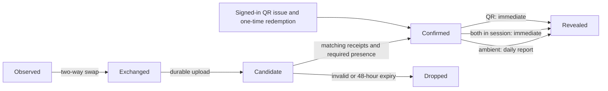

# Design — Engineer Encounters

**Version:** 0.3\
**Status:** Draft architecture; drafting defaults and unverified items labelled\
**Date:** 2026-10-10\
**Related:** `decisions.md` v0.3, `specification.md` v0.3, `ui.md` v0.1\
**Platforms:** iOS first, Android later\
**Languages:** Japanese, English

Engineer Encounters (Japanese: **すれちがいエンジニア**) retains **Engineer StreetPass** only as its internal codename and repository name. Public screens, notifications and store text use the public names.

`decisions.md` is authoritative, followed by `specification.md`. **DEFAULT** identifies a proposed implementation choice or a drafting default inherited from those documents. **FACT** and **UNVERIFIED** retain their evidence markings. The repository has no application code yet; the structures below are the implementation plan.

## Architecture decisions

- Build a native iOS app with SwiftUI and Core Bluetooth. Android follows later using the same backend and protocol.
- Promise the One open rung after its device gate. Locked and Awake remain unproven and are described as “may also work”. All five rungs operate together, without mode switching or fixed hardware.
- Confirm Bluetooth encounters from both phones' receipts. Ambient encounters require two minutes; only two active sessions permit immediate confirmation. QR is the manual alternative.
- Reveal ambient encounters at the daily report. Session and QR encounters reveal immediately. Never issue someone-is-nearby prompts.
- Use durable release accounts, external links and server-enforced, current visibility. Matching orders encounters and gates compatible-only fields; it does not hide incompatible encounters.
- Store encounter dates, never location or durable encounter times. Include block, report, favorites, saved links and immediate in-app account deletion in v1.
- Operate v1 as a free, ad-free product with no purchases, built by one owner part-time on an individual Apple developer account. Release in Japan first, with Japanese UI first, an 18+ declaration at sign-up and an 18+ App Store minimum age.

The scope is `specification.md`, **Scope of v1**. Screen definitions belong in `ui.md`, **Navigation**, **The 26 screens** and **Surfaces outside the app**.

## Stack, tools and workflow

### Languages and runtime

| Area | Technology and responsibility |
|---|---|
| iOS | Swift 6.4, SwiftUI, minimum iOS 26.0; built with Xcode 27.0. |
| Radio | Core Bluetooth; every phone is a central and a peripheral. |
| Local storage | SwiftData; pending receipts behind a replaceable queue interface. SQLite is the fallback if background writes misbehave. |
| Token storage | CryptoKit and Keychain. |
| Session surfaces | Live Activity and a one-tap widget or Control Center control. |
| Manual encounter | Camera QR scanning. |
| Backend | TypeScript Supabase Edge Functions; SQL PostgreSQL schema, access rules and server functions. |
| Managed services | Supabase free-plan Auth, PostgreSQL, Edge Functions and Cron. |
| Notifications | APNs for the daily report. |
| Public website | Plain HTML privacy policy, terms and support pages, available as URLs. |

Core Bluetooth is the selected framework for background discovery between strangers without pairing and for a later Android implementation. The simulator has no Bluetooth; it tests the interface and encounter logic through a fake.

Supabase Auth provides native Sign in with Apple and links GitHub to an already signed-in account. GitHub is verification, never an alternative sign-in. Release sign-up records the 18+ declaration and acceptance of the terms and privacy policy.

**FACT:** Supabase may pause a free-plan project with low activity over a 7-day period; paid projects are not paused. A quiet week after release can take the service offline until the owner restores it manually. **FACT:** Supabase labels manual identity linking and Cron as beta. These are operational dependencies, not reliability guarantees.

### Build kinds

| Build kind | Distribution | Included features |
|---|---|---|
| Development | Run or cable-installed from the owner's Mac. | Temporary anonymous sign-in, immediate ambient demo switch, diagnostics. |
| Internal | TestFlight only to the owner's own devices. | Demo switch and diagnostics; Sign in with Apple, no anonymous sign-in. |
| Release | App Store; TestFlight for the 20-person event, made with the release configuration against the production backend. | Sign in with Apple; anonymous sign-in, the demo switch and diagnostics are all compiled out. |

**DEFAULT:** XcodeGen defines `Development`, `Internal` and `Release` configurations. `DEVELOPMENT_BUILD` includes anonymous authentication; `DEVELOPMENT_BUILD` or `INTERNAL_BUILD` includes diagnostics and the demo switch. Release defines neither. Exclude their source files, routes, resources and test token issuer from the release target, as well as guarding imports and call sites with conditional compilation. Verify the Release artifact, not just a hidden settings row.

**DEFAULT:** the friends test uses development builds pointed at a hosted non-production Supabase project, because the phones leave the owner's Mac. Anonymous sign-in is enabled only on that non-production project and disabled on production, in addition to being compiled out of the release build. Local Supabase is for automated checks and the owner's own development. Internal testing also uses a hosted non-production backend. **DEFAULT:** only local and hosted non-production environments expose the demo reveal endpoint. **UNVERIFIED:** whether the Supabase free plan allows the second, hosted non-production project. The production backend has no such endpoint, and a client-supplied build label never grants access. The switch changes ambient reveal and notification timing, never the two-minute or both-receipts rules. Device tests use the same switch; free-account tests show results in-app without push.

### Repository

The top-level directories are binding. **DEFAULT:** child paths, package names, target names and generated-project names are as follows.

```text
.
├── ios/
│   ├── project.yml                 # XcodeGen input
│   ├── EngineerEncounters.xcodeproj # generated, never edited by hand
│   ├── App/                        # thin composition and SwiftUI entry point
│   ├── SessionActivity/            # Live Activity and one-tap control
│   ├── Packages/
│   │   ├── EncounterDomain/
│   │   ├── EncounterBluetooth/
│   │   ├── EncounterStorage/
│   │   ├── EncounterBackend/
│   │   └── EncounterUI/
│   └── Tests/                      # app integration and release checks
├── supabase/
│   ├── migrations/
│   ├── functions/
│   └── tests/database/
├── site/                           # bilingual legal and support HTML
└── docs/                           # decisions, requirements, design and UI
```

### Terminal checks and owner's tools

Every implementation unit has terminal checks for Swift packages, a simulator build, backend functions and the local database. **DEFAULT:** establish these entry points in the first unit, then run the commands separately for each unit. Keep empty-area smoke checks until that area has implementation. The three simulator configurations check the build gates. **DEFAULT:** use the iPhone 17 simulator, which exists on the owner's Mac, for app-target and Apple-specific package tests; the EngineerEncounters scheme's test action includes the app target and every package that cannot run as portable command-line tests.

```sh
swift test --package-path ios/Packages/EncounterDomain
swift test --package-path ios/Packages/EncounterStorage
swift test --package-path ios/Packages/EncounterBackend
xcodegen generate --spec ios/project.yml
xcodebuild -project ios/EngineerEncounters.xcodeproj -scheme EngineerEncounters -configuration Development -sdk iphonesimulator -destination 'generic/platform=iOS Simulator' CODE_SIGNING_ALLOWED=NO build
xcodebuild -project ios/EngineerEncounters.xcodeproj -scheme EngineerEncounters -configuration Internal -sdk iphonesimulator -destination 'generic/platform=iOS Simulator' CODE_SIGNING_ALLOWED=NO build
xcodebuild -project ios/EngineerEncounters.xcodeproj -scheme EngineerEncounters -configuration Release -sdk iphonesimulator -destination 'generic/platform=iOS Simulator' CODE_SIGNING_ALLOWED=NO build
xcodebuild -project ios/EngineerEncounters.xcodeproj -scheme EngineerEncounters -configuration Development -sdk iphonesimulator -destination 'platform=iOS Simulator,name=iPhone 17' CODE_SIGNING_ALLOWED=NO test
deno test supabase/functions
supabase test db
```

**DEFAULT:** start Docker and use `supabase start` and `supabase db reset` to prepare the local database before its checks. Grant backend tests only their declared local permissions. The simulator test command runs the app-target tests and tests of Apple-specific packages that cannot run as portable command-line tests. These are future implementation checks, not checks already passed by this documentation change.

The owner's Mac has macOS 27.0.1, Xcode 27.0 with the iOS 27.0 SDK and simulator, Swift 6.4, Homebrew, Supabase CLI, Docker, Node and Codex CLI. XcodeGen and Deno are approved for installation when implementation starts. Add the VS Code Swift extension then. **UNVERIFIED:** whether `swift test` and `xcodebuild` work in the implementing agent's sandbox; the first unit proves this.

### VS Code and cross-harness

The owner develops in VS Code with cross-harness. One agent plans and reviews; another implements a bounded unit. Each unit becomes one commit on a work branch, and the owner merges. Preserve existing work, keep secrets out of task files and logs, and do not launch another harness from a delegated executor.

Agents write Swift, TypeScript, SQL, tests and XcodeGen configuration and run terminal checks. The owner uses Xcode or their own hands for Apple ID code signing, cable installs, every real-device Bluetooth trial, battery measurements and App Store submission screens. Agents can prepare the diagnostics and written test sheet; they cannot replace radio trials with simulator results.

## System architecture


Radio discovery and local receipt persistence do not wait for the network. Upload and resolution happen later. The app never reads another user's database rows directly; server functions produce authorized cards. Link readers keep bounded preview metadata, while external platforms remain the hosts of the original works.

## iOS app structure

**DEFAULT:** the local packages and interfaces have these responsibilities.

| Package | Responsibility |
|---|---|
| `EncounterDomain` | State machine, two-minute rule, token-window selection, receipt models, clocks and interfaces; no Core Bluetooth imports. |
| `EncounterBluetooth` | `CBCentralManager` and `CBPeripheralManager`, GATT framing, connection limits and restoration. |
| `EncounterStorage` | SwiftData models and `SwiftDataReceiptQueue`; no encounter authorization. |
| `EncounterBackend` | Authenticated uploads, card APIs, link-reader requests, session and QR requests, push registration. |
| `EncounterUI` | Onboarding, Discover, Profile, Settings and shared states; standard iOS components, teal accent, light/dark modes and Dynamic Type. |

**DEFAULT:** `BluetoothTransport` hides all Core Bluetooth calls. It exposes start/stop discovery, a stream of observations and completed exchange/checkpoint events, cancellation, and restoration events. Its values use temporary peer handles rather than framework objects. `FakeBluetoothTransport` drives a controllable clock, disconnections, reordered events, token rotation and one-sided results in automatic tests. Paired fake phones produce the two receipts for confirmation tests; one fake phone alone must never confirm an encounter.

**DEFAULT:** `ReceiptQueue` exposes durable enqueue/update, pending reads, acknowledge and expiry removal. `SwiftDataReceiptQueue` is the first implementation; an in-memory queue serves tests. A SQLite implementation can replace it without changing the state machine or upload worker. A write succeeds only after durable storage succeeds. Candidate acceptance is nonterminal: retain the receipt for checkpoint updates and status checks until confirmation, definitive rejection or expiry. Terminal acknowledgement removes it idempotently.

The thin app target wires packages, permissions and build-kind features. Sessions have a two-hour expiry or an explicit stop, a Live Activity, and a one-tap start control. **DEFAULT:** use a Control Center control backed by the same session-start use case as the button. Server acknowledgement starts a new session; offline users can finish an already-started session but cannot claim a new server session. A local stop immediately clears the local session flag and queues the server stop.

**DEFAULT:** the labelled sample encounter is a dismissible on-device fixture, never a server encounter. Other people's cards are held only in memory and re-fetched on opening or foregrounding; clear them on sign-out, access changes or loss of a fresh authorization response. Favorites and saved links store references, not permanent profile snapshots.

## Bluetooth transport

### Service and characteristic contract

Use one fixed application service UUID. Every discovery-enabled phone advertises it and scans explicitly for it. Tokens never appear in advertisements. The central connects, reads the peripheral's token and writes its own token, so one connection supplies both phones with the other's token.

**DEFAULT:** freeze these UUIDs and the following version-1 layout in the protocol package before device trials.

| Item | UUID | Operation |
|---|---|---|
| Application service | `7AEF0001-6B8D-4B71-9C13-95DCE08A26F0` | Advertised and explicitly scanned. |
| Peripheral token | `7AEF0002-6B8D-4B71-9C13-95DCE08A26F0` | Read current token and exchange nonce. |
| Central token | `7AEF0003-6B8D-4B71-9C13-95DCE08A26F0` | Write own current token with response, echoing the nonce. |

**DEFAULT:** each frame contains a version byte, a phase byte, a 16-byte random token and a 16-byte random exchange nonce. The phases distinguish initial exchange, held-connection checkpoint and reconnect evidence. A reconnect frame may also carry the original presence-attempt nonce. The peripheral creates the nonce; it is bound to this exchange, not an account. Keep frames at most 64 bytes, assemble bounded reads/writes for the negotiated transport size, and reject unknown versions, malformed lengths, invalid phases and stale nonces. Read fragments refer to one immutable frame snapshot.

No account ID, name, GitHub handle, email, link or permanent device identifier crosses Bluetooth. Tokens identify participants temporarily; nonces and phase bytes only coordinate the exchange. Session state and duration are reported by each phone to the server, not advertised.

**DEFAULT:** tokens are cryptographically random, server-issued in batches and valid in non-overlapping 15-minute windows. Issue 12 hours of future windows per batch and replenish when online. Store the batch in Keychain; use CryptoKit for hashing and local integrity checks. The server keeps token digests and ownership, never relies on a client-supplied account mapping, and rejects tokens outside their windows. If no valid token is available, pause exchange participation until replenishment; never extend a token's window.

### Exchange, presence and teardown

**DEFAULT:** the peripheral durably records the central's successful write before returning success; the central records its receipt after the write response. An interrupted read, failed write or missing acknowledgement is not a completed exchange. If one phone persisted a receipt and the other did not, upload the existing receipt as a candidate; it cannot reveal a card alone.

**DEFAULT:** initially try holding the connection. After at least 120 seconds measured on each phone's monotonic clock, read and write current tokens again under the same exchange nonce. Both phones update their unresolved receipts with the checkpoint and observed duration. A timer alone never satisfies presence. Tokens at the first exchange and checkpoint may differ; retain both pairs and validate each against its own window.

**DEFAULT:** also implement the alternative of a second complete connection to the same provisional peer at least 120 seconds after the first exchange. Echo the original attempt nonce to join the two exchanges. The server resolves both token pairs to the same two accounts and requires matching receipts for both exchanges; a local peer handle alone is insufficient. Each connection still has its own nonce. Do not combine unrelated short contacts. The one-day check selects the workable approach; neither assumes a suspended app receives a timer callback on time.

**DEFAULT:** bound a connect attempt to 10 seconds and each read/write step to 5 seconds. Bound a presence attempt to 5 minutes from its first exchange. Close after successful confirmation/checkpoint, failure, expiry, discovery off, sign-out or trial reset. Cancel pending connects and discard incomplete frames. A broken held connection does not count elapsed time as presence; only the alternative's two completed exchanges can qualify it. Allow one outgoing attempt per provisional peer and four active connections total; back off duplicate attempts for 10 seconds. Reciprocal connections are acceptable and are deduplicated by the server.

A local session flag permits an early receipt upload; it cannot decide the encounter kind. Keep collecting ambient presence evidence until the server confirms a session or the presence attempt ends. If only one user is in a session, both phones still need two minutes. A new session does not retroactively turn an earlier short ambient contact into a session encounter.

Ambient attempts that end below two minutes are discarded. An uploaded one-sided receipt remains a candidate until its counterpart arrives or the 48-hour deadline expires, even if it might qualify as a session. **DEFAULT:** mark final short evidence as such; once both receipts arrive, discard it if the server cannot establish two active sessions and it has no qualifying ambient evidence. Do not discard an incomplete pair merely because the other phone is offline.

## Encounter states

| State | Meaning | Next step or failure |
|---|---|---|
| Observed | Core Bluetooth discovery callback, with a provisional local handle. | Connect; discard on timeout. No proof and no visible card. |
| Exchanged | Tokens swapped in both directions and a receipt persisted. | Collect required presence evidence and upload when online. |
| Candidate | At least one receipt uploaded; not yet confirmed. | Wait for its counterpart and validation. Drop after 48 hours unresolved. |
| Confirmed | Matching receipts and duration/session checks pass, or the QR rule passes. | Delete candidate times; retain dates and kind. Apply reveal timing. |
| Revealed | The reveal gate has passed for the viewer. | Return only currently authorized fields; remove access on deletion or safety actions. |



Revealed is a timing state, not a permanent permission grant. A revealed encounter per viewer is a confirmed encounter that a user is now allowed to see. Each of the two users reaches this at their own daily report, so one may see the other before the reverse. This follows from the decision that each user can change their report time. **DEFAULT:** persist the reveal flag per viewer. A confirmed ambient encounter supplies no identifiable preview before that viewer's report. Session and QR encounters pass both viewers' timing gates immediately.

## Confirmed encounter, security definition

### Bluetooth

A receipt names the two tokens, the per-exchange nonce, the submitting phone's session flag and its observed duration. **DEFAULT:** it also contains the protocol version, start/checkpoint token pairs, transient observation times needed to validate their windows, a final-evidence marker, and an optional prior-exchange nonce. The authenticated uploader must own the token it claims as its own.

Confirmation is one server transaction:

1. Authenticate both receipt submissions and resolve tokens to two distinct accounts.
2. Match reciprocal token pairs, version and nonce; for reconnect presence, match both exchanges and their reference.
3. Check each token was valid at the claimed exchange/checkpoint time. Check freshness and reject a nonce already consumed by another resolution.
4. Require both phones' observed duration to reach 120 seconds for ambient encounters. For the two-exchange method, both matching endpoints must be at least 120 seconds apart.
5. Classify as session only when both receipt flags indicate a session and the server's own session records show both users active at the initial exchange. Otherwise apply the ambient threshold.
6. Create or deduplicate the date-only encounter, consume the nonce(s), and delete candidate receipts and their precise times. Set the applicable reveal flags.

**DEFAULT:** freshness means upload no later than 48 hours after the observation, with a candidate lifetime no longer than 48 hours after first upload. The earlier deadline wins. Repeated delivery of the same receipt is idempotent; it never creates another encounter. Retain only expiring nonce digests for replay rejection after resolution. Never allow an expired candidate to revive through a new upload.

**DEFAULT:** deduplicate repeated exchanges into one encounter per account pair, kind and pair of viewer dates; retain separate ambient and deliberate encounter kinds so an early deliberate encounter cannot reveal a later ambient one. A deduplicated exchange adds no new feed item or notification and never advances an existing reveal flag. Rate-limit uploads to 60 per minute and resolution attempts to 30 per minute per account as initial abuse controls; tune these application limits after tests. These are not provider API limits.

A confirmed Bluetooth encounter is evidence of a Bluetooth interaction, not cryptographic proof of physical distance. A relay can carry a valid exchange, and two malicious clients can falsify observations. Signal strength is only a rough range indicator, never the confirmation gate.

### Sessions and QR

The server owns session start, expiry and stop records. Sessions last two hours or until stopped. Late receipt uploads use that record, rather than trusting a current client flag alone. A stopped local session reports its flag as false even when the stop upload is pending.

For QR, the showing phone obtains a short-lived one-time code from the server while signed in. A distinct signed-in scanning account submits it before expiry. Atomic redemption confirms and reveals the encounter immediately for both accounts. No Bluetooth receipts or two-minute wait are involved.

**DEFAULT:** use a random 128-bit opaque QR code valid for 2 minutes, stored as a digest. Put no name or permanent account identifier in the QR payload. A new code invalidates the previous outstanding code of that user. Reject self-scans, expired codes, reuse and accounts that cannot participate. Apply per-account issuance and redemption rate limits. Code issue and redemption need network access; QR avoids radio dependence, not server validation.

## Background lifecycle and storage

Opt in to the central and peripheral Bluetooth background modes and state preservation/restoration. Rebuild both managers and reconnect their delegates on restoration. Reconcile restored scans, published services and connections against persisted discovery settings and pending receipts before resuming work.

**DEFAULT:** use distinct restoration identifiers for the two managers. Persist completed exchanges and presence checkpoints, not partially assembled frames. On restoration, abandon an exchange whose acknowledgement or timing continuity is uncertain; retry as a fresh attempt. Reattach only a demonstrably continuing connection. After process loss, two completed exchanges may still qualify under the alternative, with server validation; never infer continued presence merely from relaunch.

Receipts queue locally and upload later when the network is available. **DEFAULT:** use a single queue writer and exponential retry/status checks from 5 seconds to 15 minutes, with jitter and connectivity/foreground triggers. Delete a terminally acknowledged or rejected receipt; expire unresolved observations after 48 hours. Transport retries and checkpoint updates reuse the receipt identity.

**DEFAULT:** set receipt-store files to protection that permits access while locked after first unlock, and use `kSecAttrAccessibleAfterFirstUnlockThisDeviceOnly` for required token/auth Keychain items. Check the complete SwiftData store, sidecar files and credential path on real devices. Before the first unlock after a reboot nothing works; do not claim otherwise.

Token selection happens whenever the app runs or handles a Bluetooth request, using the pre-issued window batch. There is no token in the advertisement to update while suspended. **DEFAULT:** on a callback crossing a window boundary, select the new token before answering; use an immutable frame snapshot for a fragmented operation and restart it if its token has expired before completion. No background timer is required or assumed for rotation.

**FACT:** as recorded in `decisions.md`, **Encounters**, background advertising omits the local name and moves service UUIDs to an overflow area discoverable by an iOS scanner explicitly looking for them. Advertising can slow; scans coalesce duplicates and run less often. A background wake gives around 10 seconds, not a two-minute execution grant. **FACT:** the Apple engineer statement recorded there describes background advertising as best-effort and says force-quit apps are not relaunched.

**UNVERIFIED:** whether two backgrounded iPhones discover each other at all. Measure Locked and Awake separately. Force-quitting stops discovery until reopening, and onboarding says so. Do not use BGTaskScheduler for continuous scanning or deterministic wake-ups. No location permission or location storage exists in v1; a possible later boost waits for Bluetooth-only results.

## Data model

**DEFAULT:** all table names, key columns, enums and constraints below are proposed schema details. Product rules such as 48-hour candidate expiry and current visibility remain binding. Foreign keys cascade through user-owned data; account and mutual encounter deletion also remove cross-user references, except for the binding account-deletion safety record described below.

| Table | Key columns and purpose |
|---|---|
| `auth.users` | Managed Auth identity; release provider is Apple. GitHub is linked to this identity. |
| `profiles` | `user_id` PK/FK, `display_name`, `introduction`, `contact_detail`, `discovery_on`, `age_18_declared`, `terms_version`, `privacy_version`, `moderation_state`; defaults to discovery off. |
| `interests`, `user_interests` | Curated `interest_id`; join PK `(user_id, interest_id)`. |
| `user_purposes` | PK `(user_id, purpose)`; purpose is Discovery or Collaboration, with initial field visibility of everyone eligible once discovery is on. |
| `matching_preferences` | `user_id` PK, `minimum_shared_interests`. |
| `field_visibility` | PK `(owner_id, field)`, `level`; three levels only, including a selector for purposes. Initial levels: display name, introduction, interests and purposes are everyone eligible once discovery is on; contact detail is private. |
| `linked_identities` | PK `(user_id, provider)`, `provider_user_id`, `handle`, `verified_addresses`; unique provider identity, server-managed verification evidence. |
| `external_links` | `link_id` PK, `owner_id`, `source`, `source_item_id`, `url`, editable `title`, `description`, `main_language`, `tags`, `opening_text`, `visibility`, `verification_state`, `display_order`. |
| `sessions` | `session_id` PK, `user_id`, `starts_at`, `expires_at`, `stopped_at`; temporary server session ledger. |
| `temporary_tokens` | `token_digest` PK, `user_id`, `batch_id`, `valid_from`, `valid_until`, `delete_after`; no raw server token after issue. |
| `encounter_candidates` | PK `(exchange_nonce, uploader_id)`, reciprocal token digests, version, session flag, duration, final-evidence marker, checkpoint/reference evidence, observation times, `first_uploaded_at`, `expires_at`; unresolved only. |
| `consumed_nonces` | `nonce_digest` PK, `delete_after`; expiring replay tombstone, no account pair or encounter time. |
| `qr_codes` | `code_digest` PK, `issuer_id`, `expires_at`; remove on atomic redemption. |
| `encounters` | `encounter_id` PK, ordered `user_a`, `user_b`, `kind`, `day_a`, `day_b`; dates only, no creation or observation timestamp. |
| `encounter_views` | PK `(encounter_id, viewer_id)`, `revealed`, date-only `reveal_report_day`, `favorite`; per-viewer access and retention. |
| `saved_links` | PK `(viewer_id, encounter_id, link_id)`; references, never copied link metadata. |
| `blocks` | PK `(blocker_id, blocked_id)`; either direction prevents eligibility and removes the pair's encounters. |
| `reports` | `report_id` PK, `reporter_id`, `subject_id`, optional `link_id`, `reason`, `status`, `reporter_hidden`, review deadline; no copied encounter time. Account deletion erases the report; only operator moderation outcomes may enter the safety record. |
| `deletion_safety_records` | `apple_id_hash` PK, operator moderation outcomes, `delete_after`; no reference to the deleted Auth account. |
| `deletion_safety_blocks` | PK `(apple_id_hash, blocker_id)`; incoming blocks only, with a live blocker FK that cascades when the blocker deletes their own account. |
| `notification_preferences` | `user_id` PK, local report hour/minute, IANA `time_zone`, notification enabled. |
| `report_deliveries` | PK `(user_id, report_day)`, `status`; daily idempotency, no copied profile data. |
| `push_outbox` | PK `(user_id, report_day, installation_id)`, status and expiry; delivery references only, no names or copied cards. |
| `push_tokens` | PK `(installation_id, environment, topic)`, `user_id`, protected APNs device token, `last_registered_at`, `invalidated`; registration metadata, never an encounter timestamp. |

Account deletion is available inside the app and is immediate and permanent for all personal data, with one safety exception: the server keeps only a one-way hash of the Apple account identifier together with operator moderation outcomes and the blocks other people placed on that account, for a period the privacy policy states, and re-applies them if the same Apple identity signs up again. Nothing else survives. The hash cannot be turned back into the Apple identifier; the kept record holds no name, profile field, link, token, encounter or contact detail. A block is dropped when the person who placed it deletes their own account. The privacy policy and the S20 deletion confirmation disclose this exception. The exact retention period is an open item to settle with the legal review.

**DEFAULT:** implement the safety exception with `deletion_safety_records` and `deletion_safety_blocks`. Compute the one-way hash as a keyed hash on the server from the verified Apple identifier, using a server-only secret. Recompute it on Apple sign-up and re-apply unexpired operator moderation outcomes and incoming blocks before allowing participation. The retained hash cannot be reversed into the Apple identifier, and these tables hold no name, profile field, link, token, encounter or contact detail. Delete the record and its blocks when the policy period expires; remove an incoming block on unblock or deletion of the blocker's account.

**DEFAULT:** order account pairs consistently; reject self-pairs. Enforce unique receipt submissions, nonce consumption and QR redemption transactionally. Index candidate expiry, token expiry, encounter participant/day, blocks in both directions and report status. Enforce profile prerequisites when enabling discovery, enum validity and an explicit non-null visibility choice for every published link.

**DEFAULT:** derive each viewer's encounter date from the first exchange's candidate time in that viewer's recorded time zone; freeze those dates on confirmation. Register a valid zone during account setup before issuing encounter tokens or QR codes. QR uses the redemption date in each viewer's zone and immediately discards the transient clock value. Token windows, session timers and job deadlines are operational expiry data, not stored encounter times. Do not place raw observations in function logs, analytics, report jobs or confirmed records.

Direct app access to tables is denied by default. Server functions authenticate the caller, check its live account, and return only authorized fields. **DEFAULT:** expose bounded functions for own-profile edits, token batches, receipt upload, session start/stop, QR issue/redeem, feed/card reads, favorite/save, link preview/publish, block/report, push registration and account deletion. Lock down privileged SQL functions and keep service credentials only on the server.

## Matching and visibility

```text
eligible = confirmed AND viewer.discovery_on AND owner.discovery_on
           AND NOT viewer_blocks_owner AND NOT owner_blocks_viewer
compatible = eligible AND overlapping_purposes
             AND shared_interest_count >= viewer.threshold
             AND shared_interest_count >= owner.threshold
```

**DEFAULT:** each interest threshold starts at 1 and is adjustable. The threshold of each side must pass. Compute from current settings, in both directions, on every authorized read, including past encounters, favorites and saved links.

### Authorization truth table

`C` means confirmed; `Dv`/`Do` are discovery switches; `Bv`/`Bo` are blocks in each direction; `P` is purpose overlap; `Tv`/`To` mean each interest threshold passes. `*` means any value. The rows partition all combinations.

The field columns assume the encounter is already revealed and retained for this viewer and is not hidden by moderation. Otherwise return no other-person fields regardless of the table. Private fields are visible only to their own owner through the separate own-profile API.

| C | Dv | Do | Bv | Bo | P | Tv | To | Eligible | Compatible | Everyone eligible | Compatible only | Private |
|---|---|---|---|---|---|---|---|---|---|---|---|---|
| 0 | * | * | * | * | * | * | * | No | No | No | No | No |
| 1 | 0 | 0 | * | * | * | * | * | No | No | No | No | No |
| 1 | 0 | 1 | * | * | * | * | * | No | No | No | No | No |
| 1 | 1 | 0 | * | * | * | * | * | No | No | No | No | No |
| 1 | 1 | 1 | 1 | 0 | * | * | * | No | No | No | No | No |
| 1 | 1 | 1 | 0 | 1 | * | * | * | No | No | No | No | No |
| 1 | 1 | 1 | 1 | 1 | * | * | * | No | No | No | No | No |
| 1 | 1 | 1 | 0 | 0 | 0 | * | * | Yes | No | Yes | No | No |
| 1 | 1 | 1 | 0 | 0 | 1 | 0 | 0 | Yes | No | Yes | No | No |
| 1 | 1 | 1 | 0 | 0 | 1 | 0 | 1 | Yes | No | Yes | No | No |
| 1 | 1 | 1 | 0 | 0 | 1 | 1 | 0 | Yes | No | Yes | No | No |
| 1 | 1 | 1 | 0 | 0 | 1 | 1 | 1 | Yes | Yes | Yes | Yes | No |

Discovery is off by default. Enabling it requires a display name, a user-written self-introduction, at least one interest and at least one link of any kind. Enforce these prerequisites on the server. **DEFAULT:** the server rejects a change that would remove a discovery prerequisite (the name, the self-introduction, the last interest or the last link) while discovery is on, and the user must turn discovery off first.

Once discovery is on, display name, self-introduction, interests and purposes default to everyone eligible. Contact detail defaults to private. A link has no default level: publishing requires the owner's choice. A field or link the viewer cannot see is omitted from the response, not sent for SwiftUI to hide.

Incompatible eligible encounters remain in the feed, with whatever fields are authorized. **DEFAULT:** order compatible encounters first within each day, then by shared-interest count and a stable encounter ID; never by stored encounter time. **DEFAULT:** while an encounter is not eligible, for example because the other person turned discovery off, it is hidden from the feed and from favorites, and it returns if it becomes eligible again within its retention period. The non-identifying shell is used only when the encounter is eligible and every field is private. The feed groups by day and offers Start session, QR and a favorites filter.

Reporting hides the subject from that reporter immediately. Three distinct reporters hide the profile from everyone until operator review, within 72 hours. **DEFAULT:** count distinct unresolved reporters and keep the reporter's hide in place while the report record is retained, including after resolution. Moderation suppression is an additional read gate, not a change to the definition of compatibility.

## Link readers

### Selection, preview and verification

All four readers are server-side. Read only the owner's selected public work. Return a preview, let the owner edit every automatically filled field, require an explicit visibility choice, then publish. Keep the original URL and source-specific metadata, not full works. **DEFAULT:** refresh on demand repeats preview and owner confirmation; it does not silently overwrite shared text.

| Reader | Fixed source and selection | Filled fields |
|---|---|---|
| GitHub | Official API at `api.github.com`; select the connected user's own public repositories and README through the API. | Name, description, main language, first README lines. |
| Qiita | Official API v2 at `qiita.com`; save the username once and select its own articles. | Title, tags, opening lines. |
| Zenn | Official per-user RSS at `zenn.dev/USERNAME/feed`; save the username once and select its own articles. | Title, opening lines when available. |
| Other pages | One bounded HTTPS page fetch per preview or requested refresh. | Title and Open Graph preview description only. |

**FACT:** as recorded in `decisions.md`, **Stack, tools and workflow**, GitHub OAuth without a scope grants read-only public access and `GET /users/USERNAME/social_accounts` is public. **DEFAULT:** request no GitHub scope; never request private-repository access or forward OAuth credentials to page readers.

**FACT:** Qiita API v2 documents 1,000 requests/hour authenticated and 60/hour per IP unauthenticated, `GET /api/v2/users/USER_ID/items`, and a linked GitHub ID on user objects. **FACT:** Zenn documents the per-user RSS feed, about 20 items unless `all=1` is supplied. **DEFAULT:** paginate official API lists, use `all=1` when the owner requests older Zenn entries, and handle provider throttling without inventing new provider limits.

**UNVERIFIED:** whether Zenn's feed includes opening text. If absent, fetch only the article page's preview description on the fixed Zenn host. Apply the page-fetch safeguards below to that fallback; never scrape its body.

**DEFAULT:** Disconnect GitHub requires confirmation, makes links verified through that GitHub account unverified, and removes repository link cards read through it. The discovery-prerequisite rejection rule also applies if this would remove the last link.

GitHub links are verified through the connected identity. Other links are verified if under an address on that verified GitHub profile's website or social links; Qiita also qualifies when its linked GitHub ID matches. All others are labelled unverified and reportable as impersonation. **DEFAULT:** compare canonical URLs by exact host and path boundary, not substring or lookalike host; recompute verification after identity/address/link changes. An entered Qiita or Zenn username alone never proves control.

Store only title or name, description, main language, source, tags, and roughly the first 200 characters of opening or preview text. Nothing else from the source is stored. **DEFAULT:** cap both stored opening/preview text and description at 200 characters, strip markup to plain text and keep draft previews only in the owner's editing session. Preserve owner edits until they accept a refreshed preview. On reader failure, retain the existing approved card and original link. Explain before sharing that external URLs can identify the owner even when the in-app nickname does not.

### Fetching other pages

This reader accepts arbitrary URLs and must prevent server-side request forgery:

- Accept HTTPS only; reject embedded credentials and malformed hostnames.
- Resolve the host and refuse private, loopback, link-local and other non-public destinations, including IPv6 and IPv4-mapped IPv6. Reject mixed public/non-public answers.
- Re-check the URL, DNS answers and target address at every redirect. Do not forward authentication or cookies.
- Bound response size, time and redirect count. Accept only HTML; reject other media.
- Extract only the title and preview description. Never extract page bodies or follow page links.
- Treat all fetched material as untrusted text; do not execute scripts or render fetched HTML.

**DEFAULT:** allow port 443 only, at most 3 redirects, 1 MiB of received and decoded data and a 5-second total deadline. Abort while streaming when a bound is exceeded. Use a fetch implementation that connects to a validated address with the original host for TLS and refuses unsafe address changes. If the Edge runtime cannot enforce this, disable arbitrary-page fetching until a safe implementation exists.

DNS can change between validation and connection. Address pinning reduces this risk; the implementation must still test redirects, rebinding, IPv6, parser ambiguity and actual connected addresses. Do not treat a preliminary DNS check as sufficient. The GitHub, Qiita and Zenn readers call only fixed hosts and reject redirects to arbitrary hosts. Discard downloaded buffers after producing the bounded preview.

## Daily report delivery

Ambient encounters reveal at 21:00 local time by default. The user can choose another time and turn notifications off. Notification opt-out does not stop the in-app reveal. Skip days with no confirmed ambient encounters to reveal. Session and QR reveal immediately without waiting for this job.

**DEFAULT:** Cron runs every 5 minutes and calls a restricted report worker. The app registers a validated IANA time-zone identifier on sign-in, foregrounding and detected zone changes; the latest foreground registration wins across devices. The server uses that zone, not a fixed UTC offset. If no valid zone has been registered, defer the report and request it on the next app foreground rather than guess the user's local time.

**DEFAULT:** for a daylight-saving gap, deliver at the first valid local minute after the chosen time; for a repeated time, deliver once at its first occurrence. Key delivery by user and local calendar date. A backward zone change cannot deliver a second report for an already-completed date. A forward change recomputes the next due local date. The report is once per local date, not a guaranteed 24-hour interval while travelling.

**DEFAULT:** at confirmation, assign each ambient view the date of its next scheduled local report: today if before the chosen time, otherwise the next local day. Keep only this date, not the confirmation time. This prevents confirmation after the scheduled cutoff from being revealed by a late Cron run. When the user changes report time or zone, reassign waiting views to the next future local report; do not reveal immediately on the settings update.

**DEFAULT:** the worker locks each due user's delivery row, selects eligible confirmed ambient views whose `reveal_report_day` is due, sets their reveal flags and creates an idempotent push job in the same transaction. Include older unrevealed encounters whose receipts arrived late, at their assigned next report; keep their original encounter dates. Record an empty date as closed without showing a report or sending a push, so later arrivals cannot cause a second run for that date. Encounters confirmed after today's report wait for the next report.

The two users' reports may occur at different instants. Before each feed response and notification handoff, re-check current visibility, discovery, blocks, deletion and moderation. Notifications may include currently authorized names; the delay is the privacy protection. **DEFAULT:** push jobs hold user/day references, not frozen names or cards. An outage causes a delayed report on recovery. Repeated jobs must not reveal or enqueue twice, though exactly-once delivery by the external push service is not assumed.

### Push-token lifecycle

**DEFAULT:** register APNs tokens after permission and on each app registration callback. Associate them with the signed-in account, installation, topic and APNs environment; replace changes atomically. A sign-out removes that installation's association. Account deletion removes all associations and queued notifications. Invalid/unregistered responses delete the token; transient failures retry only for the current report day. Expire registrations after 90 days without re-registration and omit raw tokens from logs.

Keep APNs signing credentials on the server. Lack of permission, a missing token or a push failure never rolls back the reveal; the report remains in-app. **FACT:** free Apple accounts have no push notifications or TestFlight/App Store distribution, and their builds expire after about a week. The friends test therefore reads the report in-app. **UNVERIFIED:** free-account Sign in with Apple availability and the current device cap.

## Retention and deletion contract

The table separates each store and deletion trigger. **DEFAULT** periods are proposals, not settled policy. Encounter observation times exist only in unresolved evidence and are discarded on confirmation or dropping it; diagnostics are bounded on-device test data. Expiry checks run on reads as well as cleanup, so a delayed job cannot extend access.

| Data | Retention | Deletion and access contract |
|---|---|---|
| On-device diagnostics | **DEFAULT:** 7 days for development and internal builds. | Prune on launch/write and available background work; clear on sign-out/account deletion or explicit clear. Release contains no diagnostics. Do not log real profile/contact data or raw tokens. |
| On-device receipts and unresolved presence | **DEFAULT:** receipts at most 48 hours after observation; incomplete presence attempts at most 5 minutes. | Delete on terminal confirmation acknowledgement, definitive rejection, expiry, sign-out or account deletion. Candidate acceptance is not terminal. Clear precise evidence when confirmation is learned; retain no time in the local confirmed record. |
| Server candidates | At most 48 hours unresolved. **DEFAULT:** also enforce the earlier observation freshness deadline. | Delete on confirmation, rejection, expiry, block, encounter removal or either account's deletion. Delete all embedded observation times. |
| Token batches | **DEFAULT:** device removes each expired token at window end, retaining only receipt evidence in the receipt queue; server digests remain until 48 hours after window end. | Clear on sign-out/account deletion; revoke participation on discovery off. Nonces expire at the same final acceptance deadline and retain no account-pair link. Never reuse expired tokens. |
| Session ledger and QR codes | **DEFAULT:** ended sessions up to 48 hours for delayed receipt validation; QR codes at most 2 minutes. | Remove sessions after validation horizon or account deletion; remove QR on use, replacement, expiry, discovery off or sign-out. Neither is an encounter-history log. |
| Confirmed encounters and view rows | 30 days unless that viewer retains a favorite. **DEFAULT:** expiry at the start of local encounter date + 30 days; cleanup hourly. | Expire the non-retaining viewer's access independently. Delete the shared record when neither viewer retains it. Explicit deletion or a block by either user removes it for both immediately, including retained references. |
| Favorites | Retained for the favoriting viewer while the encounter exists. | Current authorization always applies. Unfavorite after normal expiry removes that viewer's retained access. Mutual encounter removal, block or either account's deletion removes the favorite. |
| Saved link references | **DEFAULT:** same retention and current-visibility rules as favorites. | Saving retains access for that viewer, not a metadata snapshot. Unsave, owner link deletion or encounter removal removes the reference; the other person's unretained access still expires. |
| Moderation reports | **DEFAULT:** until resolved, then for the period stated in the privacy policy; exact resolved period remains open. | Account deletion erases reports and account identifiers; only operator moderation outcomes survive with the one-way hash under the safety exception. Resolution ends global suppression only through operator action. No permanent profile snapshot is retained. |
| Push tokens and queued pushes | **DEFAULT:** registration at most 90 days without renewal; retry only through its report day. | Delete on replacement, sign-out, invalidation or account deletion; cancel queued work after loss of authorization. |
| Approved profile/link metadata | While the account/link exists. | Owner removal or account deletion erases active data and invalidates references. Fetched page buffers are discarded after preview; other people's cards are not persisted locally. |
| Blocks and daily delivery keys | **DEFAULT:** active-account blocks until explicitly unblocked; delivery keys 30 days. | Account deletion removes outgoing blocks and delivery keys; incoming blocks survive only in the safety record. A retained block is dropped when its blocker deletes their own account or unblocks. Unblocking does not restore deleted encounters. Keys contain no names, tokens or observation times. |
| Account-deletion safety record | For a period stated in the privacy policy; exact period to settle with the legal review. | Keep only a one-way hash of the Apple account identifier, operator moderation outcomes and blocks placed by others; re-apply them on sign-up with the same Apple identity. The hash cannot be reversed; no name, profile field, link, token, encounter or contact detail survives. Drop a block when its blocker deletes their own account. Delete the record and blocks at expiry. The privacy policy and S20 deletion confirmation disclose the exception. |

**DEFAULT:** run candidate/token/session cleanup every 15 minutes and encounter/delivery-key/safety-record cleanup hourly. Apply expiry predicates in server functions independently of job timing. Clear local expired records at the next permitted execution if the app is suspended; no deterministic background deletion wake is assumed.

Explicit encounter deletion and block are transactional removals of the pair's candidates, confirmed encounters, favorites, saved references and pending delivery references. Discovery off immediately removes eligibility and stops local radio participation, but does not itself erase retained dates. Re-enabling discovery cannot undo an explicit deletion. **DEFAULT:** mark removed candidates' nonces consumed and retain unlinked nonce digests until freshness expiry to prevent a deleted encounter being recreated by the same receipts. Local receipt cleanup follows terminal status or the 48-hour limit when a phone is offline.

In-app account deletion is immediate and permanent for all personal data, with only the safety exception above. Nothing else survives. **DEFAULT:** mark the account inaccessible at the start, compute the safety hash from the verified Apple identity and transfer only operator moderation outcomes and incoming blocks to the safety tables, revoke auth/provider access, erase all other personal data and cross-user references (including outgoing blocks and incoming safety blocks the deleting account placed on others), hard-delete the Auth account, and acknowledge success only when these steps complete. Old credentials cannot read a deleted account. Purge local storage and Keychain. A failed step leaves access denied and reports an actionable deletion error; there is no grace period or user-restoration path.

Managed-service backup and log handling must be verified before public release; do not promise an unverified provider purge period. This does not permit retained active-account data or restoration of a deleted account. Removing access cannot retract an external URL already copied, the original work or a notification already delivered.

## Security requirements

- Authenticate every account-scoped request and require a live account. Release requires Apple sign-in; link GitHub only to that account.
- Deny direct table access by default. Re-evaluate current field/link authorization and safety gates in server functions; never return forbidden fields.
- Reject one-sided, mismatched, invalid-window, stale, self-paired and replayed Bluetooth evidence. Use atomic resolution and QR redemption.
- Enforce the ambient threshold and authoritative two-session exception. Rate-limit receipt upload, resolution, QR and link-fetch work per account.
- Keep temporary tokens, auth credentials and APNs/provider secrets out of advertisements, public tables, diagnostics and task logs. Use protected on-device stores and server secret storage.
- Request no location permission and store no location. Do not retain exact encounter times after candidate resolution, including in operational logging.
- Apply fetch protections, plain-text output and bounded parsing to untrusted titles, descriptions, RSS and README excerpts.
- Hide a report subject immediately from the reporter; suppress at three distinct reporters and provide the owner's review queue and published contact. Include block and deletion controls in v1.
- Make deletion remove favorites, saved links and notification work for both people where required. Retain only the one-way hash of the Apple account identifier, operator moderation outcomes and incoming blocks for the privacy-policy period; re-apply them on sign-up with the same Apple identity. The hash cannot be reversed, and the record holds no name, profile field, link, token, encounter or contact detail. Drop a retained block when its blocker deletes their own account. Disclose this exception in the privacy policy and S20 deletion confirmation; settle the exact period with the legal review. Re-check authorization at use, including after settings change.
- Compile development features out of Release and isolate non-production server paths. Build flags are not server authorization credentials.

**DEFAULT:** report reasons are spam, harassment or inappropriate content, impersonation, and other. **DEFAULT:** profile limits are 30 display-name characters, 200 introduction characters and 10 links, with curated interests and an initial-letter avatar; enforce them server-side as well as in the app.

## Test plan

### Automatic checks

Use the terminal entry points in **Stack, tools and workflow** for every implementation unit. **DEFAULT:** cover these cases through portable package tests, simulator integration tests, `deno test` and local database tests:

| Area | Required cases |
|---|---|
| Fake Bluetooth and clock | 119 seconds rejected, 120 accepted; late checkpoint; unrelated short passes not accumulated; one-session case remains ambient; rotation across a 15-minute boundary; malformed/unknown-version frames; timeout, partial write, disconnect and restoration. |
| Queue | Durable enqueue before acknowledgement, duplicate uploads, delayed/offline upload, rejection/expiry cleanup, protected-store failure and replaceable in-memory implementation. |
| Resolution | Both authenticated reporters required; swapped token ownership; expired/stale tokens; duplicate nonce and replay after deletion; receipt updates; same owners across reconnect; server sessions stopped/expired or flags forged; transaction races. |
| QR | Signed-in issuer and scanner, self-scan, expiry, second issuance, reuse, concurrent redemption and network failure. |
| Authorization | Every truth-table combination in both directions; reveal gate; changed settings on past/favorite/saved records; missing fields truly absent; direct table reads denied; incompatible feed row retained. |
| Safety/deletion | One and three distinct reports, repeat reporter, block in either direction, mutual deletion, one-sided favorite retention, saved-link deletion and hard account deletion with old credentials; only the hashed Apple safety record survives, same-Apple sign-up re-applies outcomes/blocks, different identities do not inherit them, expiry removes the record, and blocker deletion removes retained blocks. Verify policy/S20 disclosure and absence of profile, link, token, encounter and contact data in the safety record. |
| Readers | Own public selection, unverified usernames, owner edits and refresh approval, provider errors, no body retention, URL boundary verification, redirects, rebinding, IPv6, oversize, timeout and non-HTML rejection. |
| Daily report | 21:00/custom time, empty day, opt-out, DST gap/repeat, zone travel, two viewers' different report times, late receipt, Cron replay/outage, visibility change before push and invalid/rotated push token. |
| Build kinds | All three configurations; anonymous code only in development; anonymous/demo/diagnostics absent from Release artifact; event TestFlight artifact uses the release configuration and production backend with Apple sign-in and normal daily reveal/push timing; internal builds with demo/diagnostics go only to the owner's own devices; production rejects demo requests; Japanese/English resources and sample encounter. |

The fake validates logic, not radio reachability. **DEFAULT:** retain aggregated test outcomes without participant identifiers; keep detailed on-device traces under the diagnostics contract.

### One-day radio check

The owner uses the iPhone 15 and iPad (10th generation) with the real app and diagnostics. Use made-up identities, no backend, no account and logs kept on devices. **DEFAULT:** S22 is reachable from S01 before sign-in in development builds; the route is absent from internal and release builds. **DEFAULT:** use locally issued test tokens and a local confirmation harness, both compiled only into development builds. This harness consumes receipts from both devices and never substitutes for later backend validation.

Check rungs 3 and 4 in both central/peripheral orientations. Record discovery, completed two-way exchange and both devices' two-minute evidence separately. Try holding the connection and the second-exchange alternative, including a token-window boundary. Exercise locked storage access, disconnect/reopen and finite connection teardown. Use the demo switch to inspect locally confirmed results immediately. Select a presence approach only from these observations; do not infer background reliability from foreground success.

### 160-trial matrix and procedure

Borrow a second recent iPhone before the matrix. The iPad is an experimental peer; its result cannot establish iPhone-with-iPhone behaviour. No iPad-specific interface is designed.

| Rung | Stationary conditions | iPhone with iPad | iPhone with iPhone |
|---|---|---|---|
| 1 — Locked | Both locked, app backgrounded. | 20 trials | 20 trials |
| 2 — Awake | At least one awake in another app; neither app in front. | 20 trials | 20 trials |
| 3 — One open | Exactly one app open; the peer locked (**DEFAULT** trial condition). | 20 trials | 20 trials |
| 4 — Both open | Both apps open. | 20 trials | 20 trials |

Total: 4 rungs × 2 pairs × 20 = 160 stationary trials. **DEFAULT:** rung-3 trials run with the peer phone locked, the hardest case of “at least one of the two has the app open”. **DEFAULT:** split asymmetric rungs equally between device orientations and alternate them in the written test sheet.

1. Select the presence approach under test in S22, then record device models, iOS version, build version, discovery settings, permissions, battery level and presence approach. Run detached from the debugger.
2. Use S22's trial reset action on both devices to reset trial state; reset the test accounts' candidates/encounters when a backend is in use, cancel all connections and clear pending attempts. Verify S22's visible reset confirmation before starting the next trial. Use fresh attempt nonces.
3. Set the required device states, bring the pair into range and start the stationary trial. **DEFAULT:** end at 5 minutes, with no state changes during the trial.
4. In S22, record each phone's per-trial elapsed values from trial start for discovery, two-way exchange completion, two-minute evidence and server confirmation separately. S22 lists recorded trials, including missing values; offline/server-free trials show server confirmation as unavailable or pending. **DEFAULT:** share the local trial log as a file from S22 in development and internal builds; sharing is absent from release. Record missing, one-sided and duplicate results as such, not as success.
5. Use the demo switch for observable confirmation timing; verify the two-minute and two-receipt rules remain enforced. Measure normal daily reveal separately.
6. End, tear down and reset. Outside the stationary matrix, record 10-second and 30-second passes for information only; neither can satisfy ambient presence.

A rung-3 trial passes when both phones hold the two-minute presence evidence for the same exchange within 5 minutes of the start of the trial. Server confirmation time is recorded separately and is not part of the pass mark, because uploads may be deferred. At least 90 percent of rung-3 trials must pass. **DEFAULT:** apply the gate separately to each pair's 20 rung-3 trials, at least 18 successes per pair. Rungs 1 and 2 have no pass mark and only determine their public description. Record rung 4 latency separately. Twenty trials cannot distinguish 90 percent from 80 percent with confidence; the result is a go/no-go signal, not a measured reliability rate. If rung 3 fails, stop and rethink because only QR would remain.

Measure discovery-on versus discovery-off battery use over 8 hours: at most 5 additional percentage points. **DEFAULT:** use the same device, comparable usage and starting conditions on separate runs, recording the comparison rather than inferring it from one battery reading.

Test first unlock after reboot separately: nothing before first unlock, locked operation after first unlock. Also test force-quit and reopen, Bluetooth off/denied, background for an extended period, network loss/recovery, token-batch exhaustion and real QR. These are additional checks, not extra stationary trials counted toward 160.

### Friends, event and release

**DEFAULT:** v1 collects no usage analytics. Product measures are gathered by asking participants at the friends test and at the event, and technical measures come from the diagnostics of development and internal builds.

- Friends: 3–5 people in a small room or cafe; free Apple account, cable installs from the owner's Mac, temporary anonymous sign-in, sessions for immediate results and daily report inside the app without notification. **DEFAULT:** the friends test uses development builds pointed at a hosted non-production Supabase project, because the phones leave the owner's Mac. Anonymous sign-in is enabled only on that non-production project and disabled on production, in addition to being compiled out of the release build. Local Supabase is for automated checks and the owner's own development. GitHub alone is enough. **FACT:** builds expire after about a week. **UNVERIFIED:** the current free-account device cap; if reached, sign a friend's phone with that friend's own free Apple ID.
- After friends: join the Apple Developer Program; add and verify Sign in with Apple, APNs and TestFlight. Test release sign-in and production timing, not just anonymous development flows.
- Event: one real event with 20 or more people using a TestFlight build made with the release configuration against the production backend. No demo switch, diagnostics or anonymous sign-in; attendees sign in with Apple. Verify these build gates before distribution. Internal builds retain demo/diagnostics and go only to the owner's own devices. Check radio results, useful discoveries, duplicate encounters, favorites/saves, authorization changes, blocking/reporting and normal daily delivery through participant feedback and observed app behavior; this event build supplies no diagnostic logs.
- Public release: all four link readers, one professional review of Japanese/English privacy policy and terms, App Store privacy labels, Bluetooth purpose string, in-app deletion, moderation contact, sample encounter and review notes, and Supabase hosting-region/data-flow documentation.
- Japan first. Complete J-PlatPat and USPTO name searches. Later storefront waves require the EU/UK privacy-law check and trader decision; exclude China mainland until the government-filing question is answered.

## Build order

Each unit produces a reviewable change and terminal checks. The owner merges each unit's commit. Units cannot bypass the staged gates in `decisions.md`, **Build, test and release path**.

| Unit | Work and completion gate |
|---|---|
| 1 — Toolchain | Install approved XcodeGen/Deno and VS Code Swift extension; establish package, generated app and backend/database smoke checks. Prove sandbox `swift test` and simulator `xcodebuild`. |
| 2 — Bluetooth engine | Real app, versioned service, dual managers, fake, token provider, durable replaceable queue, restoration and development diagnostics. Owner completes one-day rung-3/4 check without backend. |
| 3 — Accounts and schema | Development anonymous sign-in, profile prerequisites, interests/purposes, current visibility, tokens, reciprocal receipt resolution and date-only model; no release anonymous path. |
| 4 — Basic encounters | Feed/detail, sessions with Live Activity/control, QR, favorites/saved links, daily in-app reveal, block/report/deletion and sample encounter. |
| 5 — GitHub | Linked verification, own public selection, editable preview and explicit link visibility. Complete basic-function checks and the 160-trial/battery gate. Stop if rung 3 fails. |
| 6 — Friends | Owner cable-installs development builds for 3–5 friends against hosted non-production Supabase (**DEFAULT**), with anonymous sign-in only on that project, sessions and in-app report. Local Supabase remains for automated checks and the owner's own development. Resolve findings before progressing. |
| 7 — Paid developer account integration | Owner joins the Developer Program; verify Apple sign-in, APNs, all three build kinds and TestFlight. |
| 8 — Qiita and Zenn | Official readers, verification and safe Zenn fallback; resolve or preserve the feed-content unknown. |
| 9 — Other pages | Bounded SSRF-safe reader, redirect/rebinding tests and failure behaviour. All readers complete before public release. |
| 10 — Event | Owner runs the 20+ person event with a TestFlight build made with the release configuration against the production backend, with Apple sign-in and no anonymous sign-in, demo switch or diagnostics; internal builds go only to the owner's own devices. Verify normal daily push, authorization and moderation operations. |
| 11 — Japan release | Owner obtains bilingual legal review, resolves release-blocking policy/retention/hosting/name items and completes store deliverables and submission. |
| 12 — Later storefronts | Expand in waves only after the regional checks and decisions; Android remains later. |

**DEFAULT:** these unit boundaries, names and package-level work allocation are starting divisions. Split a large unit into bounded commits without moving its gate. Backend, radio and authorization checks travel with the relevant implementation unit.

## Decision log

1. Retain native SwiftUI/Core Bluetooth iOS first and postpone Android.
   Reason: support the chosen radio path while keeping one-owner scope manageable.
2. Retain external-link hosting rather than copies of portfolios or articles.
   Reason: discovery needs a bounded preview and access to the original work.
3. Retain per-field and per-link server authorization, with direct app table access denied.
   Reason: private data must never depend on client-side hiding.
4. Replace v0.2 AI/Gemini processing, summaries, consent and settings with four link readers.
   Reason: source metadata with owner editing provides the required link previews.
5. Retain modern-device testing and fix minimum iOS 26.0, Xcode 27.0 and Swift 6.4.
   Reason: legacy compatibility is outside project scope.
6. Replace the v0.2 unresolved token investigation with a versioned connected two-way exchange.
   Reason: advertisements must carry no tokens and both phones must take part.
7. Replace the v0.2 state list with Observed, Exchanged, Candidate, Confirmed and Revealed.
   Reason: distinguish radio work, server evidence and disclosure timing.
8. Replace general background expectations with a rung-3 promise and measured rungs 1 and 2.
   Reason: locked/background discovery remains unverified.
9. Replace undifferentiated proximity with two-minute ambient presence and the two-session exception.
   Reason: passing strangers must not expose cards in real time.
10. Replace v0.2 notification choices with daily ambient reveal and immediate session/QR reveal; remove the weekly digest.
    Reason: intentional exchanges and delayed ambient disclosure serve different privacy needs.
11. Remove connection requests and the v0.2 mutual connections visibility level; retain three levels.
    Reason: viewing technical work requires no social connection workflow.
12. Replace the v0.2 matching eligibility rule with separate eligibility and compatibility.
    Reason: matching orders encounters and gates fields without hiding incompatible encounters.
13. Replace open-ended history with date-only records, 48-hour candidates and 30-day viewer retention.
    Reason: minimize movement inference while allowing favorites under current permissions.
14. Add Apple release sign-in, linked GitHub verification and immediate account deletion.
    Reason: durable identities make safety and ownership rules hold.
15. Replace the v0.2 broad milestones with terminal-checked units and toolchain, radio, friends, event and release gates.
    Reason: prove the risky dependencies before public operation.
16. Select SwiftData behind a replaceable receipt queue and generate the project with XcodeGen.
    Reason: isolate background-storage risk and keep project changes reviewable as text.
17. Adopt the public names, 18+ launch and Japan-first staged rollout.
    Reason: make the public product and its release obligations explicit.

## Defaults chosen during drafting

These are not confirmed owner decisions. Revisit technical starting values after the one-day check and matrix; retain the product gates when doing so. Rows collect all **DEFAULT** choices used above.

| Area | Drafting default |
|---|---|
| Profile | 30-character display name, 200-character introduction, curated interests, initial-letter avatar, at most 10 links. |
| Matching | Threshold starts at 1 per user; compatible-first/shared-interest/stable-ID ordering within each day; ineligible encounters hidden from feed/favorites until eligible again within retention; shell only for eligible all-private encounters. |
| Discovery prerequisites | Server rejects removing name, self-introduction, last interest or last link while discovery is on; turn discovery off first. |
| Reports/sample | Four report reasons; count distinct unresolved reporters; reporter hide while report retained, including after resolution; dismissible on-device sample. |
| Saved links | References with favorite-equivalent per-viewer retention and current permissions; no copied metadata. |
| Project/build layout | All child paths, package/interface/target names; three XcodeGen configurations and compile flags/source exclusions; local Supabase for automated checks/owner development, hosted non-production for friends development builds and internal testing; anonymous sign-in only on hosted non-production, disabled on production; production has no demo route. |
| Terminal entry points | The commands and local preparation in Stack, tools and workflow; all build configurations per unit; portable versus simulator test allocation; iPhone 17 simulator test destination for app-target and non-portable package tests. |
| App composition | Package responsibility split; `BluetoothTransport` and paired fake phones; durable `ReceiptQueue`, SwiftData and in-memory adapters; terminal acknowledgement semantics; Control Center start control, online session start and queued local stop. |
| Card caching | Other people's cards in memory only, refreshed on open/foreground and cleared without fresh authorization. |
| Transport constants | Listed service/characteristic UUIDs; v1 version/phase/token/nonce framing, 16-byte token/nonce, optional prior nonce, 64-byte bound and immutable fragmented reads. |
| Tokens | Server-issued 15-minute windows; 12-hour batches, replenishment online, digests server-side, protected device batches; pause if exhausted, never extend validity. |
| Presence | Held-connection checkpoint or linked second exchange after at least 120 seconds on both phones; matching start/end token pairs; selection by one-day check; final-short marker for rejecting paired, non-qualifying evidence. |
| Connection management | Persist before write response; 10-second connect, 5-second operation, 5-minute presence attempt, four connections, one outgoing per provisional peer, 10-second duplicate backoff and teardown rules. |
| Receipt validation | Added version/checkpoint/time/reference evidence and final marker; 48-hour observation freshness and first-upload expiry, earlier deadline wins; idempotent updates and expiring consumed-nonce digests. |
| Deduplication/abuse | One account-pair/kind/viewer-date-pair encounter; no extra item/push or earlier reveal on deduplication; separate deliberate and ambient kinds; 60 uploads and 30 resolution attempts per minute/account; per-account QR/fetch controls. |
| QR/session ledger | 128-bit QR codes, 2-minute expiry, one outstanding code; ended sessions retained at most 48 hours for receipt validation. |
| Restoration/upload | Distinct manager restoration IDs, completed evidence only, abandon uncertain work; serialized queue, retry 5 seconds–15 minutes with jitter and network/foreground triggers. |
| Locked storage | After-first-unlock file protection and device-only after-first-unlock Keychain items; callback token selection and restart expired fragmented operations. |
| Schema/APIs | All proposed table/column/enum/key/index/function names, pair ordering and transaction constraints; per-viewer reveal/date rows derived from transient evidence and time-zone settings; valid zone registered before token/code issuance. |
| Reader details | No GitHub scope, bounded pagination and owner-requested Zenn `all=1`; 200-character preview and description, transient editing draft, explicit refresh acceptance, URL host/path-boundary verification and revalidation; confirmed GitHub disconnect unverifies dependent links and removes imported repository cards, subject to the discovery-prerequisite rule. |
| Arbitrary fetch bounds | Port 443, three redirects, 1 MiB received/decoded and 5 seconds total; safe validated-address connection or feature disabled until enforceable. |
| Daily scheduling | Five-minute Cron, validated IANA zone/latest foreground device, defer missing zone, DST/travel rules, date-only next-report assignment at confirmation, reassignment after time/zone edits, per-local-date idempotency including closed empty dates, per-viewer reveal and transactional reference-only push jobs. |
| Push lifecycle | Per-installation/account/environment/topic registration; rotate/remove on callbacks, sign-out, invalidation or deletion; 90-day stale expiry and current-report-day retries. |
| Retention jobs | Receipt evidence 48 hours, incomplete presence 5 minutes, development/internal diagnostics 7 days; token/nonce horizon 48 hours past window end; date + 30-day viewer expiry; 15-minute transient cleanup and hourly encounter/key/safety-record cleanup. |
| Other retention/deletion | Resolved-report period pending privacy policy; active-account blocks until unblocked, delivery keys 30 days; hard deletion sequence with transfer of only the binding safety exception, local clearing and replay tombstones without account-pair links. |
| Safety-record implementation | `deletion_safety_records` and `deletion_safety_blocks`, server-only keyed hash of verified Apple identity, expiry metadata, cascade on blocker deletion, and re-application before participation on same-Apple sign-up. The exception and policy period are binding product rules, not drafting defaults. |
| Test procedures | Listed automated cases, aggregated outcomes without participant IDs, development-only local token/confirmation harness, balanced trial orientations, 5-minute stationary trials with rung-3 peer locked, 18/20 rung-3 successes per device pair based on both phones' two-minute evidence for the same exchange within 5 minutes of trial start, and comparable paired battery runs. |
| Diagnostics access/sharing | Development-only S01 → S22 before sign-in for no-account/no-backend trials; local trial-log file sharing in development/internal, absent from release. |
| Success measurement | No usage analytics in v1; ask friends-test/event participants for product measures and use development/internal diagnostics for technical measures. |
| Work units | Named unit boundaries and responsibility split; subdivide without bypassing gates. |

Discovery off, the two-hour session, two-minute ambient threshold, 21:00 report, default profile/contact visibility and explicit link visibility are product decisions, not drafting gaps.

## Open items and risks

- **UNVERIFIED:** background-to-background iPhone discovery. The one-day check selects a presence method; the matrix determines whether rung 3 supports the product. Locked/Awake results never become promises without evidence.
- **UNVERIFIED:** sandbox `swift test` and `xcodebuild`. Prove them in the first implementation unit, not in this documentation rewrite.
- **UNVERIFIED:** Zenn feed opening text, free-account Apple sign-in and current free-account device cap. Test the feed; use the defined metadata fallback, friends-test authentication and signing contingency.
- Validate held connections, restoration continuity, token-boundary frames, protected SwiftData sidecars and auth credentials on locked devices. None is settled by the fake. QR issuance/redemption and new sessions need the server online.
- Verify the Edge runtime can enforce connected-address validation, redirect checks and bounded streaming; DNS rebinding remains a fetch risk. Do not ship the other-page reader with a check-then-unrestricted-fetch implementation.
- Supabase free-plan pausing and beta Cron/manual linking can interrupt discovery resolution and reports. Measure recovery and document owner operations; a different operating plan needs a later decision.
- Token/nonce windows and reported clocks need device validation; paired receipts do not defeat relays or colluding clients. Do not claim physical-distance proof.
- Settle the exact account-deletion safety-record retention period with the legal review and state it in the privacy policy and S20 deletion confirmation. Choose the resolved-report retention period in the privacy policy before release. Verify managed-service backups/logs and deletion behaviour; do not invent provider retention guarantees. Review whether session expiry metadata and diagnostics meet the disclosed data flow.
- Owner must publish the moderation contact and meet the 72-hour review obligation. Product success targets remain open; ask participants about useful discoveries, original-link opens and favorites/saves, and use development/internal diagnostics for false positives, duplicates, latency and battery under the no-usage-analytics **DEFAULT**.
- Complete trademark registry searches in J-PlatPat and USPTO. **FACT:** the web search recorded in `decisions.md`, **Product**, found no existing use, but registry searches were not done.
- Obtain the Japanese/English legal review and record Supabase hosting region/data flow, privacy labels and store deliverables. EU/UK privacy-law and trader questions and China mainland government filing remain unresolved; no legal conclusion is assumed.
- **UNVERIFIED:** whether the Supabase free plan allows the second, hosted non-production project.
- Copied external URLs and delivered notifications cannot be retracted. Current permission enforcement controls later in-app access, including favorites and saved links.

Evidence and source URLs remain in `decisions.md`, **Verified sources**, **Encounters**, **Build, test and release path** and **Stack, tools and workflow**.
