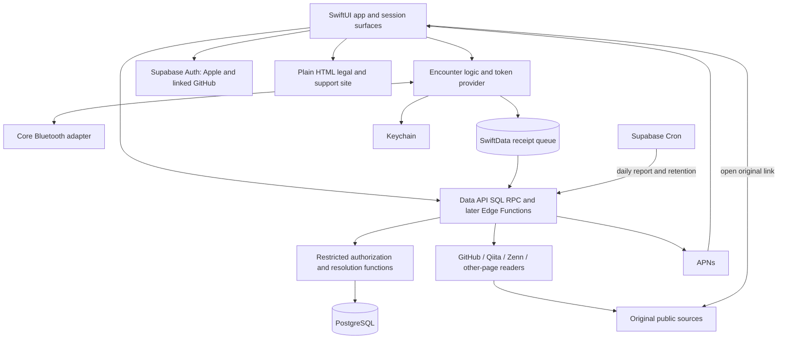
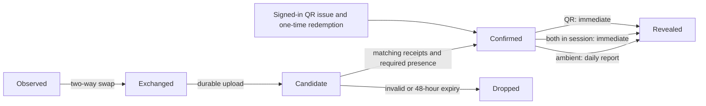

# Design — Engineer Encounters

**Version:** 0.6\
**Status:** Draft architecture; drafting defaults and unverified items labelled\
**Date:** 2026-10-12\
**Related:** `decisions.md` v0.6, `specification.md` v0.6, `ui.md` v0.4\
**Platforms:** iOS first, Android later\
**Languages:** Japanese, English

Engineer Encounters (Japanese: **すれちがいエンジニア**) retains **Engineer StreetPass** only as its internal codename and repository name. Public screens, notifications and store text use the public names.

`decisions.md` is authoritative, followed by `specification.md`. **DEFAULT** identifies a proposed implementation choice or a drafting default inherited from those documents, including built values that may still change. **FACT** and **UNVERIFIED** retain their evidence markings. **FACT:** Units 1 (Toolchain) and 2 (Bluetooth engine) are implemented and merged to main in pull requests 2, 4 and 5. Unit 3 implementation and verification are recorded under **Unit 3 contract** and **Automatic checks**. This document distinguishes their built behaviour, the owner's 2026-10-11 device results and decisions, and the remaining implementation plan. **FACT:** the three binding presence decisions made that day were implemented on 2026-10-12; see **Exchange, presence and teardown** and **160-trial matrix and procedure**.

## Architecture decisions

- Build a native iOS app with SwiftUI and Core Bluetooth. Android follows later using the same backend and protocol.
- Promise the One open rung after its device gate. Locked and Awake remain unproven and are described as “may also work”. All five rungs operate together, without mode switching or fixed hardware.
- Confirm Bluetooth encounters from both phones' receipts. Ambient encounters require two minutes; only two active sessions permit immediate confirmation. QR is the manual alternative.
- Reveal ambient encounters at the daily report. Session and QR encounters reveal immediately. Never issue someone-is-nearby prompts.
- Use durable release accounts, external links and server-enforced, current visibility. Matching orders encounters and gates compatible-only fields; it does not hide incompatible encounters.
- Store encounter dates, never location or durable encounter times. Include block, report, favorites, saved links and immediate in-app account deletion in v1.
- Operate v1 as a free, ad-free product with no purchases, built by one owner part-time on an individual Apple developer account. Release in Japan first, with Japanese UI first, an 18+ declaration at sign-up and an 18+ App Store minimum age.

The scope is `specification.md`, **Scope of v1**. Screen definitions belong in `ui.md`, **Navigation**, **The 26 screens** and **Surfaces outside the app**.

## Stack, tools and workflow

### Languages and runtime

| Area | Technology and responsibility |
|---|---|
| iOS | Swift 6.4, SwiftUI, minimum iOS 26.0; built with Xcode 27.0. |
| Radio | Core Bluetooth; every phone is a central and a peripheral. |
| Local storage | SwiftData; pending receipts behind a replaceable queue interface. SQLite is the fallback if background writes misbehave. |
| Token storage | CryptoKit and Keychain. |
| Session surfaces | Live Activity and a one-tap widget or Control Center control. |
| Manual encounter | Camera QR scanning. |
| Backend | **FACT:** Unit 3 uses SQL PostgreSQL schema, access rules and Data API RPC functions; no new Edge Function. TypeScript Edge Functions remain for later workers/readers. |
| Managed services | Supabase free-plan Auth, PostgreSQL, Edge Functions and Cron. |
| Notifications | APNs for the daily report. |
| Public website | Plain HTML privacy policy, terms and support pages, available as URLs. |

Core Bluetooth is the selected framework for background discovery between strangers without pairing and for a later Android implementation. The simulator has no Bluetooth; it tests the interface and encounter logic through a fake.

Supabase Auth provides native Sign in with Apple and links GitHub to an already signed-in account. GitHub is verification, never an alternative sign-in. Release sign-up records the 18+ declaration and acceptance of the terms and privacy policy.

**FACT:** Supabase may pause a free-plan project with low activity over a 7-day period; paid projects are not paused. A quiet week after release can take the service offline until the owner restores it manually. **FACT:** Supabase labels manual identity linking and Cron as beta. These are operational dependencies, not reliability guarantees.

### Build kinds

| Build kind | Distribution | Included features |
|---|---|---|
| Development | Run or cable-installed from the owner's Mac. | Temporary anonymous sign-in, immediate ambient demo switch, diagnostics. |
| Internal | TestFlight only to the owner's own devices. | Demo switch and diagnostics; Apple sign-in remains Unit 7, no anonymous sign-in. |
| Release | App Store; TestFlight for the 20-person event, made with the release configuration against the production backend. | Apple sign-in remains Unit 7; anonymous sign-in, the demo switch and diagnostics are all compiled out. |

The table records current build gates and the intended v1 distribution. **FACT:** Development temporary sign-in is built; Apple sign-in remains Unit 7 and daily/demo reveal remains Unit 4. **FACT:** XcodeGen defines `Development`, `Internal` and `Release`. Unit 2 compiles `ios/App/Development` only into Development and `ios/App/Diagnostics` only into Development and Internal. Per-configuration `EXCLUDED_SOURCE_FILE_NAMES` is anchored at `$(SRCROOT)/App`, with conditional compilation at declarations and call sites. Development defines `DEVELOPMENT_BUILD`, Internal defines `INTERNAL_BUILD`, and Release defines neither. The localized development and diagnostics string tables follow the same exclusions.

**FACT:** `ios/Tests/check-release-artifact.sh` builds all three configurations and checks marker names and bundled Japanese/English string tables. Local test tokens and the no-account S01 → S22 entry are Development-only. The built Settings list gives Development and Internal a route to S22; signed-out/loading/error diagnostics entry is also available in Internal. The demo switch persists a setting; it has no reveal consumer yet and never changes exchange or evidence logic.

**DEFAULT:** the friends test uses development builds pointed at a hosted non-production Supabase project, because the phones leave the owner's Mac. For the later hosted test, enable anonymous sign-in only on that non-production project and disable it on production, in addition to being compiled out of the release build. Local Supabase is for automated checks and the owner's own development. Internal testing will use a hosted non-production backend. **DEFAULT:** only local and hosted non-production environments expose the demo reveal endpoint. **UNVERIFIED:** whether the Supabase free plan allows the second, hosted non-production project. The production backend has no such endpoint, and a client-supplied build label never grants access. The switch changes ambient reveal and notification timing, never the two-minute or both-receipts rules. Device tests use the same switch; free-account tests show results in-app without push.

### Repository

The top-level directories are binding. **FACT:** the iOS packages, thin app, scripts and tests below exist after Unit 3; `EncounterDomainTestSupport` is a separate library product inside the domain package. **DEFAULT:** `SessionActivity` and `site` remain planned paths.

```text
.
├── ios/
│   ├── project.yml                 # XcodeGen input
│   ├── EngineerEncounters.xcodeproj # generated, never edited by hand
│   ├── App/                        # thin composition and SwiftUI entry point
│   │   ├── Composition/            # account/session/storage binding, runtime, participation
│   │   ├── Development/            # Development-only entry and local test issuer
│   │   └── Diagnostics/            # Development/Internal S22 and trial logs
│   ├── Scripts/                    # typecheck-app.sh
│   ├── SessionActivity/            # planned Live Activity and one-tap control
│   ├── Packages/
│   │   ├── EncounterDomain/         # EncounterDomain + EncounterDomainTestSupport
│   │   ├── EncounterBluetooth/
│   │   ├── EncounterStorage/
│   │   ├── EncounterBackend/
│   │   └── EncounterUI/
│   └── Tests/                      # app integration and release checks
├── supabase/
│   ├── migrations/
│   ├── functions/
│   └── tests/database/
├── site/                           # planned bilingual legal and support HTML
└── docs/                           # decisions, requirements, design and UI
```

### Terminal checks and owner's tools

**FACT:** Unit 1 established terminal entry points for packages, simulator builds, backend functions and the local database. Run the commands separately for each unit; empty areas still have smoke checks. The three simulator configurations check the build gates. **DEFAULT:** use the iPhone 17 simulator, which exists on the owner's Mac. **FACT:** the EngineerEncounters scheme tests the app-hosted tests and the EncounterBluetooth and EncounterUI package tests. EncounterBluetooth also declares macOS, so its package tests run directly on the Mac.

```sh
swift test --package-path ios/Packages/EncounterDomain
swift test --package-path ios/Packages/EncounterBluetooth
swift test --package-path ios/Packages/EncounterStorage
swift test --package-path ios/Packages/EncounterBackend
sh ios/Scripts/typecheck-app.sh Development
sh ios/Scripts/typecheck-app.sh Internal
sh ios/Scripts/typecheck-app.sh Release
sh ios/Tests/check-release-artifact.sh
xcodegen generate --spec ios/project.yml
xcodebuild -project ios/EngineerEncounters.xcodeproj -scheme EngineerEncounters -configuration Development -sdk iphonesimulator -destination 'generic/platform=iOS Simulator' CODE_SIGNING_ALLOWED=NO build
xcodebuild -project ios/EngineerEncounters.xcodeproj -scheme EngineerEncounters -configuration Internal -sdk iphonesimulator -destination 'generic/platform=iOS Simulator' CODE_SIGNING_ALLOWED=NO build
xcodebuild -project ios/EngineerEncounters.xcodeproj -scheme EngineerEncounters -configuration Release -sdk iphonesimulator -destination 'generic/platform=iOS Simulator' CODE_SIGNING_ALLOWED=NO build
xcodebuild -project ios/EngineerEncounters.xcodeproj -scheme EngineerEncounters -configuration Development -sdk iphonesimulator -destination 'platform=iOS Simulator,name=iPhone 17' -derivedDataPath /tmp/encounters-unit3-development CODE_SIGNING_ALLOWED=NO test
deno test supabase/functions
supabase start
supabase db reset
supabase test db
supabase db lint --schema public,private
deno test --allow-env=ENCOUNTERS_LOCAL_API_URL,ENCOUNTERS_LOCAL_PUBLIC_KEY --allow-net supabase/functions/tests/local_http_flow_test.ts
xcodebuild -project ios/EngineerEncounters.xcodeproj -scheme EngineerEncounters -configuration Internal -sdk iphonesimulator -destination 'platform=iOS Simulator,name=iPhone 17' -derivedDataPath /tmp/encounters-unit3-internal ENABLE_TESTABILITY=YES CODE_SIGNING_ALLOWED=NO test
```

**FACT:** start Docker, then run `supabase start` and `supabase db reset` before database tests and lint of both `public` and `private`. `deno test supabase/functions` passes with the live flow test ignored. The live command requires `ENCOUNTERS_LOCAL_API_URL` (loopback local API) and `ENCOUNTERS_LOCAL_PUBLIC_KEY` set outside logs, with `--allow-env` and `--allow-net`. Local anonymous sign-in is enabled in `supabase/config.toml`; hosted configuration remains unexercised. Internal hosted tests require `ENABLE_TESTABILITY=YES`. On the owner Mac the default derived-data path held a stale module; a fresh `-derivedDataPath` was needed for `xcodebuild test` (use separate fresh paths per configuration, including Development). These are implementation entry points, not checks run by this documentation update. **FACT:** the documented unsigned simulator test skips the real Keychain round-trip when it returns `errSecMissingEntitlement`. It does not verify locked-device file protection: the storage package's protection assertion is iOS-only and needs a device run; locked access must also be checked on a device.

The owner's Mac has macOS 27.0.1, Xcode 27.0 with the iOS 27.0 SDK and simulator, Swift 6.4, Homebrew, Supabase CLI, Docker, Node and Codex CLI. **FACT:** XcodeGen and Deno are installed. Add the VS Code Swift extension if still needed.

**FACT:** plain `swift test` fails in the implementing agent's sandbox on the module-cache path. This form passes there; replace `<Package>` with the package name:

```sh
env XDG_CACHE_HOME=$PWD/.build/sandbox/xdg CLANG_MODULE_CACHE_PATH=$PWD/.build/sandbox/clang SWIFTPM_MODULECACHE_OVERRIDE=$PWD/.build/sandbox/manifest swift test --disable-sandbox --package-path ios/Packages/<Package> --cache-path $PWD/.build/sandbox/swiftpm-cache --config-path $PWD/.build/sandbox/swiftpm-config --security-path $PWD/.build/sandbox/swiftpm-security --manifest-cache local
```

The same cache and sandbox options with `swift build --triple arm64-apple-ios26.0-simulator --sdk <iPhoneSimulator SDK path>` compile iOS-only package code there. **FACT:** `ios/Scripts/typecheck-app.sh` accepts Development, Internal or Release and type-checks the app without `xcodebuild`; Development also type-checks the hosted tests. XcodeGen, `xcodebuild`, app-hosted test execution, `ios/Tests/check-release-artifact.sh` and every Supabase command do not run in that sandbox. Database units cannot be checked by the implementer; they are verified by the tester role. The tester role runs those checks outside it.

### VS Code and cross-harness

The owner develops in VS Code with cross-harness. One agent plans and reviews; another implements a bounded unit. Each unit becomes one commit on a work branch, and the owner merges. Preserve existing work, keep secrets out of task files and logs, and do not launch another harness from a delegated executor.

Agents write Swift, TypeScript, SQL, tests and XcodeGen configuration and run terminal checks. **FACT:** the implementing role uses the sandbox-compatible Swift commands and type-check script; the tester role runs Xcode generation/builds, hosted tests, artifact checks and Supabase checks outside the sandbox. The owner uses Xcode or their own hands for Apple ID code signing, cable installs, every real-device Bluetooth trial, battery measurements and App Store submission screens. Agents can prepare the diagnostics and written test sheet; they cannot replace radio trials with simulator results.

## System architecture



Radio discovery and local receipt persistence do not wait for the network. Upload and resolution happen later. The app never reads another user's database rows directly; server functions produce authorized cards. Link readers keep bounded preview metadata, while external platforms remain the hosts of the original works.

## iOS app structure

**FACT:** Units 1–3 established the following packages and interfaces; later-unit responsibilities are identified explicitly.

| Package | Responsibility |
|---|---|
| `EncounterDomain` | Deterministic synchronous `EncounterEngineCore`, actor runtime `EncounterEngine`, two-minute rule, token-window selection, receipt models, clocks and command/event interfaces; no Core Bluetooth imports. |
| `EncounterDomainTestSupport` | Separate library product: `FakeBluetoothTransport`, paired-phones rig, manual clock, queue contract and test confirmation check. The app never links it. |
| `EncounterBluetooth` | `CBCentralManager` and `CBPeripheralManager`, GATT framing, connection limits and restoration. |
| `EncounterStorage` | `SwiftDataReceiptQueue` model actor and `KeychainTokenBatchStore`; no encounter authorization. |
| `EncounterBackend` | Auth session establishment/refresh, own-account RPCs, server token issuer, fair receipt uploader and wire types are built. SQL card authorization is built; feed, readers, session start/stop, QR and push registration remain later work. |
| `EncounterUI` | Localized welcome/declarations, S02/S03/S05 onboarding, S12/S16/S17 and Settings list are built with shared profile states, standard iOS components, teal accent, light/dark modes and Dynamic Type. Discover, link flows and other product roots remain later work. |

**FACT:** Unit 2 changed `BluetoothTransport` from the planned completed-exchange interface to radio primitives. Commands are `startDiscovery`, `stopDiscovery`, `connect`, `read`, `write`, `disconnect`, `answerRead` and `answerWrite`. Its ordered event stream emits `availabilityChanged`, `peerObserved`, `connected`, `connectFailed`, `frameRead`, `readFailed`, `writeAcknowledged`, `writeFailed`, `disconnected`, `incomingRead`, `incomingWrite` and `restored`. Values use provisional local peer handles rather than framework objects. The encounter engine owns the entire exchange; the core returns ordered effects and deadlines, and the actor serializes radio, token and storage I/O.

**FACT:** `FakeBluetoothTransport`, `PairedPhonesRig`, `ManualEncounterClock` and `TestEncounterConfirmation` live in `EncounterDomainTestSupport`, linked by tests only. The fake exercises the real engine protocol logic, including disconnections, reordered events, token rotation and one-sided results. The confirmation check requires reciprocal receipts and cannot confirm from one fake phone. Unit 2 changed the planned device confirmation harness to a test-only check. There is no on-device two-receipt confirmation harness. S22 shows only that device's two-minute evidence with an exchange digest, the first 8 hexadecimal characters of SHA-256 of the exchange nonce; the owner compares both screens.

**FACT:** `ReceiptQueue` exposes durable enqueue/update, pending reads, terminal acknowledgement, expiry removal and clearing. `SwiftDataReceiptQueue` is the built adapter; `InMemoryReceiptQueue` serves tests. Writes succeed only after storage succeeds. Candidate acceptance is nonterminal: retain the receipt for checkpoint updates and later status checks until confirmation, definitive rejection or expiry. Terminal acknowledgement removes it idempotently and retains a bounded identity tombstone. **DEFAULT:** SQLite remains a replaceable fallback. Built upload handling is in **Unit 3 contract**, **iOS client and app integration**.

**FACT:** `AppComposition` owns `EncounterRuntime`, account/session composition and the persisted local participation switch, default off. No encounter radio manager is created before participation consent and storage readiness; an explicit permission request can create a permission-only observer. `App.init` restores the account and storage binding even on background relaunch; foregrounding refreshes it. Built backend, issuer, upload and storage-isolation rules are defined once in **Unit 3 contract**, **iOS client and app integration**. Session flag remains false until Unit 4. The local participation switch enables no-account Development radio trials independently of product discovery.

Sessions, still planned, have a two-hour expiry or an explicit stop, a Live Activity, and a one-tap start control. **DEFAULT:** use a Control Center control backed by the same session-start use case as the button. Server acknowledgement starts a new session; offline users can finish an already-started session but cannot claim a new server session. A local stop immediately clears the local session flag and queues the server stop.

**DEFAULT:** the labelled sample encounter is a dismissible on-device fixture, never a server encounter. Other people's cards are held only in memory and re-fetched on opening or foregrounding; clear them on sign-out, access changes or loss of a fresh authorization response. Favorites and saved links store references, not permanent profile snapshots.

## Bluetooth transport

### Service and characteristic contract

**FACT:** Unit 2 uses one fixed application service UUID. Every participating phone with available radio and a valid token advertises it and scans explicitly for it. Tokens never appear in advertisements. The central connects, reads the peripheral's token and writes its own token, so one connection supplies both phones with the other's token.

**FACT:** these UUIDs and the version-1 layout are defined in `EncounterProtocol` and `ExchangeFrame`.

| Item | UUID | Operation |
|---|---|---|
| Application service | `7AEF0001-6B8D-4B71-9C13-95DCE08A26F0` | Advertised and explicitly scanned. |
| Peripheral token | `7AEF0002-6B8D-4B71-9C13-95DCE08A26F0` | Read and notify properties; reads carry the current token and exchange nonce. No value is ever notified. |
| Central token | `7AEF0003-6B8D-4B71-9C13-95DCE08A26F0` | Write own current token with response, echoing the nonce. |

**FACT:** each frame contains a version byte, a phase byte, a 16-byte random token and a 16-byte random exchange nonce: 34 bytes, or 50 with the optional 16-byte prior nonce allowed only for second exchange evidence. The phases distinguish initial exchange, held connection checkpoint and second exchange evidence. The peripheral creates the nonce; it is bound to this exchange, not an account. The 64-byte bound is checked before decoding; unknown versions, malformed lengths, invalid phases and inappropriate prior nonces are rejected, and the engine checks nonce freshness and phase continuity. Read fragments refer to one immutable snapshot valid only until its token expires; write fragments are assembled within one callback and never carried into another. **DEFAULT:** these protocol values are the starting constants for later interoperability.

**FACT:** Unit 2 added the notify property to observe the subscription lifecycle, without sending notifications. After characteristic discovery the central subscribes before reporting readiness. The peripheral treats subscription as connected and unsubscription as disconnected: Core Bluetooth supplies it no other central connect/disconnect signal and no way to force a central off. Logical peripheral close releases local state only. Pull request 5 changed central teardown to unsubscribe before cancelling the link, waiting at most 1 second. An offset-0 read from a still-subscribed central with no open logical link admits a new logical connection, subject to the same admission bounds; continuation reads cannot create one.

**FACT:** after the 2026-10-11 security review, the adapter has an event-backlog admission limit of 256: at that limit observations are dropped and new subscriptions/read admissions are refused, while events for admitted work and command outcomes are always delivered. The backlog can therefore exceed 256 to finish admitted work. At most 16 peripheral-role logical links are open; each admits one outstanding read and write. Write callbacks accept at most 8 nonempty fragments. Observations emit at most once per peer every 2 seconds and use a 256-peer registry; central links and cancellations also share a 256-entry bound. **DEFAULT:** these resource limits may be tuned after trials.

No account ID, name, GitHub handle, email, link or permanent device identifier crosses Bluetooth. Tokens identify participants temporarily; nonces and phase bytes only coordinate the exchange. Session state and duration are reported by each phone to the server, not advertised.

**FACT:** `TokenProvider` selects a valid token from an ordered batch of non-overlapping, exactly 15-minute windows, prunes expired windows on selection and never extends validity. Development's local issuer uses cryptographically random tokens and 12-hour coverage; `KeychainTokenBatchStore` stores the batch after first unlock, this device only. Without a valid token the engine pauses participation. The built server issue, prerequisite, coverage, digest and replenishment rules are in **Unit 3 contract**, **Binding owner decisions — 2026-10-12**, **Token issue** and **iOS client and app integration**. CryptoKit currently supplies the diagnostic nonce hash, not a separate batch-integrity check.

### Exchange, presence and teardown

**FACT:** the peripheral durably saves the central's write before answering success; the central saves after the write acknowledgement. An interrupted read, failed write or missing acknowledgement is not a completed exchange. The engine rechecks its own token at the central write acknowledgement and after either role's save; a token roll rejects completion and rolls back/removes the saved evidence, with a retriable presence step where possible. Upload remains planned: an eligible one-sided receipt can only be a candidate and never reveal a card alone.

**FACT:** both presence approaches are built. The held connection (接続を維持) remains selectable in S22; see the implemented default below. After at least 120 seconds on each phone's monotonic clock, a fresh read/write of current tokens under the same exchange nonce updates that phone's one receipt with a checkpoint token pair and observed duration. A timer alone never supplies two-minute evidence. Tokens at the first exchange and checkpoint may differ; both pairs are retained for validation against their own windows.

**FACT:** the second exchange (2回目の交換) closes the first central link and completes another exchange with the same provisional peer at least 120 seconds later. Unit 2 changed the planned receipt shape: it creates a second receipt with its own exchange nonce, `priorExchangeNonce` equal to the first exchange's nonce, and observed duration measured monotonically between the exchanges. The first receipt is kept and marked final; the second has no held connection checkpoint. Unit 3 resolution accepts both built shapes: the linked second-exchange shape is now the one clients send by default, and the held-connection checkpoint shape must still be accepted while it stays selectable. Resolution must resolve the token pairs to the same two accounts and require reciprocal receipts for both exchanges. A local handle alone is insufficient and unrelated short contacts are never combined.

**Owner decision, 2026-10-11; FACT — implemented on 2026-10-12:** make the second exchange the default, keeping the held connection selectable in S22 until iPhone-with-iPhone trials in the 160-trial matrix confirm the choice. Both approaches passed rungs 3 and 4 on the iPhone 15 and iPad (10th generation), but a held connection occupies one of the engine's four connection slots for two minutes per peer. The second exchange is the only approach with a possible route for locked phones. Accepted trade-off: it proves two completed exchanges at least 120 seconds apart, not continuous presence; leaving and returning within the 5-minute attempt still counts. Rung 3 remains the public promise; rungs 1 and 2 remain unproven and never promised. Neither approach assumes a suspended app receives a timer callback. **FACT — implemented on 2026-10-12:** EncounterEngineCore, EncounterEngine and EncounterRuntime default to the second exchange. S22 reads a missing or unrecognised stored value as second exchange; held connection stays selectable and a device that chose it earlier keeps that stored choice. Release has no S22 and uses second exchange. A phone on held connection and a phone on second exchange produce no two-minute evidence together (`testDifferentPresenceApproachesFailCleanly`); both S22 selectors must show the same approach before a trial.

**FACT:** connect attempts have a 10-second timeout and read/write/save steps a 5-second timeout. A pre-exchange peripheral attempt also has a 20-second total bound. Presence expires 5 minutes after the first completed exchange. Evidence completion, terminal failure, expiry, stopping participation, radio/token loss and Reset close attempts; a refused checkpoint or second exchange step can retry inside the original bound. A broken held connection supplies no qualifying elapsed evidence. The engine admits one outgoing attempt per provisional peer and four active or closing connections total, including incoming links and pending connects, with a 10-second duplicate backoff. Built sign-out and server date-pair deduplication follow **Unit 3 contract**. **DEFAULT:** these timeout and concurrency values may still change.

**FACT:** the engine bounds pending peers to 256, expiring them 30 seconds after their last observation, and observed peers to 256. Its consumed-nonce ledger holds at most 4,096 entries, expiring after 48 monotonic hours and evicting the oldest entry at capacity. The returning-central refusal table holds at most 256 handles. **FACT — implemented on 2026-10-12:** a returning central is refused until 5 seconds after the start of its previous peripheral-role attempt when that attempt ended without evidence. An attempt lasting 5 seconds or longer leaves no refusal, so that central is accepted at once. A new incoming link that would supersede a still-connected stale attempt begun less than 5 seconds ago is disconnected instead of replacing it. The refusal table still holds at most 256 handles, dropping the oldest at capacity; Stop and Reset still clear it. Evidence completion does not set that refusal.

**Owner decision, 2026-10-11; FACT — implemented on 2026-10-12:** after two-minute evidence, start no new exchange with that peer for 15 minutes (one token window); Reset clears the pause. Reason: the 2026-10-11 check showed a pair repeating about every 131 to 133 seconds, storing receipts and using the radio without end. A longer pause cannot be enforced because the app keeps no lasting peer identifier.

**FACT — implemented on 2026-10-12:** `EncounterProtocol.evidencePauseDuration` is 900 seconds. When an exchange this phone started (central role) reaches two-minute evidence, it starts no new outgoing attempt to that temporary peer handle until 900 monotonic seconds after that evidence. It does not refuse the peer: an incoming link from a paused handle is accepted and offered an initial exchange. Evidence reached only in the peripheral role sets no pause. The in-memory table is keyed by temporary peer handle, holds at most 256 entries and drops the oldest at capacity. Reset clears it on that phone only; turning the local participation switch off and on keeps it; process relaunch loses it. Paused peers stay out of the pending-peer table; after expiry a peer is dialled at its first observation at or after expiry, with no timer wake-up at expiry. With this code on both phones a pair no longer repeats every 131 to 133 seconds; one further cycle can occur in a direction that started late or failed because that phone has not yet reached evidence as central.

**DEFAULT:** central-role-only scope is an implementation choice narrower than the owner’s 2026-10-11 wording, “after two-minute evidence with a peer”. The peripheral saves its receipt before the central receives the acknowledgement, so only the central knows both phones hold matching receipts; the handle a phone dials is the central-role handle. The owner has not yet confirmed this scope. **UNVERIFIED:** whether a backgrounded phone receives a new discovery so that it resumes after 15 minutes.

**Owner decision, 2026-10-11; FACT — implemented on 2026-10-12:** count the 5-second refusal from the start of that central's previous attempt, rather than its end. This still limits an attacker to one attempt per 5 seconds per handle and accepts an honest returning peer immediately when its previous attempt lasted longer. The static security review of 2026-10-12 is recorded in **Security requirements**; device verification remains open in **160-trial matrix and procedure**.

A local session flag permits retaining short evidence for early upload; it cannot decide the encounter kind. **FACT:** the engine captures the initial flag and keeps collecting ambient evidence; the app supplies false until sessions exist. Built upload/status handling follows **Unit 3 contract**. If only one user is in a session, both phones still need two minutes. A new session does not retroactively turn an earlier short ambient contact into a session encounter.

**FACT:** ambient attempts ending without two-minute evidence are discarded; a session-flagged receipt is retained and marked final, as is the first receipt of a qualifying second exchange pair. An uploaded one-sided receipt remains a candidate until its counterpart arrives or the 48-hour deadline expires, even if it might qualify as a session. **FACT:** nonqualifying matched pairs follow **Unit 3 contract**, **Resolution and confirmation**; the Unit 4 follow-up is listed in **Open items and risks**. Do not discard an incomplete pair merely because the other phone is offline.

## Encounter states

| State | Meaning | Next step or failure |
|---|---|---|
| Observed | Core Bluetooth discovery callback, with a provisional local handle. | Connect; discard on timeout. No proof and no visible card. |
| Exchanged | Tokens swapped in both directions and a receipt persisted. | Collect required presence evidence and upload when online. |
| Candidate | At least one receipt uploaded; not yet confirmed. | Wait for its counterpart and validation. Drop after 48 hours unresolved. |
| Confirmed | Matching receipts and duration/session checks pass, or the QR rule passes. | Delete candidate times; retain dates and kind. Apply reveal timing. |
| Revealed | The reveal gate has passed for the viewer. | Return only currently authorized fields; remove access on deletion or safety actions. |



Revealed is a timing state, not a permanent permission grant. A revealed encounter per viewer is a confirmed encounter that a user is now allowed to see. Each of the two users reaches this at their own daily report, so one may see the other before the reverse. This follows from the decision that each user can change their report time. **DEFAULT:** persist the reveal flag per viewer. A confirmed ambient encounter supplies no identifiable preview before that viewer's report. Session and QR encounters pass both viewers' timing gates immediately.

## Confirmed encounter, security definition

### Bluetooth

**FACT:** `EncounterReceipt` contains an immutable identity, protocol version, role, exchange nonce, optional `priorExchangeNonce`, start token pair and its transient wall observation time, optional checkpoint pair/time, monotonic observed duration, initial session flag, final-evidence marker and upload status. A held connection updates one receipt with the checkpoint; a second exchange creates a linked second receipt and retains the final first receipt. Unit 3 accepts both shapes and authenticates ownership; see **Unit 3 contract**.

Built validation, transactional resolution, freshness, statuses, replay rejection, date-only deduplication and abuse limits are defined once in **Unit 3 contract**, **Receipt upload and statuses**, **Resolution and confirmation** and **Limits, cleanup and authorized cards**. The contract accepts both built receipt shapes. **FACT:** the device's 4,096-entry nonce ledger can evict older entries before 48 hours and is lost on process restart or Reset; server nonce consumption must be the replay control, not that ledger. The token prerequisite and accepted discovery-off consequence are in **Unit 3 contract**, **Binding owner decisions — 2026-10-12**.

A confirmed Bluetooth encounter is evidence of a Bluetooth interaction, not cryptographic proof of physical distance. A relay can carry a valid exchange, and two malicious clients can falsify observations. Signal strength is only a rough range indicator, never the confirmation gate.

### Sessions and QR

The server owns session start, expiry and stop records. Sessions last two hours or until stopped. Late receipt uploads use that record, rather than trusting a current client flag alone. A stopped local session reports its flag as false even when the stop upload is pending.

For QR, the showing phone obtains a short-lived one-time code from the server while signed in. A distinct signed-in scanning account submits it before expiry. Atomic redemption confirms and reveals the encounter immediately for both accounts. No Bluetooth receipts or two-minute wait are involved.

**DEFAULT:** use a random 128-bit opaque QR code valid for 2 minutes, stored as a digest. Put no name or permanent account identifier in the QR payload. A new code invalidates the previous outstanding code of that user. Reject self-scans, expired codes, reuse and accounts that cannot participate. Apply per-account issuance and redemption rate limits. Code issue and redemption need network access; QR avoids radio dependence, not server validation.

## Background lifecycle and storage

**FACT:** the app declares `bluetooth-central` and `bluetooth-peripheral` background modes. `CoreBluetoothTransport` creates both managers on one serial queue with distinct iOS restoration identifiers, restores delegates, services and connections, and leaves restored discovery untouched until the engine supplies a command. `App.init` recreates the runtime when the persisted local participation switch is on; managers are not created while it is off.

**FACT:** only completed receipt payloads persist; partially assembled frames and monotonic attempts do not. A restored connection without a live connected engine attempt is disconnected logically and retried fresh; only a demonstrably live attempt is kept. On first start after process loss, nonfinal receipts with a session flag or qualifying ambient evidence are finalized, and other nonfinal receipts are removed. Unit 2 therefore does not resume a half-finished second exchange pair across process loss. Never infer continued presence from relaunch. **UNVERIFIED:** real-device restoration continuity still needs its own trial.

**FACT:** `SwiftDataReceiptQueue` is a single model actor storing each receipt as its Codable payload beside identity, enqueue sequence and expiry. It stores at most 4,096 receipts and 4,096 terminal-identity tombstones; a full receipt queue fails the write. Expired receipts are never returned. Enqueue removes expired rows, and the engine runs expiry on start, on refresh and every 15 minutes while running. Receipt expiry uses wall time; monotonic time drives presence. Terminal acknowledgement removes a receipt idempotently, retaining its identity/expiry within the tombstone bound. Checkpoint updates keep the original identity and initial evidence; the second exchange gets a new identity.

Built upload, acceptance, terminal handling and retry rules are in **Unit 3 contract**, **iOS client and app integration**. **FACT:** start, foreground refresh, queue events and scheduled retry deadlines trigger uploads without waiting on the radio lifecycle chain. **DEFAULT:** a connectivity-specific trigger remains later work.

**FACT:** the receipt directory, store and existing sidecars use after-first-unlock file protection, reapplied around writes, and the directory is excluded from device backups. `KeychainTokenBatchStore` uses `kSecAttrAccessibleAfterFirstUnlockThisDeviceOnly`, with no iCloud synchronization. Auth credentials use the same device-only after-first-unlock Keychain protection; see **Unit 3 contract**. Check the complete locked SwiftData/sidecar and credential paths on real devices; the one-day exchange results are not a separate protection audit. Before the first unlock after a reboot nothing works; do not claim otherwise.

**FACT:** token selection uses the stored batch whenever the engine runs or handles a Bluetooth request, caching only the current valid window and reloading on refresh/start. There is no advertised token to update while suspended. A callback across a window boundary selects the new token before answering; fragmented reads use an immutable snapshot until expiry, and the engine refuses/retries presence steps whose own token rolls before completion. No background timer is required for selection. **UNVERIFIED:** crossing a window boundary on real devices was not tested on 2026-10-11.

**FACT:** as recorded in `decisions.md`, **Encounters**, background advertising omits the local name and moves service UUIDs to an overflow area discoverable by an iOS scanner explicitly looking for them. Advertising can slow; scans coalesce duplicates and run less often. A background wake gives around 10 seconds, not a two-minute execution grant. **FACT:** the Apple engineer statement recorded there describes background advertising as best-effort and says force-quit apps are not relaunched.

**FACT:** device check, 2026-10-11, iPhone 15 and iPad (10th generation) — both approaches produced two-minute evidence in both orientations with one app open. In the trials with one app open the locked device completed its part on time; in most of them its step followed contact from the open device within seconds, which is consistent with the open device waking it (an inference from timing, not logged); in the second-exchange trial with the iPhone locked, the locked iPhone made its second connection on its own at about 125 s, about ten seconds before the iPad made its own. With both locked, neither approach produced evidence until a device was woken: a suspended app gets no timer. Held-connection checkpoints then ran late; second exchange attempts beyond the 5-minute bound expired and needed a fresh pair. The first exchange happened immediately after Reset, before both devices were left locked, so discovery between two backgrounded devices was not tested.

**UNVERIFIED:** background-to-background iPhone discovery and rung 2 (Awake). Rungs 1 and 2 remain unproven and never promised. An undecided, unbuilt idea is to ask iOS for the second connection after a delay with `CBConnectPeripheralOptionStartDelayKey`, so the system might wake a locked phone; no result establishes that it will. Force-quitting stops discovery until reopening, and onboarding must say so. Do not use BGTaskScheduler for continuous scanning or deterministic wake-ups. No location permission or location storage exists in v1; a possible later boost waits for Bluetooth-only results.

## Data model

**FACT:** the Unit 3 allocation below exists in `private`; remaining whole-product tables are **DEFAULT** planned schema details. This table is an overview; **Unit 3 contract**, **Table allocation**, identifies the built subset. Product rules such as 48-hour candidate expiry and current visibility remain binding. Foreign keys cascade through user-owned data; account and mutual encounter deletion also remove cross-user references, except for the binding account-deletion safety record described below.

| Table | Key columns and purpose |
|---|---|
| `auth.users` | Managed Auth identity; release provider is Apple. GitHub is linked to this identity. |
| `profiles` | `user_id` PK/FK, `display_name`, `introduction`, `contact_detail`, `discovery_on`, `age_18_declared`, `terms_version`, `privacy_version`, `moderation_state`; defaults to discovery off. |
| `interests`, `user_interests` | Curated `interest_id`; join PK `(user_id, interest_id)`. |
| `user_purposes` | PK `(user_id, purpose)`; purpose is Discovery or Collaboration, with initial field visibility of everyone eligible once discovery is on. |
| `matching_preferences` | `user_id` PK, `minimum_shared_interests`. |
| `field_visibility` | PK `(owner_id, field)`, `level`; three levels only, including a selector for purposes. Initial levels: display name, introduction, interests and purposes are everyone eligible once discovery is on; contact detail is private. |
| `linked_identities` | PK `(user_id, provider)`, `provider_user_id`, `handle`, `verified_addresses`; unique provider identity, server-managed verification evidence. |
| `external_links` | `link_id` PK, `owner_id`, `source`, `source_item_id`, `url`, editable `title`, `description`, `main_language`, `tags`, `opening_text`, `visibility`, `verification_state`, `display_order`. |
| `sessions` | `session_id` PK, `user_id`, `starts_at`, `expires_at`, `stopped_at`; temporary server session ledger. |
| `temporary_tokens` | `token_digest` PK, `user_id`, `batch_id`, `valid_from`, `valid_until`, `delete_after`; no raw server token after issue. |
| `encounter_candidates` | PK `(nonce_digest, uploader_id)`, reciprocal token digests, version, session flag, duration, final-evidence marker, checkpoint/reference evidence, observation times, `first_uploaded_at`, `expires_at`; unresolved only. |
| `consumed_nonces` | `exchange_digest` PK, date-only `delete_after`; scoped replay tombstone defined in **Unit 3 contract**, with no account pair or encounter time. |
| `qr_codes` | `code_digest` PK, `issuer_id`, `expires_at`; remove on atomic redemption. |
| `encounters` | `encounter_id` PK, ordered `user_a`, `user_b`, `kind`, `day_a`, `day_b`; dates only, no creation or observation timestamp. |
| `encounter_views` | PK `(encounter_id, viewer_id)`, `revealed`, date-only `reveal_report_day`, `favorite`; per-viewer access and retention. |
| `saved_links` | PK `(viewer_id, encounter_id, link_id)`; references, never copied link metadata. |
| `blocks` | PK `(blocker_id, blocked_id)`; either direction prevents eligibility and removes the pair's encounters. |
| `reports` | `report_id` PK, `reporter_id`, `subject_id`, optional `link_id`, `reason`, `status`, `reporter_hidden`, review deadline; no copied encounter time. Account deletion erases the report; only operator moderation outcomes may enter the safety record. |
| `deletion_safety_records` | `apple_id_hash` PK, operator moderation outcomes, `delete_after`; no reference to the deleted Auth account. |
| `deletion_safety_blocks` | PK `(apple_id_hash, blocker_id)`; incoming blocks only, with a live blocker FK that cascades when the blocker deletes their own account. |
| `notification_preferences` | `user_id` PK, local report hour/minute, IANA `time_zone`, notification enabled. |
| `report_deliveries` | PK `(user_id, report_day)`, `status`; daily idempotency, no copied profile data. |
| `push_outbox` | PK `(user_id, report_day, installation_id)`, status and expiry; delivery references only, no names or copied cards. |
| `push_tokens` | PK `(installation_id, environment, topic)`, `user_id`, protected APNs device token, `last_registered_at`, `invalidated`; registration metadata, never an encounter timestamp. |

Account deletion is available inside the app and is immediate and permanent for all personal data, with one safety exception: the server keeps only a one-way hash of the Apple account identifier together with operator moderation outcomes and the blocks other people placed on that account, for a period the privacy policy states, and re-applies them if the same Apple identity signs up again. Nothing else survives. The hash cannot be turned back into the Apple identifier; the kept record holds no name, profile field, link, token, encounter or contact detail. A block is dropped when the person who placed it deletes their own account. The privacy policy and the S20 deletion confirmation disclose this exception. The exact retention period is an open item to settle with the legal review.

**DEFAULT:** implement the safety exception with `deletion_safety_records` and `deletion_safety_blocks`. Compute the one-way hash as a keyed hash on the server from the verified Apple identifier, using a server-only secret. Recompute it on Apple sign-up and re-apply unexpired operator moderation outcomes and incoming blocks before allowing participation. The retained hash cannot be reversed into the Apple identifier, and these tables hold no name, profile field, link, token, encounter or contact detail. Delete the record and its blocks when the policy period expires; remove an incoming block on unblock or deletion of the blocker's account.

**DEFAULT:** order account pairs consistently; reject self-pairs. Enforce unique receipt submissions, nonce consumption and QR redemption transactionally. Index candidate expiry, token expiry, encounter participant/day, blocks in both directions and report status. Enforce profile prerequisites when enabling discovery, enum validity and an explicit non-null visibility choice for every published link.

The built Bluetooth date rules and binding token prerequisite decision are in **Unit 3 contract**, **Binding owner decisions — 2026-10-12** and **Resolution and confirmation**. **DEFAULT:** QR will require a valid registered zone, use the redemption date in each viewer's zone and immediately discard the transient clock value. Token windows, session timers and job deadlines are operational expiry data, not stored encounter times. Do not place raw observations in function logs, analytics, report jobs or confirmed records.

Direct app access to tables is denied by default. Server functions authenticate the caller, check its live account, and return only authorized fields. **FACT:** own-profile edits, token batches, receipt upload and card reads are bounded RPCs in **Unit 3 contract**. **DEFAULT:** session start/stop, QR, feed, favorite/save, link preview/publish, block/report, push registration and deletion remain planned RPCs. Lock down privileged SQL functions and keep service credentials only on the server.

## Unit 3 contract

**FACT — built, 2026-10-12:** accounts/schema, SQL token issue, reciprocal receipt resolution, current-visibility cards, backend client, app composition and the allocated screens are implemented through `37ed0dc`. The five migrations under `supabase/migrations` and `ios/App` / `ios/Packages` are the implementation evidence. The contract below records locally verified behaviour; tunable built values retain **DEFAULT** only because they may change. **Automatic checks** records the last full results; **Security requirements** records review. No app run against a backend in the simulator or on a device, or hosted Supabase exercise, is claimed. The three dated owner decisions below are retained as historical binding decisions; their future-tense wording is not current build status. The **Data model** covers the whole product, with the built subset identified in **Table allocation**.

### Binding owner decisions — 2026-10-12

1. **Owner decision — scope:** Unit 3 will also build `S02`, `S03`, `S05`, `S12`, `S16` and `S17`, the Settings list needed to reach `S12`, `S16` and `S17`, and the two declarations plus the Development-only temporary sign-in on `S01`. `S04` and all link flows stay in Unit 5; Sign in with Apple stays in Unit 7; sessions, QR, feed, block, report and deletion stay in Unit 4. Until the owner supplies real values, the screens will use a placeholder interest list and a shared-interest threshold range of 1 to 10. Both real values remain open items.
2. **Owner decision — token prerequisite:** the server will issue tokens to a signed-in account that has recorded the 18+ declaration and acceptance of the terms and privacy policy and registered a valid time zone. Discovery on will not be required. Accepted consequence: an account with discovery off can still have encounters confirmed and stored as dates only; they become visible if both people later turn discovery on within retention, subject to reveal and current authorization. Requiring discovery for token issue remains an owner open item to revisit once onboarding and link flows exist. No Unit 3 function creates links, so the app cannot turn discovery on before Unit 5.
3. **Owner decision — review:** the owner confirmed the planned Unit 3 auth and database changes and a security review of its diff before merge. This records authorization and a future review requirement, not a completed implementation or review.

### Server boundary, wire format and errors

- **FACT:** clients call SQL functions in `public` through Data API RPC; Unit 3 adds no Edge Function. Public entry points are `security definer` with empty `search_path`, caller identity from `auth.uid()` and no client-supplied account identifier. Execute on every public function is revoked from `PUBLIC`, `anon` and `service_role`, then granted only to `authenticated`; private helpers derive account references server-side.
- **FACT:** application tables live in `private`, outside the exposed Data API schemas, with RLS enabled, no policies and no direct grants to `anon` or `authenticated`. Managed `auth.users` is the identity table.
- **FACT:** JSON is `snake_case`; tokens/nonces are 32 lowercase hexadecimal characters representing 16 bytes, timestamps are whole Unix seconds, UUIDs are strings, and curated interest identifiers are text. Stored token/nonce hashes are SHA-256 of the raw bytes (`bytea`), including unresolved candidates; raw values are never persisted server-side.
- **FACT:** stable exception messages are `not_authenticated`, `account_not_ready`, `declaration_required`, `invalid_input`, `prerequisite_missing`, `rate_limited`, `not_found`. Invalid/missing fields use a comma-separated detail; no other error text is contractual.
- **FACT:** readiness requires a profile with the 18+ declaration, non-empty terms/privacy versions, registered zone and `moderation_state = active`. States are `active`, `hidden`, `suspended`; operator transitions remain Unit 4.
- **FACT:** `require_caller` checks the live Auth row without a row lock. Limiting/token issue/upload use a transaction-level account advisory lock, with global order account → sorted nonce lock keys → sorted pair lock keys. Resolution proceeds only with the locks acquired in that call, deferring joined evidence that needs other locks. Prerequisite-changing profile writes still serialize on the profile row. The limiter (`private.account_limit_events`) prunes its own account/bucket, counts first (including later transaction timestamps), and records only accepted attempts; failed calls roll back their events. Unit 4 deletion must use the account lock too (see **Open items and risks**).

### Own-account functions

- **FACT:** `accept_declarations(age_18 boolean, terms_version text, privacy_version text)` creates the profile on first call without an Auth trigger, initializes discovery off, the five visibility rows below and threshold 1; false/null age raises `declaration_required`. Opaque versions must be non-empty after trimming and at most 32 code points. Development sends `development-draft` for both.
- **FACT:** `register_time_zone(time_zone text)` requires a profile (`declaration_required` otherwise) and a name in `pg_timezone_names` (`invalid_input` otherwise). It creates notification preferences at 21:00 with notifications enabled, or updates the zone; latest registration wins. **DEFAULT:** the built cap is ten accepted calls per account in a rolling day; excess returns `rate_limited`.
- **FACT:** `get_own_profile()` returns `display_name`, `introduction`, `contact_detail`, interest identifiers, purposes, `minimum_shared_interests`, field-to-level `field_visibility`, `discovery_on`, `link_count`, prerequisite booleans (`display_name`, `introduction`, `interest`, `link`), `declarations_recorded`, `time_zone`, `moderation_state`. Before declarations it returns empty/default values with `declarations_recorded = false`.
- **FACT:** `update_own_profile(display_name text, introduction text, contact_detail text)` replaces trimmed text. Length is Unicode code points after trimming Unicode White_Space, not grapheme clusters; input consisting solely of white space or the invisible code points enumerated by `private.trim_input` is empty. Invisibles alongside visible text are preserved. **DEFAULT:** built limits are 30/200/100 code points respectively. Empty means absent; clearing name/introduction while discovery is on raises `prerequisite_missing`.
- **FACT:** `set_own_interests(interest_ids text[])` replaces with distinct valid curated identifiers. **DEFAULT:** the built maximum is ten distinct interests; the input array also has a ten-element bound (duplicates still count toward that input bound). Empty while discovery is on raises `prerequisite_missing` naming `interest`.
- **FACT:** `set_own_purposes(purposes text[])` accepts only `discovery` and `collaboration`, deduplicates them and allows an empty set; the screens require at least one purpose. **DEFAULT:** its input array is also capped at ten elements. Both array APIs reject null, multidimensional arrays and null/unknown elements.
- **FACT:** `set_minimum_shared_interests(value integer)` accepts the owner-authorized interim 1–10 range; `set_field_visibility(field text, level text)` accepts the five fields and `everyone_eligible`, `compatible_only`, `private`. Initial visibility is everyone eligible for name/introduction/interests/purposes and private for contact.
- **FACT:** `set_discovery(enabled boolean)` with true first raises `account_not_ready` for an unready account. A ready account then needs name, introduction, an interest and any external link; `prerequisite_missing` names only `display_name`, `introduction`, `interest`, `link`. Turning off succeeds for a live authenticated caller even without a profile. Null raises `invalid_input`.
- **FACT:** `list_interests()` returns ordered `interest_id`, `label_ja`, `label_en`, `display_order`. Local-only placeholders are in `supabase/seed.sql`, not a migration: hosted migrations supply none. App screens load this catalogue rather than embedding it.

### Token issue

- **FACT:** `issue_token_batch(covered_until bigint default null)` requires readiness under owner decision 2, returns `batch_id` and ordered `windows` (`token`, `valid_from`, `valid_until`), and does not require discovery on. Windows are 900 seconds aligned to multiples of 900. Issue starts at the current window or a later aligned `covered_until`, ending at the first boundary at/after server time + 12 hours; already-covered calls return no windows.
- **FACT:** tokens use the database cryptographic random source. Stored digests have owner, batch, validity and `delete_after = valid_until + 48 hours`. **DEFAULT:** built caps are four unexpired tokens per account/window and twenty calls per account/hour; excess is `rate_limited`.

### Receipt upload and statuses

**FACT:** `submit_receipts(receipts jsonb)` requires readiness and accepts 1–50 objects, returning ordered `{id, status}` acknowledgements. Shape: `id`, `protocol_version`, `role` (`central`/`peripheral`), `exchange_nonce`, optional `prior_exchange_nonce`, `start`, optional `checkpoint` (pairs each contain `own_token`, `peer_token`, `observed_at`), `observed_duration`, `session_flag`, `is_final_evidence`. Invalid outer arrays raise `invalid_input`; malformed individual evidence is rejected. Resubmission is idempotent and queries status. The final marker is not a server confirmation gate.

| Status | FACT built meaning and client action |
|---|---|
| `candidate` | Nonterminal; retry later. It does not guarantee storage at the candidate cap. |
| `resolved` | This call resolved this receipt; it does not disclose whether an encounter was created (including blocks). |
| `consumed` | This receipt's own exchange has a live scoped replay tombstone. A prior exchange alone does not make it consumed. |
| `rejected` | Submitted evidence cannot qualify; an invalid immutable-field update leaves the stored candidate intact. |
| `expired` | Past freshness or stored candidate expiry; retained expired candidates answer this for the skew grace. |

**FACT:** all statuses except `candidate` are terminal for the client, which acknowledges/removes the local receipt. Server receipt checks run in this order:

1. Validate shape and protocol version 1.
2. For both start and checkpoint, require own-token ownership by the caller and a live peer token belonging to another account. There is no upload rule tying checkpoint peer ownership to start peer ownership; reciprocal resolution is the separate gate.
3. Check both tokens at each pair's claimed time, with half-open windows `valid_from <= observed_at < valid_until`.
4. Check start freshness: more than 300 seconds ahead is rejected; at least 48 hours old is expired. **DEFAULT:** the built skew is 300 seconds.
5. Check only the receipt's own exchange tombstone, keyed by SHA-256 over the nonce digest and both sorted start token digests; another token pair using the same nonce is not consumed by that key.
6. Store/update by `(nonce_digest, uploader_id)`. Receipt identity, version, role, prior nonce and start pair/time are immutable; rejection preserves the stored candidate. Checkpoint, duration, session flag and final marker can update. Expiry is the earlier of first upload or start + 48 hours and never moves. Expired candidates remain readable as expired through a 300-second grace, without authorizing resolution or counting toward capacity.

### Resolution and confirmation

- **FACT:** upload resolves transactionally; the counterpart has the same nonce, opposite role, same version/prior nonce, reciprocal start tokens, and uploader/peer ownership reversed. Unmatched or nonqualifying pairs remain candidates until expiry.
- **FACT:** session kind requires both flags and authoritative server sessions active at the matched starts, with no duration requirement. For encounter dates, reciprocal originals supply the first starts when present; otherwise the matched receipt starts are used. Session start/stop APIs remain Unit 4.
- **FACT:** held-connection ambient requires no prior nonce, reciprocal valid checkpoint pairs and both durations at least 120 seconds. Second-exchange ambient requires two reciprocal originals for the same accounts, no original prior nonce, matching roles/version, both joined durations at least 120 seconds and each account's start observations at least 120 seconds apart.
- **FACT:** confirmation orders `user_a`/`user_b` and uses each viewer's first reported start in its registered zone for dates (UTC fallback if the preference is absent). A unique ordered pair/kind/date-pair deduplicates exact repeats without changing views/reveal flags. Per-viewer same-day feed deduplication is still Unit 4.
- **FACT:** new encounters have two views: session revealed immediately; ambient unrevealed with report day today before that viewer's local report time, otherwise tomorrow. Discovery on is not a confirmation gate under owner decision 2.
- **FACT:** a resolution removes and consumes only the matched receipts and their reciprocal originals when present for a second exchange, including blocked resolutions that create no encounter. Other pending exchanges for the same accounts remain. Only qualifying pairs spend resolution budget. Tombstones store no confirmation timestamp; **DEFAULT:** built expiry is the first UTC midnight at least 48 hours and 300 seconds after resolution.

### Limits, cleanup and authorized cards

- **FACT:** upload returns `rate_limited` beyond its call budget; resolution budget exhaustion leaves candidates for later. **DEFAULT:** built limits are sixty upload calls/account/minute, thirty qualifying resolutions/account/minute and 2000 unexpired candidates/account. A new receipt beyond the candidate cap returns `candidate` without storage, rather than `rate_limited`.
- **FACT:** `private.cleanup_expired_data` is scheduled by `pg_cron` every 15 minutes and deletes candidates after their 300-second grace, token digests and scoped tombstones past `delete_after`; it retains the time-zone bucket for a day and other limiter events for an hour. Each authorization/validation path also applies expiry itself. Confirmed encounters and sessions are outside this cleanup (Unit 4).
- **FACT:** `get_encounter_card(encounter_id uuid)` requires participation, a revealed view within retention (viewer-local date + 30 days unless favorite), current eligibility under **Authorization truth table** and active owner moderation state; otherwise `not_found`. Gates, authorization and values share one statement snapshot. Favorite bypasses retention, never current authorization.
- **FACT:** output contains `encounter_id`, `kind`, caller-local `day` and authorized fields only among name, introduction, interests, purposes, contact and links. Forbidden fields are absent, not null. Eligible all-private output has `shell = true`. A private ordered-viewer/owner helper computes eligibility, compatibility and shared-interest count for Unit 4 feed reuse; feed/order/favorites/report hiding APIs remain Unit 4.

### Table allocation

- **FACT:** Unit 3 creates `profiles`, `interests`, `user_interests`, `user_purposes`, `matching_preferences`, `field_visibility`, `notification_preferences`, `temporary_tokens`, `encounter_candidates`, `consumed_nonces`, `encounters`, `encounter_views`, `account_limit_events`. `external_links`, `blocks`, `sessions` exist as tables only for prerequisites, authorization and classification; their APIs remain Units 4/5.
- **FACT:** Unit 3 does not create `linked_identities`, `qr_codes`, `saved_links`, `reports`, `deletion_safety_records`, `deletion_safety_blocks`, `report_deliveries`, `push_outbox`, `push_tokens`.

### iOS client and app integration

- **FACT:** `EncounterBackend` uses `URLSession` for Auth/Data API without a third-party package. Separate wire types preserve domain `Codable` storage. Provider-neutral session establish/refresh supports Unit 7 Apple sign-in. RPC retries one unauthorized response after refresh, refusing account changes; only `not_authenticated` triggers automatic sign-out, while transport, storage and other failures preserve a pending/restorable account.
- **FACT:** each configuration reads its own `DEVELOPMENT_`, `INTERNAL_` or `RELEASE_BACKEND_URL` / `BACKEND_PUBLIC_KEY` build settings through git-ignored `ios/Config/Local.xcconfig`; its example holds placeholders. Empty/invalid settings mean backend unavailable. Only Development accepts non-HTTPS or includes the local-network ATS exception. Temporary anonymous request/declarations are Development-only and checked in the release artifact; Internal/Release cannot establish a new session until Unit 7, but share restore/refresh/server-issuer infrastructure.
- **FACT:** credentials use device-only after-first-unlock Keychain storage. `BackendStorageBinding` normalizes backend origin, scopes token services/receipt directories by backend and account digest, and fences replaced compositions and old async responses. `KeychainSessionStore` embeds backend identity alongside account credentials. Stored sessions, server tokens and receipts are bound to backend/account; legacy, unbound or foreign stores are quarantined before network/radio use. A stored session is identified as belonging to another backend or account only from the record kept with its credential in the Keychain; stale or unreadable preferences never establish a mismatch or initiate deletion. The prepared-binding lease is in memory, and account-derived storage names use HMAC-SHA-256 keyed with the per-installation salt. A durable non-secret sign-out marker prevents failed credential deletion from restoring an account or allowing new sign-in; pending credential deletion is retried on its own on restore/refresh without tearing down the runtime. Refresh during sign-in or sign-out does not discard the new session. When Keychain is unavailable no stored session is available; while the binding is not ready no backend call is attempted and the runtime reports storage unavailable, retrying preparation on the next refresh.
- **FACT:** restoration shows a restoring state without a sign-in control; setup/profile failures preserve the account with Retry. Sign-in is refused while any session is present; switching accounts is sign-out then sign-in. Sign-out is exposed only on S22 in Development/Internal. It invalidates old network/radio work, clears receipts/server tokens, credentials and salted onboarding markers. Trial-log clearing is not wired yet (see **Retention and deletion contract**).
- **FACT:** runtime issuer/session flag are injected. Signed in uses `ServerTokenIssuer`; signed-out Development retains `LocalTestTokenIssuer`; session flag remains false. Tokens replenish without blocking radio/lifecycle work. Upload sends only final unexpired evidence, at most 50 per call: new receipts first in queue order, then rotating held-candidate rechecks. Candidate retries grow from 5 seconds to 15 minutes with bounded jitter; terminal acknowledgements delete evidence. Queue/backpressure and obsolete-response fencing remain active during session recovery.
- **FACT:** built root routing is S01 → S02 → S03 → S05, then Settings; S04/link flows, Discover/Profile tabs and full product roots remain later work. `OnboardingCompletionStore` keys completion by an installation-salted HMAC-SHA-256 digest, removing legacy UUID keys. Settings reaches S12/S16/S17 and S22 in Development/Internal. S16 activation is unavailable; S05 cannot activate before a link exists. S12 requires name/introduction/an interest only when discovery is on (purpose remains a screen requirement); writes narrow old shared fields/selections before expanding replacements, and preserve unsaved input/confirmed partial results through failures. Legal links and the two S05 sketch headings are omitted because their texts do not exist yet; see `ui.md` for screen details.

## Matching and visibility

```text
eligible = confirmed AND viewer.discovery_on AND owner.discovery_on
           AND NOT viewer_blocks_owner AND NOT owner_blocks_viewer
compatible = eligible AND overlapping_purposes
             AND shared_interest_count >= viewer.threshold
             AND shared_interest_count >= owner.threshold
```

**DEFAULT:** each interest threshold starts at 1 and is adjustable. The threshold of each side must pass. Compute from current settings, in both directions, on every authorized read, including past encounters, favorites and saved links.

### Authorization truth table

`C` means confirmed; `Dv`/`Do` are discovery switches; `Bv`/`Bo` are blocks in each direction; `P` is purpose overlap; `Tv`/`To` mean each interest threshold passes. `*` means any value. The rows partition all combinations.

The field columns assume the encounter is already revealed and retained for this viewer and is not hidden by moderation. Otherwise return no other-person fields regardless of the table. Private fields are visible only to their own owner through the separate own-profile API.

| C | Dv | Do | Bv | Bo | P | Tv | To | Eligible | Compatible | Everyone eligible | Compatible only | Private |
|---|---|---|---|---|---|---|---|---|---|---|---|---|
| 0 | * | * | * | * | * | * | * | No | No | No | No | No |
| 1 | 0 | 0 | * | * | * | * | * | No | No | No | No | No |
| 1 | 0 | 1 | * | * | * | * | * | No | No | No | No | No |
| 1 | 1 | 0 | * | * | * | * | * | No | No | No | No | No |
| 1 | 1 | 1 | 1 | 0 | * | * | * | No | No | No | No | No |
| 1 | 1 | 1 | 0 | 1 | * | * | * | No | No | No | No | No |
| 1 | 1 | 1 | 1 | 1 | * | * | * | No | No | No | No | No |
| 1 | 1 | 1 | 0 | 0 | 0 | * | * | Yes | No | Yes | No | No |
| 1 | 1 | 1 | 0 | 0 | 1 | 0 | 0 | Yes | No | Yes | No | No |
| 1 | 1 | 1 | 0 | 0 | 1 | 0 | 1 | Yes | No | Yes | No | No |
| 1 | 1 | 1 | 0 | 0 | 1 | 1 | 0 | Yes | No | Yes | No | No |
| 1 | 1 | 1 | 0 | 0 | 1 | 1 | 1 | Yes | Yes | Yes | Yes | No |

Discovery is off by default. Enabling it requires a display name, a user-written self-introduction, at least one interest and at least one link of any kind. Built profile/interest prerequisite protection is in **Unit 3 contract**. **DEFAULT:** Unit 5 link mutations must apply the same rejection when removing the last link; turn discovery off first.

Once discovery is on, display name, self-introduction, interests and purposes default to everyone eligible. Contact detail defaults to private. A link has no default level: publishing requires the owner's choice. A field or link the viewer cannot see is omitted from the response, not sent for SwiftUI to hide.

Incompatible eligible encounters remain in the feed, with whatever fields are authorized. **DEFAULT:** order compatible encounters first within each day, then by shared-interest count and a stable encounter ID; never by stored encounter time. **DEFAULT:** while an encounter is not eligible, for example because the other person turned discovery off, it is hidden from the feed and from favorites, and it returns if it becomes eligible again within its retention period. The non-identifying shell is used only when the encounter is eligible and every field is private. The feed groups by day and offers Start session, QR and a favorites filter.

Reporting hides the subject from that reporter immediately. Three distinct reporters hide the profile from everyone until operator review, within 72 hours. **DEFAULT:** count distinct unresolved reporters and keep the reporter's hide in place while the report record is retained, including after resolution. Moderation suppression is an additional read gate, not a change to the definition of compatibility.

## Link readers

### Selection, preview and verification

All four readers are server-side. Read only the owner's selected public work. Return a preview, let the owner edit every automatically filled field, require an explicit visibility choice, then publish. Keep the original URL and source-specific metadata, not full works. **DEFAULT:** refresh on demand repeats preview and owner confirmation; it does not silently overwrite shared text.

| Reader | Fixed source and selection | Filled fields |
|---|---|---|
| GitHub | Official API at `api.github.com`; select the connected user's own public repositories and README through the API. | Name, description, main language, first README lines. |
| Qiita | Official API v2 at `qiita.com`; save the username once and select its own articles. | Title, tags, opening lines. |
| Zenn | Official per-user RSS at `zenn.dev/USERNAME/feed`; save the username once and select its own articles. | Title, opening lines when available. |
| Other pages | One bounded HTTPS page fetch per preview or requested refresh. | Title and Open Graph preview description only. |

**FACT:** as recorded in `decisions.md`, **Stack, tools and workflow**, GitHub OAuth without a scope grants read-only public access and `GET /users/USERNAME/social_accounts` is public. **DEFAULT:** request no GitHub scope; never request private-repository access or forward OAuth credentials to page readers.

**FACT:** Qiita API v2 documents 1,000 requests/hour authenticated and 60/hour per IP unauthenticated, `GET /api/v2/users/USER_ID/items`, and a linked GitHub ID on user objects. **FACT:** Zenn documents the per-user RSS feed, about 20 items unless `all=1` is supplied. **DEFAULT:** paginate official API lists, use `all=1` when the owner requests older Zenn entries, and handle provider throttling without inventing new provider limits.

**UNVERIFIED:** whether Zenn's feed includes opening text. If absent, fetch only the article page's preview description on the fixed Zenn host. Apply the page-fetch safeguards below to that fallback; never scrape its body.

**DEFAULT:** Disconnect GitHub requires confirmation, makes links verified through that GitHub account unverified, and removes repository link cards read through it. The discovery-prerequisite rejection rule also applies if this would remove the last link.

GitHub links are verified through the connected identity. Other links are verified if under an address on that verified GitHub profile's website or social links; Qiita also qualifies when its linked GitHub ID matches. All others are labelled unverified and reportable as impersonation. **DEFAULT:** compare canonical URLs by exact host and path boundary, not substring or lookalike host; recompute verification after identity/address/link changes. An entered Qiita or Zenn username alone never proves control.

Store only title or name, description, main language, source, tags, and roughly the first 200 characters of opening or preview text. Nothing else from the source is stored. **DEFAULT:** cap both stored opening/preview text and description at 200 characters, strip markup to plain text and keep draft previews only in the owner's editing session. Preserve owner edits until they accept a refreshed preview. On reader failure, retain the existing approved card and original link. Explain before sharing that external URLs can identify the owner even when the in-app nickname does not.

### Fetching other pages

This reader accepts arbitrary URLs and must prevent server-side request forgery:

- Accept HTTPS only; reject embedded credentials and malformed hostnames.
- Resolve the host and refuse private, loopback, link-local and other non-public destinations, including IPv6 and IPv4-mapped IPv6. Reject mixed public/non-public answers.
- Re-check the URL, DNS answers and target address at every redirect. Do not forward authentication or cookies.
- Bound response size, time and redirect count. Accept only HTML; reject other media.
- Extract only the title and preview description. Never extract page bodies or follow page links.
- Treat all fetched material as untrusted text; do not execute scripts or render fetched HTML.

**DEFAULT:** allow port 443 only, at most 3 redirects, 1 MiB of received and decoded data and a 5-second total deadline. Abort while streaming when a bound is exceeded. Use a fetch implementation that connects to a validated address with the original host for TLS and refuses unsafe address changes. If the Edge runtime cannot enforce this, disable arbitrary-page fetching until a safe implementation exists.

DNS can change between validation and connection. Address pinning reduces this risk; the implementation must still test redirects, rebinding, IPv6, parser ambiguity and actual connected addresses. Do not treat a preliminary DNS check as sufficient. The GitHub, Qiita and Zenn readers call only fixed hosts and reject redirects to arbitrary hosts. Discard downloaded buffers after producing the bounded preview.

## Daily report delivery

Ambient encounters reveal at 21:00 local time by default. The user can choose another time and turn notifications off. Notification opt-out does not stop the in-app reveal. Skip days with no confirmed ambient encounters to reveal. Session and QR reveal immediately without waiting for this job.

**DEFAULT:** Cron runs every 5 minutes and calls a restricted report worker. The app registers a validated IANA time-zone identifier on sign-in, foregrounding and detected zone changes; the latest foreground registration wins across devices. The server uses that zone, not a fixed UTC offset. If no valid zone has been registered, defer the report and request it on the next app foreground rather than guess the user's local time.

**DEFAULT:** for a daylight-saving gap, deliver at the first valid local minute after the chosen time; for a repeated time, deliver once at its first occurrence. Key delivery by user and local calendar date. A backward zone change cannot deliver a second report for an already-completed date. A forward change recomputes the next due local date. The report is once per local date, not a guaranteed 24-hour interval while travelling.

**DEFAULT:** at confirmation, assign each ambient view the date of its next scheduled local report: today if before the chosen time, otherwise the next local day. Keep only this date, not the confirmation time. This prevents confirmation after the scheduled cutoff from being revealed by a late Cron run. When the user changes report time or zone, reassign waiting views to the next future local report; do not reveal immediately on the settings update.

**DEFAULT:** the worker locks each due user's delivery row, selects eligible confirmed ambient views whose `reveal_report_day` is due, sets their reveal flags and creates an idempotent push job in the same transaction. Include older unrevealed encounters whose receipts arrived late, at their assigned next report; keep their original encounter dates. Record an empty date as closed without showing a report or sending a push, so later arrivals cannot cause a second run for that date. Encounters confirmed after today's report wait for the next report.

The two users' reports may occur at different instants. Before each feed response and notification handoff, re-check current visibility, discovery, blocks, deletion and moderation. Notifications may include currently authorized names; the delay is the privacy protection. **DEFAULT:** push jobs hold user/day references, not frozen names or cards. An outage causes a delayed report on recovery. Repeated jobs must not reveal or enqueue twice, though exactly-once delivery by the external push service is not assumed.

### Push-token lifecycle

**DEFAULT:** register APNs tokens after permission and on each app registration callback. Associate them with the signed-in account, installation, topic and APNs environment; replace changes atomically. A sign-out removes that installation's association. Account deletion removes all associations and queued notifications. Invalid/unregistered responses delete the token; transient failures retry only for the current report day. Expire registrations after 90 days without re-registration and omit raw tokens from logs.

Keep APNs signing credentials on the server. Lack of permission, a missing token or a push failure never rolls back the reveal; the report remains in-app. **FACT:** free Apple accounts have no push notifications or TestFlight/App Store distribution, and their builds expire after about a week. The friends test therefore reads the report in-app. **UNVERIFIED:** free-account Sign in with Apple availability and the current device cap.

## Retention and deletion contract

The table separates each store and deletion trigger. **DEFAULT** periods are proposals, not settled policy. Encounter observation times exist only in unresolved evidence and are discarded on confirmation or dropping it; diagnostics are bounded on-device test data. Expiry checks run on reads as well as cleanup, so a delayed job cannot extend access.

| Data | Retention | Deletion and access contract |
|---|---|---|
| On-device diagnostics | **FACT:** Development/Internal trial log uses a 7-day cutoff from device-local calendar dates and prunes at load, write and refresh; at most 200 trials, 200 exchange and 200 evidence entries per trial, and the newest 50 attempt endings per trial. **DEFAULT:** the 7-day period and caps may change. | Release contains no diagnostics. Relaunch closes incomplete trials; Reset starts a new trial and retains earlier logs. No raw tokens or peer handles are stored, but shared exchange digests reveal that the two owners met. **FACT:** the log's clear method exists but sign-out does not call it; sign-out/account-deletion trial-log clearing remains Unit 4. |
| On-device receipts and unresolved presence | **FACT:** receipt deadline is 48 hours after its first observation; presence attempts end at 5 minutes and pre-exchange peripheral attempts at 20 seconds. Queue caps are 4,096 receipts and 4,096 tombstones. **DEFAULT:** these bounds may change. | Expired receipts are excluded on read and removed on enqueue, start, refresh and 15-minute running maintenance. Terminal acknowledgement removes evidence idempotently; candidate acceptance is nonterminal. Reset clears the queue and attempts. Short ambient evidence is discarded, except a final first receipt needed for a qualifying second exchange. **FACT:** sign-out clearing and terminal server acknowledgement are integrated under **Unit 3 contract**; account deletion remains Unit 4. No local confirmed timestamp is stored. |
| Server candidates | **FACT:** earlier of start/first-upload + 48 hours, with an expired-response grace; see **Unit 3 contract**. | Matched resolution (including block) removes its evidence only; immutable-update rejection preserves the stored row. Expiry cleanup and Auth cascade are built; block/removal/deletion APIs remain Unit 4. |
| Token batches | **FACT:** device selection prunes expired windows best effort on the next execution, not with a suspended timer; expired tokens are never selected. Batches use device-only after-first-unlock Keychain storage. Built server digest expiry is in **Unit 3 contract**, **Token issue**. | The local participation switch stops radio use without deleting the batch; trial Reset clears receipts/attempts but retains valid test tokens. **FACT:** sign-out clears server tokens under **Unit 3 contract**; account deletion remains Unit 4. The engine nonce ledger expires after 48 monotonic hours and evicts the oldest beyond 4,096; server replay control is built in **Unit 3 contract**. |
| Session ledger and QR codes | **DEFAULT:** ended sessions up to 48 hours for delayed receipt validation; QR codes at most 2 minutes. | Remove sessions after validation horizon or account deletion; remove QR on use, replacement, expiry, discovery off or sign-out. Neither is an encounter-history log. |
| Confirmed encounters and view rows | 30 days unless that viewer retains a favorite. **DEFAULT:** expiry at the start of local encounter date + 30 days; cleanup hourly. | Expire the non-retaining viewer's access independently. Delete the shared record when neither viewer retains it. Explicit deletion or a block by either user removes it for both immediately, including retained references. |
| Favorites | Retained for the favoriting viewer while the encounter exists. | Current authorization always applies. Unfavorite after normal expiry removes that viewer's retained access. Mutual encounter removal, block or either account's deletion removes the favorite. |
| Saved link references | **DEFAULT:** same retention and current-visibility rules as favorites. | Saving retains access for that viewer, not a metadata snapshot. Unsave, owner link deletion or encounter removal removes the reference; the other person's unretained access still expires. |
| Moderation reports | **DEFAULT:** until resolved, then for the period stated in the privacy policy; exact resolved period remains open. | Account deletion erases reports and account identifiers; only operator moderation outcomes survive with the one-way hash under the safety exception. Resolution ends global suppression only through operator action. No permanent profile snapshot is retained. |
| Push tokens and queued pushes | **DEFAULT:** registration at most 90 days without renewal; retry only through its report day. | Delete on replacement, sign-out, invalidation or account deletion; cancel queued work after loss of authorization. |
| Approved profile/link metadata | While the account/link exists. | Owner removal or account deletion erases active data and invalidates references. Fetched page buffers are discarded after preview; other people's cards are not persisted locally. |
| Blocks and daily delivery keys | **DEFAULT:** active-account blocks until explicitly unblocked; delivery keys 30 days. | Account deletion removes outgoing blocks and delivery keys; incoming blocks survive only in the safety record. A retained block is dropped when its blocker deletes their own account or unblocks. Unblocking does not restore deleted encounters. Keys contain no names, tokens or observation times. |
| Account-deletion safety record | For a period stated in the privacy policy; exact period to settle with the legal review. | Keep only a one-way hash of the Apple account identifier, operator moderation outcomes and blocks placed by others; re-apply them on sign-up with the same Apple identity. The hash cannot be reversed; no name, profile field, link, token, encounter or contact detail survives. Drop a block when its blocker deletes their own account. Delete the record and blocks at expiry. The privacy policy and S20 deletion confirmation disclose the exception. |

**DEFAULT:** Unit 3 transient cleanup and expiry predicates are in **Unit 3 contract**, **Limits, cleanup and authorized cards**. Later units will run session cleanup every 15 minutes and encounter/delivery-key/safety-record cleanup hourly. Clear local expired records at the next permitted execution if the app is suspended; no deterministic background deletion wake is assumed.

Explicit encounter deletion and block are transactional removals of the pair's candidates, confirmed encounters, favorites, saved references and pending delivery references. Discovery off immediately removes eligibility and stops local radio participation, but does not itself erase retained dates. Re-enabling discovery cannot undo an explicit deletion. **DEFAULT:** mark removed candidates' nonces consumed and retain unlinked nonce digests under **Unit 3 contract**, **Resolution and confirmation**, to prevent a deleted encounter being recreated by the same receipts. Local receipt cleanup follows terminal status or the 48-hour limit when a phone is offline.

In-app account deletion is immediate and permanent for all personal data, with only the safety exception above. Nothing else survives. **DEFAULT:** mark the account inaccessible at the start, compute the safety hash from the verified Apple identity and transfer only operator moderation outcomes and incoming blocks to the safety tables, revoke auth/provider access, erase all other personal data and cross-user references (including outgoing blocks and incoming safety blocks the deleting account placed on others), hard-delete the Auth account, and acknowledge success only when these steps complete. Old credentials cannot read a deleted account. Purge local storage and Keychain. A failed step leaves access denied and reports an actionable deletion error; there is no grace period or user-restoration path.

Managed-service backup and log handling must be verified before public release; do not promise an unverified provider purge period. This does not permit retained active-account data or restoration of a deleted account. Removing access cannot retract an external URL already copied, the original work or a notification already delivered.

## Security requirements

- Authenticate every account-scoped request and require a live account. Release requires Apple sign-in; link GitHub only to that account.
- Deny direct table access by default. Re-evaluate current field/link authorization and safety gates in server functions; never return forbidden fields.
- Reject one-sided, mismatched, invalid-window, stale, self-paired and replayed Bluetooth evidence. Use atomic resolution and QR redemption.
- Enforce the ambient threshold and authoritative two-session exception. Rate-limit receipt upload, resolution, QR and link-fetch work per account.
- Keep temporary tokens, auth credentials and APNs/provider secrets out of advertisements, public tables, diagnostics and task logs. Use protected on-device stores and server secret storage.
- Request no location permission and store no location. Do not retain exact encounter times after candidate resolution, including in operational logging.
- Apply fetch protections, plain-text output and bounded parsing to untrusted titles, descriptions, RSS and README excerpts.
- Hide a report subject immediately from the reporter; suppress at three distinct reporters and provide the owner's review queue and published contact. Include block and deletion controls in v1.
- Make deletion remove favorites, saved links and notification work for both people where required. Retain only the one-way hash of the Apple account identifier, operator moderation outcomes and incoming blocks for the privacy-policy period; re-apply them on sign-up with the same Apple identity. The hash cannot be reversed, and the record holds no name, profile field, link, token, encounter or contact detail. Drop a retained block when its blocker deletes their own account. Disclose this exception in the privacy policy and S20 deletion confirmation; settle the exact period with the legal review. Re-check authorization at use, including after settings change.
- Compile development features out of Release and isolate non-production server paths. Build flags are not server authorization credentials.
- **FACT:** the 2026-10-11 static security review of Unit 2 fixed unbounded adapter events, missing receipt-expiry invocation, unbounded engine ledgers and trial logs, missing own-token rechecks at completion, and unbounded write fragments. The adapter, engine, store and diagnostics now enforce the resource bounds recorded above; admitted work always gets its result events.
- Accepted for now: device-ledger eviction makes server nonce consumption essential; short session candidates need a smaller receipt budget once sessions exist; wall-clock changes affect receipt expiry; failed token-roll cleanup can leave rejected evidence until expiry; and shared Development/Internal trial logs reveal a meeting through the exchange digest. These remain open risks. **FACT — security review, 2026-10-12:** the security reviewer role statically reviewed the refusal and pause diffs; no device test was run. Creation of peripheral-role attempts stays limited to one per 5 seconds per handle while participation is uninterrupted and that handle stays in the 256-entry refusal table; eviction above 256 is the bound that already existed. The finding fixed the same day was that paused peers kept being observed could fill the 256-entry pending-peer table and keep other peers from being dialled; paused peers are now kept out of that table. Accepted open risk, rated low by the 2026-10-12 security review: no enforced idle interval remains after an evidence-free attempt lasting 5 seconds or longer, so four handles can keep all four connection slots occupied continuously. Before the change this needed five handles using the 20-second pre-exchange bound, or four handles occupying about 300 of every 305 seconds by completing a first exchange and withholding evidence. A separate occupancy or failure budget is possible later hardening: undecided, not built.

**FACT — Unit 3 security review, 2026-10-12:** the initial review found no high and two medium app findings, both fixed (failed-deletion sign-out recovery and backend/account storage isolation). Follow-up review of the fix found one high and one medium issue, both fixed in `37ed0dc`. Final recovery behaviour is in **Unit 3 contract**, **iOS client and app integration**. Accepted review risks are listed once in **Open items and risks**, alongside the earlier Unit 2 risks.

**UNVERIFIED — code review, not tested:** under second exchange a peripheral-role attempt waiting without a link is not counted in the four connection slots and the number of such attempts is not capped. Each keeps a provisional receipt for up to 5 minutes; about 14 first exchanges per second from distinct handles for 5 minutes would reach the 4,096-receipt cap without the session flag. A full queue fails the write and the runtime then stops the engine as storage unavailable. Open risk, no decision.

**DEFAULT:** report reasons are spam, harassment or inappropriate content, impersonation, and other. **DEFAULT:** profile limits are 30 display-name characters, 200 introduction characters and 10 links, with curated interests and an initial-letter avatar; enforce them server-side as well as in the app.

## Test plan

### Automatic checks

Use the terminal entry points in **Stack, tools and workflow** for every implementation unit. **FACT:** Unit 2 has domain core/runtime and paired-fake tests, adapter-state tests on the Mac, SwiftData/Keychain contract and failure tests, and app-hosted participation, local-issuer, runtime, diagnostics and build-kind tests. They cover both receipt shapes, 119/120-second thresholds on independent clocks, late wakes, token rolls including acknowledgement/save completion, timeouts, partial/malformed writes, one-sided results, restoration/process loss, expiry maintenance and resource limits. `check-release-artifact.sh` checks the actual three build artifacts. Unit 3 adds pgTAP account/token/resolution/authorization/privilege/cleanup coverage, a concurrent live local HTTP flow test, backend wire/session/issuer/uploader tests and app recovery/onboarding/settings tests. **DEFAULT:** later product cases remain required where marked below:

| Area | Required cases |
|---|---|
| Fake Bluetooth and clock | Built: 119 rejected, 120 accepted; both approaches and receipt shapes; late checkpoint; unrelated short passes not joined; one-session case cannot bypass ambient evidence; token rolls; malformed/unknown-version frames; timeout, partial write, disconnect, restoration and resource bounds. The presence follow-up tests pass; device trials still gate the matrix. |
| Queue | Built: durable enqueue before response, identity/update/tombstone contract, reopen, expiry filtering/maintenance, caps and storage failures, with replaceable in-memory implementation. Built: fair uploads, candidate retries, terminal cleanup and held-network recovery; device protection still needs device checks. |
| Resolution | **FACT:** local database and HTTP coverage of both authenticated reporters; swapped token ownership; expired/stale tokens; duplicate nonce and replay after deletion; receipt updates; same owners across the second exchange; server session rows stopped/expired or flags forged; concurrent HTTP uploads. Multi-transaction deletion/race checks remain Unit 4. |
| QR | Signed-in issuer and scanner, self-scan, expiry, second issuance, reuse, concurrent redemption and network failure. |
| Authorization | **FACT:** both-direction truth table, reveal/retention/moderation, changed settings, favorite cannot override authorization, forbidden fields absent and direct reads/execute grants denied. Feed/saved-reference behavior remains Unit 4. |
| Safety/deletion | One and three distinct reports, repeat reporter, block in either direction, mutual deletion, one-sided favorite retention, saved-link deletion and hard account deletion with old credentials; only the hashed Apple safety record survives, same-Apple sign-up re-applies outcomes/blocks, different identities do not inherit them, expiry removes the record, and blocker deletion removes retained blocks. Verify policy/S20 disclosure and absence of profile, link, token, encounter and contact data in the safety record. |
| Readers | Own public selection, unverified usernames, owner edits and refresh approval, provider errors, no body retention, URL boundary verification, redirects, rebinding, IPv6, oversize, timeout and non-HTML rejection. |
| Daily report | 21:00/custom time, empty day, opt-out, DST gap/repeat, zone travel, two viewers' different report times, late receipt, Cron replay/outage, visibility change before push and invalid/rotated push token. |
| Accounts/app | **FACT:** provider-neutral auth, only not-authenticated signs out, restoring without sign-in, account switch through sign-out, durable failed-deletion quarantine, backend/account-bound session/token/receipt storage, Keychain-unavailable recovery, fair uploads, settings/onboarding validation and partial-write/stale-profile recovery. |
| Build kinds | **FACT:** all three configurations and artifact exclusions pass. Later product gates: anonymous code only in development; anonymous/demo/diagnostics absent from Release artifact; event TestFlight artifact uses the release configuration and production backend with Apple sign-in and normal daily reveal/push timing; internal builds with demo/diagnostics go only to the owner's own devices; production rejects demo requests; Japanese/English resources and sample encounter. |

**FACT — last full Unit 3 verification, 2026-10-12:** local Supabase passed 3218 pgTAP assertions over seven files and clean lint of `public`/`private`; the live local HTTP account/token/concurrent-receipt flow passed. Package tests passed: Domain 128, Storage 33, Backend 69, Bluetooth 73. Simulator app-hosted tests passed: Development 129 and Internal 117; UI package tests 70 passed, and the release-artifact check passed. One simulator run lost its test host at launch under heavy machine load and passed on rerun. These are tester/owner results, not project checks rerun by this documentation update. pgTAP is single-session; the HTTP test covers concurrent uploads with synthetic evidence. No simulator/device app-to-backend run or hosted Supabase exercise occurred; Unit 2 real-device presence follow-ups remain open.

The fake validates logic, not radio reachability. **DEFAULT:** retain aggregated test outcomes without participant identifiers; keep detailed on-device traces under the diagnostics contract.

### One-day radio check

**FACT:** the owner ran the one-day check on 2026-10-11 with an iPhone 15 and an iPad (10th generation), Development builds, locally issued test tokens, no backend and no account. S22 is reachable from S01 before sign-in only in Development; Internal had no route in that Unit 2 check; current routing is in **Build kinds**. Release excludes it. The local participation switch starts the radio. There is no on-device confirmation harness: a trial counts when both devices show two-minute evidence for the same exchange digest, compared by the owner. The demo setting does not produce confirmed encounters or notifications yet.

Values are seconds from trial start (Reset). Each device records two evidence values per trial, one per role; each row gives the iPhone values, then the iPad values. The two devices start their trial clocks at their own Reset, so values for the same exchange differ slightly between devices. They are evidence elapsed times unless stated otherwise; they are not encounter times retained by the product.

| Approach and conditions | 2026-10-11 results on iPhone 15 / iPad (10th generation) | Interpretation |
|---|---|---|
| First round, before teardown fix | Both reached evidence at about 123–132 s; afterward central attempts failed about every 10 s. | The physical link survived app-level cancel, so the peer saw no new subscription. Pull request 5 fixed unsubscribe-before-cancel and read admission for a still-subscribed central. |
| Held connection, both open, after fix | iPhone 124.4 and 127.5 s; iPad 129.0 and 132.2 s. | Both devices reached two-minute evidence. |
| Held connection, iPad open, iPhone locked | iPhone 122.6 and 123.8 s; iPad 121.4 and 122.7 s. | Both devices reached two-minute evidence. |
| Held connection, iPhone open, iPad locked | iPhone 256.8 and 261.2 s; iPad 261.3 and 265.9 s. | Continuation of the both-open trial without Reset; not a clean reset-then-lock trial. |
| Held connection, both locked | First exchanges about 2.3 s; checkpoint only after waking a device, about 255 s, observed duration 252.7 s. Repeat gave the same result. | No two-minute evidence while both remained locked; suspended timers did not run. |
| Second exchange, both open | iPhone about 124.4 s for both exchanges; iPad about 124.4 s for both exchanges. | Both devices reached two-minute evidence. |
| Second exchange, iPad open, iPhone locked | iPhone 125.2 and 136.8 s; iPad 123.6 and 135.3 s; locked iPhone reconnected on its own at 125 s. | Both devices reached two-minute evidence; the locked iPhone reconnected on its own first. |
| Second exchange, iPhone open, iPad locked | iPhone 126.1 and 133.0 s; iPad 127.4 and 134.4 s. | Both devices reached two-minute evidence. |
| Second exchange, both open, about 2 m apart for 10 minutes | Evidence about 123.5, 256.3, 389.9 and 522.9 s; no failed or disconnected attempt. | Repeated evidence exposed unnecessary receipt/radio work. |
| Second exchange, both locked | First exchanges about 1–2 s; no second exchange while locked. Woke a device after about 310 s; attempts ended expired at the 5-minute bound without evidence. Fresh exchanges after waking gave evidence about 445 s. | No two-minute evidence while locked; waking after expiry required a fresh pair. |

**FACT:** conclusions, 2026-10-11 — rungs 3 and 4 worked with both approaches on this iPhone 15/iPad (10th generation) pair in both orientations, with the held connection continuation caveat above. In the trials with one app open the locked device completed its part on time; in most of them its step followed contact from the open device within seconds, which is consistent with the open device waking it (an inference from timing, not logged); in the second-exchange trial with the iPhone locked, the locked iPhone made its second connection on its own at about 125 s, about ten seconds before the iPad made its own. With both locked neither approach produced evidence until waking, because a suspended app gets no timer. The owner also observed a connection at more than 10 m, without a log; it is not a range guarantee. These observations do not replace the 160-trial/battery gate or establish iPhone-with-iPhone behaviour. Rung 3 remains the public promise; rungs 1 and 2 remain unproven and never promised.

**UNVERIFIED:** background-to-background discovery was not tested: the both-locked trials exchanged immediately after Reset, before leaving both devices locked. Rung 2 was not tried. The owner ended the check on 2026-10-11 without a trial across a 15-minute token-window boundary, a real loss of contact and return, or iPhone with iPhone. These trials remain open, along with separate restoration, first-unlock and protected-storage checks.

**FACT:** observations, 2026-10-11 — after Reset one direction often had one failed central attempt at about 1–2 s and completed its first exchange about 10 s later, attributed to the then-current 5-second returning-central rule. **FACT — fake transport test, 2026-10-12:** `testCentralReturningAfterOwnResetCompletesFirstExchangeImmediatelyAfterALongAttempt` shows that under held connection a central returning right after its own Reset, more than 5 seconds after its previous attempt began, completes a first exchange at once. Under second exchange, if the other phone still holds a waiting attempt (first exchange done, evidence not yet reached), it takes the returning link as that attempt’s reconnect. The returning central receives a reconnect-evidence frame where it expects an initial exchange, ends with an invalid frame and completes the first exchange after the 10-second backoff. The 2026-10-11 observation therefore has a second cause under second exchange which the refusal change does not remove. Removing it needs a protocol decision: undecided, not built. In second exchange trials S22 kept the first exchange of each pair pending indefinitely while the trial stayed open, because evidence is recorded under the second exchange's digest. Showing which first exchange an evidence entry completes remains undecided and unbuilt.

### 160-trial matrix and procedure

Borrow a second recent iPhone before the matrix. The iPad is an experimental peer; its result cannot establish iPhone-with-iPhone behaviour. No iPad-specific interface is designed.

**Owner decision, 2026-10-11; FACT — implemented on 2026-10-12:** use second exchange for the matrix; see **Exchange, presence and teardown** for the three completed implementation prerequisites.

**FACT:** automatic verification now follows the last full Unit 3 results under **Automatic checks**. **UNVERIFIED:** no real-device trial of the three presence follow-ups has been run; the matrix remains open.

See **Security requirements** for the static review, accepted low occupancy risk and **UNVERIFIED** waiting-attempt receipt-cap risk.

| Rung | Stationary conditions | iPhone with iPad | iPhone with iPhone |
|---|---|---|---|
| 1 — Locked | Both locked, app backgrounded. | 20 trials | 20 trials |
| 2 — Awake | At least one awake in another app; neither app in front. | 20 trials | 20 trials |
| 3 — One open | Exactly one app open; the peer locked (**DEFAULT** trial condition). | 20 trials | 20 trials |
| 4 — Both open | Both apps open. | 20 trials | 20 trials |

Total: 4 rungs × 2 pairs × 20 = 160 stationary trials. **DEFAULT:** rung-3 trials run with the peer phone locked, the hardest case of “at least one of the two has the app open”. **DEFAULT:** split asymmetric rungs equally between device orientations and alternate them in the written test sheet.

1. With the three implementation prerequisites done on 2026-10-12, verify their behaviour on real phones before the matrix and select the second exchange in S22 on both devices, then record device models, iOS version, build version, discovery settings, permissions, battery level and presence approach. Both S22 selectors must match; see **Exchange, presence and teardown**. Run detached from the debugger; the held connection remains selectable for comparison.
2. Use S22's trial reset action on both devices to reset trial state; reset the test accounts' candidates/encounters when a backend is in use, cancel all connections and clear pending attempts. Verify S22's visible reset confirmation before starting the next trial. Use fresh attempt nonces. **UNVERIFIED — code review, not tested:** when two phones are Reset one after the other, the fresh first exchange made by the phone Reset first is deleted when the second phone is Reset. Under second exchange its reconnect at 120 seconds then meets a new attempt offering an initial exchange, ends with an invalid frame and starts again, so that direction reaches two-minute evidence at about 250 seconds. Reset both phones as close together as possible.
3. Set the required device states, bring the pair into range and start the stationary trial. **DEFAULT:** end at 5 minutes, with no state changes during the trial.
4. In S22, record each phone's per-trial elapsed values from trial start for discovery, two-way exchange completion, two-minute evidence and server confirmation separately. **FACT:** S22 lists recorded trials with missing/pending values, and server confirmation is currently unavailable. Compare both screens' evidence for the same exchange digest; there is no on-device two-receipt confirmation. Development can share the local log as a file; Internal has the built Settings route (see **Build kinds**). Sharing is absent from Release and reveals a meeting if both logs share a digest. Record missing, one-sided and duplicate results as such, not as success.
5. Once backend confirmation/reveal exists, use the demo switch for observable confirmation timing while enforcing the two-minute and both-receipts rules. Measure normal daily reveal separately. The current demo setting has no reveal consumer.
6. End, tear down and reset. Outside the stationary matrix, record 10-second and 30-second passes for information only; neither can satisfy ambient presence.

A rung-3 trial passes when both phones hold the two-minute presence evidence for the same exchange within 5 minutes of the start of the trial. Server confirmation time is recorded separately and is not part of the pass mark, because uploads may be deferred. At least 90 percent of rung-3 trials must pass. **DEFAULT:** apply the gate separately to each pair's 20 rung-3 trials, at least 18 successes per pair. Rungs 1 and 2 have no pass mark and only determine their public description. Record rung 4 latency separately. Twenty trials cannot distinguish 90 percent from 80 percent with confidence; the result is a go/no-go signal, not a measured reliability rate. If rung 3 fails, stop and rethink because only QR would remain.

Measure discovery-on versus discovery-off battery use over 8 hours: at most 5 additional percentage points. **DEFAULT:** use the same device, comparable usage and starting conditions on separate runs, recording the comparison rather than inferring it from one battery reading.

Test first unlock after reboot separately: nothing before first unlock, locked operation after first unlock. Also test force-quit and reopen, Bluetooth off/denied, background for an extended period, network loss/recovery, token-batch exhaustion and real QR. These are additional checks, not extra stationary trials counted toward 160.

### Friends, event and release

**DEFAULT:** v1 collects no usage analytics. Product measures are gathered by asking participants at the friends test and at the event, and technical measures come from the diagnostics of development and internal builds.

- Friends: 3–5 people in a small room or cafe; free Apple account, cable installs from the owner's Mac, temporary anonymous sign-in, sessions for immediate results and daily report inside the app without notification. **DEFAULT:** the friends test uses development builds pointed at a hosted non-production Supabase project, because the phones leave the owner's Mac. For the later hosted test, enable anonymous sign-in only on that non-production project and disable it on production, in addition to being compiled out of the release build. Local Supabase is for automated checks and the owner's own development. GitHub alone is enough. **FACT:** builds expire after about a week. **UNVERIFIED:** the current free-account device cap; if reached, sign a friend's phone with that friend's own free Apple ID.
- After friends: join the Apple Developer Program; add and verify Sign in with Apple, APNs and TestFlight. Test release sign-in and production timing, not just anonymous development flows.
- Event: one real event with 20 or more people using a TestFlight build made with the release configuration against the production backend. No demo switch, diagnostics or anonymous sign-in; attendees sign in with Apple. Verify these build gates before distribution. Internal builds retain demo/diagnostics and go only to the owner's own devices. Check radio results, useful discoveries, duplicate encounters, favorites/saves, authorization changes, blocking/reporting and normal daily delivery through participant feedback and observed app behavior; this event build supplies no diagnostic logs.
- Public release: all four link readers, one professional review of Japanese/English privacy policy and terms, App Store privacy labels, Bluetooth purpose string, in-app deletion, moderation contact, sample encounter and review notes, and Supabase hosting-region/data-flow documentation.
- Japan first. Complete J-PlatPat and USPTO name searches. Later storefront waves require the EU/UK privacy-law check and trader decision; exclude China mainland until the government-filing question is answered.

## Build order

Each unit produces a reviewable change and terminal checks. The owner merges each unit's commit. Units cannot bypass the staged gates in `decisions.md`, **Build, test and release path**.

| Unit | Work and completion gate |
|---|---|
| 1 — Toolchain | **FACT:** complete, merged in pull request 2. Package/app/backend/database smoke entry points established; XcodeGen and Deno installed. Sandbox Swift tests pass with redirected caches and `--disable-sandbox`; iOS-only code builds/type-checks there. Xcode and Supabase checks run in the tester role outside the sandbox. |
| 2 — Bluetooth engine | **FACT:** complete, merged in pull requests 4 and 5. Real app, primitive transport, engine/core, both receipt shapes, test-support product, token provider, durable queue, restoration and build-gated diagnostics built. The 2026-10-11 iPhone 15/iPad (10th generation) gate showed rung-3/4 evidence without backend; teardown fixed in pull request 5. Both-locked evidence waited for wake; omitted trials remain open. |
| Before the 160-trial matrix — presence follow-up | **Owner decision, 2026-10-11; FACT — implemented on 2026-10-12:** second exchange default, central-role 15-minute outgoing pause and refusal from attempt start; see **Exchange, presence and teardown**. Device verification and the borrowed second iPhone remain open; see **160-trial matrix and procedure**. |
| 3 — Accounts and schema | **FACT:** implementation status and behaviour are under **Unit 3 contract**; see **Automatic checks** for verification and **Security requirements** for the completed review/fixes. Owner decisions and later-unit allocations remain binding. |
| 4 — Basic encounters | Feed/detail, sessions with Live Activity/control, QR, favorites/saved links, daily in-app reveal, block/report/deletion and sample encounter. |
| 5 — GitHub and link flows | `S04` and all link flows, linked verification, own public selection, editable preview and explicit link visibility. Complete basic-function checks and the 160-trial/battery gate. Stop if rung 3 fails. |
| 6 — Friends | Owner cable-installs development builds for 3–5 friends against hosted non-production Supabase (**DEFAULT**), with anonymous sign-in only on that project, sessions and in-app report. Local Supabase remains for automated checks and the owner's own development. Resolve findings before progressing. |
| 7 — Paid developer account integration | Owner joins the Developer Program; verify Apple sign-in, APNs, all three build kinds and TestFlight. |
| 8 — Qiita and Zenn | Official readers, verification and safe Zenn fallback; resolve or preserve the feed-content unknown. |
| 9 — Other pages | Bounded SSRF-safe reader, redirect/rebinding tests and failure behaviour. All readers complete before public release. |
| 10 — Event | Owner runs the 20+ person event with a TestFlight build made with the release configuration against the production backend, with Apple sign-in and no anonymous sign-in, demo switch or diagnostics; internal builds go only to the owner's own devices. Verify normal daily push, authorization and moderation operations. |
| 11 — Japan release | Owner obtains bilingual legal review, resolves release-blocking policy/retention/hosting/name items and completes store deliverables and submission. |
| 12 — Later storefronts | Expand in waves only after the regional checks and decisions; Android remains later. |

The Unit 3 scope and retained Unit 4/5/7 allocations are binding under **Unit 3 contract**, **Binding owner decisions — 2026-10-12**. **DEFAULT:** the remaining unit boundaries, names and package-level work allocation are starting divisions. Split a large unit into bounded commits without moving its gate. Backend, radio and authorization checks travel with the relevant implementation unit.

## Decision log

1. Retain native SwiftUI/Core Bluetooth iOS first and postpone Android.
   Reason: support the chosen radio path while keeping one-owner scope manageable.
2. Retain external-link hosting rather than copies of portfolios or articles.
   Reason: discovery needs a bounded preview and access to the original work.
3. Retain per-field and per-link server authorization, with direct app table access denied.
   Reason: private data must never depend on client-side hiding.
4. Replace v0.2 AI/Gemini processing, summaries, consent and settings with four link readers.
   Reason: source metadata with owner editing provides the required link previews.
5. Retain modern-device testing and fix minimum iOS 26.0, Xcode 27.0 and Swift 6.4.
   Reason: legacy compatibility is outside project scope.
6. Replace the v0.2 unresolved token investigation with a versioned connected two-way exchange.
   Reason: advertisements must carry no tokens and both phones must take part.
7. Replace the v0.2 state list with Observed, Exchanged, Candidate, Confirmed and Revealed.
   Reason: distinguish radio work, server evidence and disclosure timing.
8. Replace general background expectations with a rung-3 promise and measured rungs 1 and 2.
   Reason: locked/background discovery remains unverified.
9. Replace undifferentiated proximity with two-minute ambient presence and the two-session exception.
   Reason: passing strangers must not expose cards in real time.
10. Replace v0.2 notification choices with daily ambient reveal and immediate session/QR reveal; remove the weekly digest.
    Reason: intentional exchanges and delayed ambient disclosure serve different privacy needs.
11. Remove connection requests and the v0.2 mutual connections visibility level; retain three levels.
    Reason: viewing technical work requires no social connection workflow.
12. Replace the v0.2 matching eligibility rule with separate eligibility and compatibility.
    Reason: matching orders encounters and gates fields without hiding incompatible encounters.
13. Replace open-ended history with date-only records, 48-hour candidates and 30-day viewer retention.
    Reason: minimize movement inference while allowing favorites under current permissions.
14. Add Apple release sign-in, linked GitHub verification and immediate account deletion.
    Reason: durable identities make safety and ownership rules hold.
15. Replace the v0.2 broad milestones with terminal-checked units and toolchain, radio, friends, event and release gates.
    Reason: prove the risky dependencies before public operation.
16. Select SwiftData behind a replaceable receipt queue and generate the project with XcodeGen.
    Reason: isolate background-storage risk and keep project changes reviewable as text.
17. Adopt the public names, 18+ launch and Japan-first staged rollout.
    Reason: make the public product and its release obligations explicit.
18. Record Units 1 and 2 as built and merged in pull requests 2, 4 and 5, on 2026-10-11.
    Reason: distinguish sandbox-compatible Swift checks from external Xcode/Supabase checks, and record the primitive transport, real protocol engine, separate test-support product, two receipt shapes, protected bounded stores and build-kind gates as implementation facts. Unit 2 changed the planned completed-exchange transport interface and second exchange receipt layout.
19. Record the one-day iPhone 15/iPad (10th generation) results and subscription teardown fix on 2026-10-11.
    Reason: rungs 3/4 worked with both approaches on that pair; both-locked timers waited for wake. Pull request 5 fixed unsubscribe-before-cancel and still-subscribed read admission. Background discovery, rung 2 and the not-run trials remain unverified; the public ladder promise is unchanged.
20. Record the 2026-10-11 static security review's fixes and accepted open risks.
    Reason: resource bounds, receipt maintenance and completion token checks are built; device nonce eviction, short-session queue pressure, wall-clock expiry, failed token-roll cleanup and shared-digest meeting disclosure still need follow-up. Server nonce consumption in Unit 3 is the replay control.
21. Make the second exchange the default and retain the held connection in S22 — owner decision of 2026-10-11. **FACT:** implemented on 2026-10-12; see **Exchange, presence and teardown**.
    Reason: both passed rungs 3/4, holding occupies one of four slots for two minutes per peer, and only the second exchange has a possible route for locked phones. Accept that two completed exchanges at least 120 seconds apart prove no continuous presence and count a leave-and-return within the 5-minute attempt.
22. Pause outgoing exchanges for 15 minutes after central-role two-minute evidence — owner decision of 2026-10-11. **FACT:** implemented on 2026-10-12; **DEFAULT:** scope awaits owner confirmation; see **Exchange, presence and teardown**.
    Reason: the 2026-10-11 check showed a pair repeating about every 131 to 133 seconds and spending storage/radio work indefinitely; a longer pause needs a lasting peer identifier that the app does not keep. See **Exchange, presence and teardown**.
23. Count the returning-central 5-second refusal from attempt start — owner decision of 2026-10-11. **FACT:** implemented on 2026-10-12; see **Exchange, presence and teardown**.
    Reason: retain one attempt per 5 seconds per handle for an attacker and accept an honest peer immediately after an attempt that lasted longer. See **Security requirements** for the review and **One-day radio check** for the remaining Reset mismatch.
24. Record the 2026-10-12 static security review and fixed pending-peer starvation finding; see **Security requirements**.
    Reason: preserve per-handle admission limits and record the accepted low occupancy risk; see **Security requirements** for the result and undecided hardening.
25. Record the 2026-10-12 verification; **UNVERIFIED:** device behaviour remains open; see **160-trial matrix and procedure**.
    Reason: distinguish passing automated checks from device trials and unresolved protocol risks; see **One-day radio check**, **160-trial matrix and procedure** and **Security requirements**.

26. Record the binding 2026-10-12 Unit 3 scope, token prerequisite and authorized auth/database changes with security review before merge; see **Unit 3 contract**, **Binding owner decisions — 2026-10-12**.
    Reason: later units need one reference and the discovery-off consequence must be explicit.
27. **FACT:** record Unit 3 implementation status and code-derived differences from the original plan under **Unit 3 contract**.
    Reason: scoped replay keys, lock order, fair upload and protected account recovery are implemented; later-unit work must use the actual boundary.
28. **FACT:** record the completed Unit 3 security review/fixes and last full verification; see **Security requirements** and **Automatic checks**.
    Reason: distinguish verified local/database/simulator results from unrun backend/device/hosted exercises.

## Defaults chosen during drafting

Rows collect **DEFAULT** choices used above, alongside **FACT** notes where Units 2/3 built or changed them. Revisit tunable technical values after the matrix; retain product gates. The explicitly marked owner decisions of 2026-10-11 are binding and **FACT:** implemented on 2026-10-12; **DEFAULT:** central-role-only pause scope awaits owner confirmation; see **Exchange, presence and teardown**.

| Area | Drafting default |
|---|---|
| Profile | 30-character display name, 200-character introduction, curated interests, initial-letter avatar, at most 10 links. |
| Matching | Threshold starts at 1 per user; compatible-first/shared-interest/stable-ID ordering within each day; ineligible encounters hidden from feed/favorites until eligible again within retention; shell only for eligible all-private encounters. |
| Discovery prerequisites | Built profile/interest checks: **Unit 3 contract**. **DEFAULT:** last-link mutation checks belong to Unit 5. |
| Reports/sample | Four report reasons; count distinct unresolved reporters; reporter hide while report retained, including after resolution; dismissible on-device sample. |
| Saved links | References with favorite-equivalent per-viewer retention and current permissions; no copied metadata. |
| Project/build layout | **FACT:** three XcodeGen configurations and anchored source/string-table exclusions; Development-only issuer/entry and Development/Internal diagnostics; actual artifact check; separate `EncounterDomainTestSupport`, never linked by the app. Built Settings/diagnostics routing: **Build kinds**. **DEFAULT:** planned SessionActivity/site paths; local Supabase for checks/owner development, hosted non-production for friends/internal, hosted anonymous sign-in only there and absent from production/Release, no production demo route. Built account integration: **Unit 3 contract**; reveal remains Unit 4. |
| Terminal entry points | **FACT:** package tests include Mac EncounterBluetooth; sandbox Swift requires redirected caches and `--disable-sandbox`. `typecheck-app.sh` checks each app configuration, hosted tests in Development only. Tester runs Xcode/Supabase and artifact/hosted checks outside the sandbox; unsigned simulator skips real Keychain round-trip and cannot verify device file protection. Local preparation and fresh derived-data/testability requirements: **Terminal checks and owner's tools**. **DEFAULT:** all configurations per unit and iPhone 17 destination. |
| App composition | **FACT:** primitive `BluetoothTransport`, synchronous core/actor runtime and test-only paired fake; durable queue/adapters and nonterminal candidates; AppComposition/EncounterRuntime, persisted local participation switch default off, managers only after participation/storage readiness, runtime recreated from App.init; session flag false. **DEFAULT:** Control Center control, online session start and queued local stop remain planned. |
| Card caching | Other people's cards in memory only, refreshed on open/foreground and cleared without fresh authorization. |
| Transport constants | **FACT:** listed UUIDs, read/notify peripheral characteristic without notified values, subscribe/unsubscribe lifecycle, unsubscribe-before-cancel with 1-second wait and offset-0 read admission; v1 34/50-byte framing, 16-byte token/nonce, optional prior nonce, 64-byte bound and immutable read snapshots. **DEFAULT:** tunable starting constants. |
| Tokens | Built device behaviour: **Bluetooth transport**, **Service and characteristic contract**. Built server issue and client integration: **Unit 3 contract**; its owner token prerequisite is binding. |
| Presence | **FACT:** held connection updates one checkpoint receipt; second exchange creates a linked second receipt and keeps the final first receipt. At least 120 monotonic seconds on both phones remains binding. **Owner decision, 2026-10-11; FACT — implemented on 2026-10-12:** second exchange default; see **Exchange, presence and teardown**. |
| Connection management | **FACT:** persist before write response; own-token rechecks at acknowledgement/after save; 10-second connect, 5-second operation/save, 20-second pre-exchange peripheral bound, 5-minute presence attempt, four active/closing slots, one outgoing per peer, 10-second backoff. **DEFAULT:** tunable timeouts/bounds. |
| Peer pause after evidence | **Owner decision, 2026-10-11; FACT — implemented on 2026-10-12:** 15-minute outgoing pause after central-role evidence; **DEFAULT:** scope awaits owner confirmation; **UNVERIFIED:** background resumption; see **Exchange, presence and teardown**. |
| Returning-central refusal | **Owner decision, 2026-10-11; FACT — implemented on 2026-10-12:** 5-second refusal counted from attempt start; see **Exchange, presence and teardown**. |
| Resource bounds | **FACT:** adapter admission backlog 256 with admitted work delivered, 16 peripheral links, 8 nonempty write fragments, 2-second peer observation throttle, 256-peer registry/central tracking; engine pending/observed/refusal/pause tables 256, pending lifetime 30 seconds, consumed nonces 4,096/48 hours; queue receipts/tombstones 4,096 each; see **Exchange, presence and teardown** for the pause. **DEFAULT:** tunable limits; server replay control remains required. |
| Receipt validation | Built shapes: **Confirmed encounter, security definition**. Built server validation, statuses and replay consumption: **Unit 3 contract**. |
| Deduplication/abuse | Built Bluetooth rules and tunable **DEFAULT** limits: **Unit 3 contract**. Per-account QR/fetch controls remain later work. |
| QR/session ledger | 128-bit QR codes, 2-minute expiry, one outstanding code; ended sessions retained at most 48 hours for receipt validation. |
| Restoration/upload | **FACT:** distinct manager restoration IDs, delegates/services/connections restored, completed payloads only, disconnect unknown live attempts; first start finalizes qualifying/session evidence and drops other nonfinal evidence, never resumes a half-finished pair after process loss. Built upload rules: **Unit 3 contract**, **iOS client and app integration**; network/foreground triggers: **Background lifecycle and storage**. Device restoration remains UNVERIFIED. |
| Locked storage | **FACT:** after-first-unlock receipt directory/store/sidecars and device-only Keychain tokens, backup-excluded receipt directory; callback token selection, immutable snapshots and own-token completion checks. Built auth storage: **Unit 3 contract**; device protection/first-unlock audit and radio token-boundary trial remain UNVERIFIED. |
| Schema/APIs | **DEFAULT:** remaining whole-product model: **Data model**; built Unit 3 function, wire, table allocation and client contract: **Unit 3 contract**. Owner decisions in that section are binding. |
| Unit 3 tunable values | **DEFAULT:** built bounds are recorded at their point of use in **Unit 3 contract** and may change; they are no longer an unimplemented proposal or pending digest-review task. |
| Reader details | No GitHub scope, bounded pagination and owner-requested Zenn `all=1`; 200-character preview and description, transient editing draft, explicit refresh acceptance, URL host/path-boundary verification and revalidation; confirmed GitHub disconnect unverifies dependent links and removes imported repository cards, subject to the discovery-prerequisite rule. |
| Arbitrary fetch bounds | Port 443, three redirects, 1 MiB received/decoded and 5 seconds total; safe validated-address connection or feature disabled until enforceable. |
| Daily scheduling | Five-minute Cron, validated IANA zone/latest foreground device, defer missing zone, DST/travel rules, date-only next-report assignment at confirmation, reassignment after time/zone edits, per-local-date idempotency including closed empty dates, per-viewer reveal and transactional reference-only push jobs. |
| Push lifecycle | Per-installation/account/environment/topic registration; rotate/remove on callbacks, sign-out, invalidation or deletion; 90-day stale expiry and current-report-day retries. |
| Retention jobs | **FACT:** receipts 48 wall-clock hours; engine expiry on start, refresh and each 15 running minutes; incomplete presence 5 minutes; diagnostics 7 days/200 trials, 200 exchange and 200 evidence entries per trial, newest 50 attempt endings per trial; expired token pruning on execution, nonce ledger 48 monotonic hours. **DEFAULT:** tunable local periods/caps; built server token/replay expiry in **Unit 3 contract**, date + 30-day viewer expiry, 15-minute transient and hourly encounter/key/safety cleanup. |
| Other retention/deletion | Resolved-report period pending privacy policy; active-account blocks until unblocked, delivery keys 30 days; hard deletion sequence with transfer of only the binding safety exception, local clearing and replay tombstones without account-pair links. |
| Safety-record implementation | `deletion_safety_records` and `deletion_safety_blocks`, server-only keyed hash of verified Apple identity, expiry metadata, cascade on blocker deletion, and re-application before participation on same-Apple sign-up. The exception and policy period are binding product rules, not drafting defaults. |
| Test procedures | **FACT:** test-only paired confirmation check in EncounterDomainTestSupport; Development local tokens and owner comparison of both S22 exchange digests, no on-device confirmation display. One-day result recorded for 2026-10-11; not-run trials stay open. **FACT:** the owner follow-ups were implemented on 2026-10-12; see **160-trial matrix and procedure** for remaining prerequisites. **DEFAULT:** required later automated cases, aggregated outcomes without participant IDs, balanced orientations, 5-minute stationary second exchange matrix, rung-3 peer locked, 18/20 successes per pair on both devices' same-digest evidence, paired battery runs. |
| Diagnostics access/sharing | **FACT:** Development-only S01 → S22 without account/backend, persisted local participation switch; Development/Internal log sharing and built Settings routing under **Build kinds**, absent from Release. Shared digests disclose a meeting. S22 first-pair completion display remains undecided/unbuilt. |
| Success measurement | No usage analytics in v1; ask friends-test/event participants for product measures and use development/internal diagnostics for technical measures. |
| Work units | **FACT:** Units 1/2 complete and Unit 3 built on this branch; one-day iPhone 15/iPad gate recorded. **DEFAULT:** remaining boundaries and work split; subdivide without bypassing gates. **FACT:** the three 2026-10-11 presence decisions were implemented on 2026-10-12; see **Exchange, presence and teardown** and **160-trial matrix and procedure**. |

Discovery off, the two-hour session, two-minute ambient threshold, 21:00 report, default profile/contact visibility and explicit link visibility are product decisions, not drafting gaps.

## Open items and risks

- **Owner — interests and threshold:** supply the real curated list and threshold range; interim values follow the retained scope decision in **Unit 3 contract**.
- **Owner — token prerequisite:** revisit requiring discovery once onboarding/link flows exist; see the retained token decision.
- **Legal/UI texts:** supply legal texts, links and final version strings, plus the two S05 sketch headings; until then those links/headings are omitted.
- **Unit 4 — feed deduplication:** deduplicate same-day cards per viewer, including when the counterpart changes zone.
- **Unit 4 — deletion races:** account deletion must take the account advisory lock and map foreign-key races. Upload already maps foreign-key violations to `not_found`; other own-account calls need this treatment when deletion is built.
- **Unit 4 — short session evidence:** decide early discard before expiry and its smaller receipt budget.
- **Unit 4 — physical cleanup:** remove confirmed encounters and sessions at their retention horizon; Unit 3 cleanup handles only transient evidence/digests/limiter events.
- **Unit 4 — diagnostics clearing:** connect trial-log clearing to sign-out/account deletion; its clear method exists but is not called by the built sign-out.
- **Bluetooth status follow-up:** the engine reports powered-off Bluetooth as unavailable. The app status side channel already distinguishes powered off for S05/S16/S22; keep that distinction consistent through the engine.
- **UNVERIFIED — app/backend:** the app has never been run against a backend in the simulator or on a device, including a Development phone on local networking.
- **UNVERIFIED — hosted Supabase:** no hosted project has been exercised, including its anonymous sign-in setting.
- **Accepted Unit 3 review risks:** a caller can learn whether an overheard token is a live token of another account; paired receipts do not prove distance (see **Confirmed encounter, security definition**); a counterpart changing its time zone can produce a second same-day card until feed deduplication.

- **UNVERIFIED:** background-to-background iPhone discovery and rung 2. The 2026-10-11 iPhone 15/iPad (10th generation) check produced rung-3/4 evidence with both approaches, but first exchanges in both-locked trials happened immediately after Reset, so background discovery was not tested. Both-locked evidence waited for wake. The matrix still gates rung 3; rungs 1 and 2 stay unproven and never promised.
- **Owner decision, 2026-10-11; FACT — implemented on 2026-10-12:** second exchange default; see **Exchange, presence and teardown**.
- **Owner decision, 2026-10-11; FACT — implemented on 2026-10-12:** 15-minute outgoing pause after central-role evidence; see **Exchange, presence and teardown**.
- **Owner decision, 2026-10-11; FACT — implemented on 2026-10-12:** 5-second refusal from attempt start; see **Exchange, presence and teardown**.
- **UNVERIFIED:** undecided and not built — delayed second connection with `CBConnectPeripheralOptionStartDelayKey` might let iOS wake a locked phone. Do not claim it works. Also undecided/unbuilt: show in S22 which first exchange an evidence entry completes; currently its different digest leaves the first entry pending while the trial remains open.
- **UNVERIFIED:** the owner ended the 2026-10-11 check without a 15-minute token-window-boundary trial, real loss of contact and return, or iPhone-with-iPhone trials. Repeat held connection with iPhone open/iPad locked from a clean Reset; existing values came from a continuation. Borrow the second iPhone before the matrix.
- **FACT:** sandbox checks are settled: redirected caches and `--disable-sandbox` permit Swift tests/builds; the type-check script covers app configurations and Development hosted tests. Xcode generation/builds, hosted test execution, artifact checks and Supabase checks belong to the tester outside that sandbox. Unsigned simulator Keychain and device file-protection limitations still need device validation.
- **UNVERIFIED:** Zenn feed opening text, free-account Apple sign-in and current free-account device cap. Test the feed; use the defined metadata fallback, friends-test authentication and signing contingency.
- Validate restoration continuity, first unlock after reboot, protected SwiftData sidecars and auth credentials on locked devices separately. Held connections and second exchanges worked with one app open on the tested pair; the fake does not prove radio reachability or locked storage guarantees. QR issuance/redemption and new sessions need the server online.
- Accepted security risk from the 2026-10-11 static review: the device nonce ledger evicts its oldest entry beyond 4,096, so Unit 3 server nonce consumption must provide replay control.
- Accepted security risk: short session contacts can cheaply fill the 4,096-receipt cap. The app currently supplies false; short session candidates need a smaller budget once sessions exist. See **Security requirements** for the waiting-attempt risk without the session flag.
- **DEFAULT:** central-role-only pause scope awaits owner confirmation; see **Exchange, presence and teardown**.
- **UNVERIFIED:** background resumption and device verification remain open; see **Exchange, presence and teardown** and **160-trial matrix and procedure**.
- **FACT — fake transport test, 2026-10-12:** the second exchange Reset mismatch needs a protocol decision, undecided and not built; see **One-day radio check**.
- **UNVERIFIED — code review, not tested:** sequential Reset can delay evidence; see **160-trial matrix and procedure**, step 2.
- **UNVERIFIED — code review, not tested:** waiting second exchange attempts expose the receipt cap, an open risk with no decision; see **Security requirements**.
- Accepted open risk, rated low on 2026-10-12: occupancy or failure hardening is undecided and not built; see **Security requirements**.
- Accepted security risk: receipt expiry follows wall time, so changing device time can delete or extend receipts, even though presence uses monotonic time.
- Accepted security risk: failed cleanup after a token-roll rejection can leave the rejected receipt until expiry; the server must still validate evidence.
- Accepted security risk: a shared trial log carries the same exchange digest on both phones and reveals that their owners met. Logs exist only in Development/Internal; sharing does not anonymize that relationship.
- Verify the Edge runtime can enforce connected-address validation, redirect checks and bounded streaming; DNS rebinding remains a fetch risk. Do not ship the other-page reader with a check-then-unrestricted-fetch implementation.
- Supabase free-plan pausing and beta Cron/manual linking can interrupt discovery resolution and reports. Measure recovery and document owner operations; a different operating plan needs a later decision.
- Token/nonce windows and reported clocks still need device validation; see the accepted Unit 3 review risks above for the evidence limit.
- Settle the exact account-deletion safety-record retention period with the legal review and state it in the privacy policy and S20 deletion confirmation. Choose the resolved-report retention period in the privacy policy before release. Verify managed-service backups/logs and deletion behaviour; do not invent provider retention guarantees. Review whether session expiry metadata and diagnostics meet the disclosed data flow.
- Owner must publish the moderation contact and meet the 72-hour review obligation. Product success targets remain open; ask participants about useful discoveries, original-link opens and favorites/saves, and use development/internal diagnostics for false positives, duplicates, latency and battery under the no-usage-analytics **DEFAULT**.
- Complete trademark registry searches in J-PlatPat and USPTO. **FACT:** the web search recorded in `decisions.md`, **Product**, found no existing use, but registry searches were not done.
- Obtain the Japanese/English legal review and record Supabase hosting region/data flow, privacy labels and store deliverables. EU/UK privacy-law and trader questions and China mainland government filing remain unresolved; no legal conclusion is assumed.
- **UNVERIFIED:** whether the Supabase free plan allows the second, hosted non-production project.
- Copied external URLs and delivered notifications cannot be retracted. Current permission enforcement controls later in-app access, including favorites and saved links.

Evidence and source URLs remain in `decisions.md`, **Verified sources**, **Encounters**, **Build, test and release path** and **Stack, tools and workflow**.
