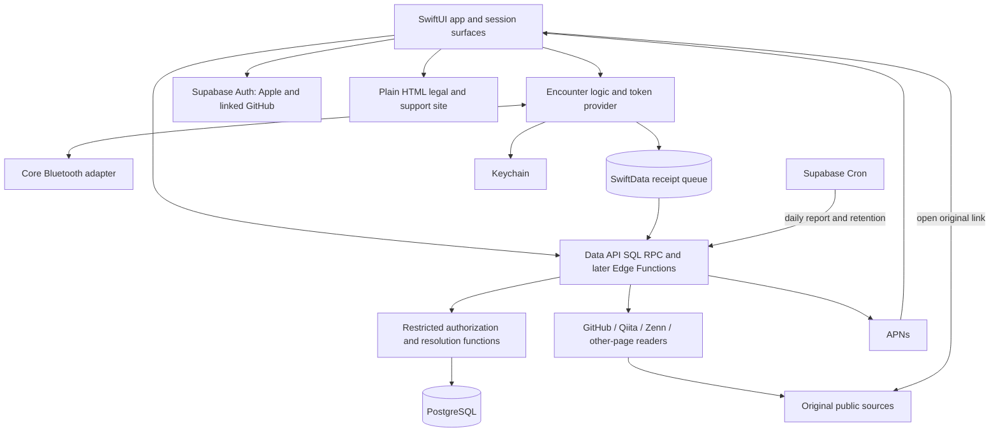
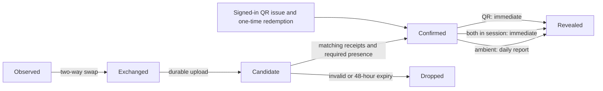

# Design — Engineer Encounters

**Version:** 0.11\
**Status:** Built Units 1–5 recorded; remaining fixes and release gates labelled\
**Date:** 2026-10-17\
**Related:** `decisions.md` v0.8, `specification.md` v0.8, `ui.md` v0.9\
**Platforms:** iOS first, Android later\
**Languages:** Japanese, English

Engineer Encounters (Japanese: **すれちがいエンジニア**) retains **Engineer StreetPass** only as its internal codename and repository name. Public screens, notifications and store text use the public names.

`decisions.md` is authoritative, followed by `specification.md`. **DEFAULT** identifies a proposed implementation choice or a drafting default inherited from those documents, including built values that may still change. **FACT** and **UNVERIFIED** retain their evidence markings. **FACT:** Units 1 (Toolchain) and 2 (Bluetooth engine) are implemented and merged to main in pull requests 2, 4 and 5. Unit 3 implementation and verification are recorded under **Unit 3 contract** and **Automatic checks**. This document distinguishes their built behaviour, the owner's 2026-10-11 device results and decisions, and the remaining implementation plan. Units 4/5 are recorded from this branch under **Unit 4 and 5 contract**; review and tester results have their own dated evidence below. **FACT:** the three binding presence decisions made that day were implemented on 2026-10-12; see **Exchange, presence and teardown** and **160-trial matrix and procedure**.

## Architecture decisions

- Build a native iOS app with SwiftUI and Core Bluetooth. Android follows later using the same backend and protocol.
- Promise the One open rung after its device gate. Locked and Awake remain unproven and are described as “may also work”. All five rungs operate together, without mode switching or fixed hardware.
- Confirm Bluetooth encounters from both phones' receipts. Ambient encounters require two minutes; only two active sessions permit immediate confirmation. QR is the manual alternative.
- Reveal ambient encounters at the daily report. Session and QR encounters reveal immediately. Never issue someone-is-nearby prompts.
- Use durable release accounts, external links and server-enforced, current visibility. Authorized shared interests order encounters; compatibility gates compatible-only fields and does not hide incompatible encounters.
- Store encounter dates, never location or durable encounter times. Include block, report, favorites, saved links and immediate in-app account deletion in v1.
- Operate v1 as a free, ad-free product with no purchases, built by one owner part-time on an individual Apple developer account. Release in Japan first, with Japanese UI first, an 18+ declaration at sign-up and an 18+ App Store minimum age.

The scope is `specification.md`, **Scope of v1**. Screen definitions belong in `ui.md`, **Navigation**, **The 26 screens** and **Surfaces outside the app**.

## Stack, tools and workflow

### Languages and runtime

| Area | Technology and responsibility |
|---|---|
| iOS | Swift 6.4, SwiftUI, minimum iOS 26.0; built with Xcode 27.0. |
| Radio | Core Bluetooth; every phone is a central and a peripheral. |
| Local storage | SwiftData; pending receipts behind a replaceable queue interface. SQLite is the fallback if background writes misbehave. |
| Token storage | CryptoKit and Keychain. |
| Session surfaces | Live Activity and a one-tap widget or Control Center control. |
| Manual encounter | Camera QR scanning. |
| Backend | **FACT:** SQL PostgreSQL schema/access rules and Data API RPCs; Unit 5 adds the TypeScript `github-links` Edge Function, and Unit 4 adds SQL Cron report/retention work. Later readers and APNs remain later units. |
| Managed services | Supabase free-plan Auth, PostgreSQL, Edge Functions and Cron. |
| Notifications | APNs for the daily report. |
| Public website | Plain HTML privacy policy, terms and support pages, available as URLs. |

Core Bluetooth is the selected framework for background discovery between strangers without pairing and for a later Android implementation. The simulator has no Bluetooth; it tests the interface and encounter logic through a fake.

Supabase Auth provides native Sign in with Apple and links GitHub to an already signed-in account. The product uses GitHub for verification; the Auth-level sign-in limitation is in **Open items and risks**. Release sign-up records the 18+ declaration and acceptance of the terms and privacy policy.

**FACT:** Supabase may pause a free-plan project with low activity over a 7-day period; paid projects are not paused. A quiet week after release can take the service offline until the owner restores it manually. **FACT:** Supabase labels manual identity linking and Cron as beta. These are operational dependencies, not reliability guarantees.

### Build kinds

| Build kind | Distribution | Included features |
|---|---|---|
| Development | Run or cable-installed from the owner's Mac. | Temporary anonymous sign-in, immediate ambient demo switch, diagnostics. |
| Internal | TestFlight only to the owner's own devices. | Demo switch and diagnostics; Apple sign-in remains Unit 7, no anonymous sign-in. |
| Release | App Store; TestFlight for the 20-person event, made with the release configuration against the production backend. | Apple sign-in remains Unit 7; anonymous sign-in, the demo switch and diagnostics are all compiled out. |

The table records current build gates and the intended v1 distribution. **FACT:** Development temporary sign-in is built; Apple sign-in remains Unit 7; daily/demo reveal is built under **Daily reveal and demo**. **FACT:** XcodeGen defines `Development`, `Internal` and `Release`. Unit 2 compiles `ios/App/Development` only into Development and `ios/App/Diagnostics` only into Development and Internal. Per-configuration `EXCLUDED_SOURCE_FILE_NAMES` is anchored at `$(SRCROOT)/App`, with conditional compilation at declarations and call sites. Development defines `DEVELOPMENT_BUILD`, Internal defines `INTERNAL_BUILD`, and Release defines neither. The localized development and diagnostics string tables follow the same exclusions.

**FACT:** `ios/Tests/check-release-artifact.sh` builds all three configurations and checks marker names and bundled Japanese/English string tables. Local test tokens and the no-account S01 → S22 entry are Development-only. The built Settings list gives Development and Internal a route to S22; signed-out/loading/error diagnostics entry is also available in Internal. The demo switch has a reveal consumer under **Daily reveal and demo** and never changes exchange or evidence logic.

**DEFAULT:** the friends test uses development builds pointed at a hosted non-production Supabase project, because the phones leave the owner's Mac. For the later hosted test, enable anonymous sign-in only on that non-production project and disable it on production, in addition to being compiled out of the release build. Local Supabase is for automated checks and the owner's own development. Internal testing will use a hosted non-production backend. **FACT:** only local and explicitly configured hosted non-production environments can enable demo reveal; the exact callable boundary is in **Unit 4 and 5 contract**. **UNVERIFIED:** whether the Supabase free plan allows the second, hosted non-production project. The production backend never enables demo reveal; **Unit 4 and 5 contract**, **Daily reveal and demo**, defines its indistinguishable rejection. A client-supplied build label never grants access. The switch changes ambient reveal and notification timing, never the two-minute or both-receipts rules. Device tests use the same switch; free-account tests show results in-app without push.

### Repository

The top-level directories are binding. **FACT:** the iOS packages, thin app, scripts and tests below exist after Units 4/5; `EncounterDomainTestSupport` is a separate library product inside the domain package. **FACT:** `SessionActivity` exists; `site` remains unbuilt.

```text
.
├── ios/
│   ├── project.yml                 # XcodeGen input
│   ├── EngineerEncounters.xcodeproj # generated, never edited by hand
│   ├── App/                        # thin composition and SwiftUI entry point
│   │   ├── Composition/            # account/session/storage binding, runtime, participation
│   │   ├── Development/            # Development-only entry and local test issuer
│   │   └── Diagnostics/            # Development/Internal S22 and trial logs
│   ├── Scripts/                    # typecheck-app.sh
│   ├── SessionActivity/            # built Live Activity and Control Center start control
│   ├── Packages/
│   │   ├── EncounterDomain/         # EncounterDomain + EncounterDomainTestSupport
│   │   ├── EncounterBluetooth/
│   │   ├── EncounterStorage/
│   │   ├── EncounterBackend/
│   │   └── EncounterUI/
│   └── Tests/                      # app integration and release checks
├── supabase/
│   ├── migrations/
│   ├── functions/
│   └── tests/database/
├── site/                           # planned bilingual legal and support HTML
└── docs/                           # decisions, requirements, design and UI
```

### Terminal checks and owner's tools

**FACT:** Unit 1 established terminal entry points for packages, simulator builds, backend functions and the local database. Run the commands separately for each unit; empty areas still have smoke checks. The three simulator configurations check the build gates. **DEFAULT:** use the iPhone 17 simulator, which exists on the owner's Mac. **FACT:** the EngineerEncounters scheme tests the app-hosted tests and the EncounterBluetooth and EncounterUI package tests. EncounterBluetooth also declares macOS, so its package tests run directly on the Mac.

```sh
swift test --package-path ios/Packages/EncounterDomain
swift test --package-path ios/Packages/EncounterBluetooth
swift test --package-path ios/Packages/EncounterStorage
swift test --package-path ios/Packages/EncounterBackend
sh ios/Scripts/typecheck-app.sh Development
sh ios/Scripts/typecheck-app.sh Internal
sh ios/Scripts/typecheck-app.sh Release
sh ios/Tests/check-release-artifact.sh
xcodegen generate --spec ios/project.yml
xcodebuild -project ios/EngineerEncounters.xcodeproj -scheme EngineerEncounters -configuration Development -sdk iphonesimulator -destination 'generic/platform=iOS Simulator' CODE_SIGNING_ALLOWED=NO build
xcodebuild -project ios/EngineerEncounters.xcodeproj -scheme EngineerEncounters -configuration Internal -sdk iphonesimulator -destination 'generic/platform=iOS Simulator' CODE_SIGNING_ALLOWED=NO build
xcodebuild -project ios/EngineerEncounters.xcodeproj -scheme EngineerEncounters -configuration Release -sdk iphonesimulator -destination 'generic/platform=iOS Simulator' CODE_SIGNING_ALLOWED=NO build
xcodebuild -project ios/EngineerEncounters.xcodeproj -scheme EngineerEncounters -configuration Development -sdk iphonesimulator -destination 'platform=iOS Simulator,name=iPhone 17' -derivedDataPath /tmp/encounters-unit3-development CODE_SIGNING_ALLOWED=NO test
deno test supabase/functions
supabase start
supabase db reset
supabase test db
supabase db lint --schema public,private,service
deno test --allow-env=ENCOUNTERS_LOCAL_API_URL,ENCOUNTERS_LOCAL_PUBLIC_KEY --allow-net supabase/functions/tests/local_http_flow_test.ts
deno test --allow-env=ENCOUNTERS_LOCAL_API_URL,ENCOUNTERS_LOCAL_PUBLIC_KEY,ENCOUNTERS_LOCAL_SERVICE_KEY,ENCOUNTERS_LOCAL_DB_URL --allow-net --allow-run=psql supabase/functions/tests/unit4_http_flow_test.ts
xcodebuild -project ios/EngineerEncounters.xcodeproj -scheme EngineerEncounters -configuration Internal -sdk iphonesimulator -destination 'platform=iOS Simulator,name=iPhone 17' -derivedDataPath /tmp/encounters-unit3-internal ENABLE_TESTABILITY=YES CODE_SIGNING_ALLOWED=NO test
```

**FACT:** copy `supabase/.env.example` to git-ignored `supabase/.env` and supply the local OAuth values there, never in logs. Start Docker, then run `supabase start` and `supabase db reset` before database tests and lint of `public`, `private` and `service`. If an old database volume lacks schema `service`, stop the stack once with `supabase stop --no-backup`, start it again and reset it. Restart the stack after configuration changes so Auth/API settings take effect. `deno test supabase/functions` passes with the live flow tests ignored. The live command requires `ENCOUNTERS_LOCAL_API_URL` (loopback local API) and `ENCOUNTERS_LOCAL_PUBLIC_KEY` set outside logs, with `--allow-env` and `--allow-net`. The `unit4_http_flow_test.ts` command additionally needs `ENCOUNTERS_LOCAL_SERVICE_KEY` and `ENCOUNTERS_LOCAL_DB_URL`; all four variables must be set or it is ignored. API/database URLs must be loopback, `psql` must be on PATH, and the tester resets the local database afterwards because the test leaves fixtures. Local anonymous sign-in is enabled and email/phone sign-up disabled in `supabase/config.toml`; hosted configuration remains unexercised. Internal hosted tests require `ENABLE_TESTABILITY=YES`. On the owner Mac the default derived-data path held a stale module; a fresh `-derivedDataPath` was needed for `xcodebuild test` (use separate fresh paths per configuration, including Development). These are implementation entry points, not checks run by this documentation update. **FACT:** the documented unsigned simulator test skips the real Keychain round-trip when it returns `errSecMissingEntitlement`. It does not verify locked-device file protection: the storage package's protection assertion is iOS-only and needs a device run; locked access must also be checked on a device.

**FACT — local device setup, 2026-10-15/16:** the GitHub OAuth app must list `http://<mac-host>.local:54321/auth/v1/callback` as a redirect URI. Add `SUPABASE_AUTH_EXTERNAL_GITHUB_REDIRECT_URI=http://<mac-host>.local:54321/auth/v1/callback` to git-ignored `supabase/.env`; this is a Supabase CLI environment override, with no tracked configuration change. The local Edge runtime may exit on the first start after Docker boots; `docker start supabase_edge_runtime_<project>` recovers it.

The owner's Mac has macOS 27.0.1, Xcode 27.0 with the iOS 27.0 SDK and simulator, Swift 6.4, Homebrew, Supabase CLI, Docker, Node and Codex CLI. **FACT:** XcodeGen and Deno are installed. Add the VS Code Swift extension if still needed.

**FACT:** plain `swift test` fails in the implementing agent's sandbox on the module-cache path. This form passes there; replace `<Package>` with the package name:

```sh
env XDG_CACHE_HOME=$PWD/.build/sandbox/xdg CLANG_MODULE_CACHE_PATH=$PWD/.build/sandbox/clang SWIFTPM_MODULECACHE_OVERRIDE=$PWD/.build/sandbox/manifest swift test --disable-sandbox --package-path ios/Packages/<Package> --cache-path $PWD/.build/sandbox/swiftpm-cache --config-path $PWD/.build/sandbox/swiftpm-config --security-path $PWD/.build/sandbox/swiftpm-security --manifest-cache local
```

The same cache and sandbox options with `swift build --triple arm64-apple-ios26.0-simulator --sdk <iPhoneSimulator SDK path>` compile iOS-only package code there. **FACT:** `ios/Scripts/typecheck-app.sh` accepts Development, Internal or Release and type-checks the app and hosted tests without `xcodebuild`. The app module's source list excludes `SessionActivityBundle.swift`, as `ios/project.yml` does for the app target. The script separately type-checks the complete SessionActivity extension with `swiftc -typecheck` and `-D SESSION_ACTIVITY_EXTENSION` in every configuration; no extra command is needed. XcodeGen, `xcodebuild`, app-hosted test execution, `ios/Tests/check-release-artifact.sh` and every Supabase command do not run in that sandbox. Database units cannot be checked by the implementer; they are verified by the tester role. The tester role runs those checks outside it.

**FACT — screenshot gallery:** `ios/Tests/ScreenGalleryTests.swift` is opt-in. Pass an absolute output directory to the hosted process with the `TEST_RUNNER_` prefix:

```sh
env TEST_RUNNER_ENCOUNTERS_SCREEN_GALLERY=/absolute/path/gallery-ja xcodebuild -project ios/EngineerEncounters.xcodeproj -scheme EngineerEncounters -configuration Development -sdk iphonesimulator -destination 'platform=iOS Simulator,name=iPhone 17' -derivedDataPath /tmp/encounters-gallery-ja -testLanguage ja -testRegion JP -only-testing:EngineerEncountersTests/ScreenGalleryTests CODE_SIGNING_ALLOWED=NO test
```

Use a separate output and derived-data directory with `-testLanguage en -testRegion US` for English. The gallery renders 37 states in five variants: light, dark and ax at 393 × 852 pt, full at 393 × 2400 pt, and axfull at 393 × 2700 pt; ax and axfull use Dynamic Type `accessibility2`. Each language produces 185 PNGs. An axfull height of 3600 pt failed because the simulator renders at 3× and its render server refused images over about 8192 px. Without the variable, the gallery is skipped, adding one skip to the app-hosted suites.

**FACT — assets:** `ios/project.yml` sets `ASSETCATALOG_COMPILER_APPICON_NAME: AppIcon` and `ASSETCATALOG_COMPILER_GLOBAL_ACCENT_COLOR_NAME: AccentColor` for the app target. `ios/App/Assets.xcassets` contains both assets; `ios/Scripts/render-app-icon.swift` reproducibly renders the default, dark and tinted app icons.

### VS Code and cross-harness

The owner develops in VS Code with cross-harness. One agent plans and reviews; another implements a bounded unit. Each unit becomes one commit on a work branch, and the owner merges. Preserve existing work, keep secrets out of task files and logs, and do not launch another harness from a delegated executor.

Agents write Swift, TypeScript, SQL, tests and XcodeGen configuration and run terminal checks. **FACT:** the implementing role uses the sandbox-compatible Swift commands and type-check script; the tester role runs Xcode generation/builds, hosted tests, artifact checks and Supabase checks outside the sandbox. The owner uses Xcode or their own hands for Apple ID code signing, cable installs, every real-device Bluetooth trial, battery measurements and App Store submission screens. Agents can prepare the diagnostics and written test sheet; they cannot replace radio trials with simulator results.

## System architecture



Radio discovery and local receipt persistence do not wait for the network. Upload and resolution happen later. The app never reads another user's database rows directly; server functions produce authorized cards. Link readers keep bounded preview metadata, while external platforms remain the hosts of the original works.

## iOS app structure

**FACT:** Units 1–5 established the following packages and interfaces; later-unit responsibilities are identified explicitly.

| Package | Responsibility |
|---|---|
| `EncounterDomain` | Deterministic synchronous `EncounterEngineCore`, actor runtime `EncounterEngine`, two-minute rule, token-window selection, receipt models, clocks and command/event interfaces; no Core Bluetooth imports. |
| `EncounterDomainTestSupport` | Separate library product: `FakeBluetoothTransport`, paired-phones rig, manual clock, queue contract and test confirmation check. The app never links it. |
| `EncounterBluetooth` | `CBCentralManager` and `CBPeripheralManager`, GATT framing, connection limits and restoration. |
| `EncounterStorage` | `SwiftDataReceiptQueue` model actor and `KeychainTokenBatchStore`; no encounter authorization. |
| `EncounterBackend` | Auth session establishment/refresh, own-account RPCs, server token issuer, fair receipt uploader and wire types are built. Feed/detail/favorites/saves, GitHub reader/linking, session, QR, report, safety and deletion services are built; Apple sign-in and push registration remain Unit 7. |
| `EncounterUI` | Localized welcome/declarations, S02/S03/S05 onboarding, S12/S16/S17 and Settings list are built with shared profile states. Units 4/5 add Discover/detail/favorites, sessions/QR, own-card previews, link flows and report/safety/account/legal screens with three product tab roots. The shared design system in `ios/Packages/EncounterUI/Sources/EncounterUI/EncounterDesign.swift` supplies semantic palette tokens, reusable components and `EncounterMark`, with light/dark/high-contrast appearances and Dynamic Type; `ui.md`, **Principles and look**, records the built rules. |

**FACT:** Unit 2 changed `BluetoothTransport` from the planned completed-exchange interface to radio primitives. Commands are `startDiscovery`, `stopDiscovery`, `connect`, `read`, `write`, `disconnect`, `answerRead` and `answerWrite`. Its ordered event stream emits `availabilityChanged`, `peerObserved`, `connected`, `connectFailed`, `frameRead`, `readFailed`, `writeAcknowledged`, `writeFailed`, `disconnected`, `incomingRead`, `incomingWrite` and `restored`. Values use provisional local peer handles rather than framework objects. The encounter engine owns the entire exchange; the core returns ordered effects and deadlines, and the actor serializes radio, token and storage I/O.

**FACT:** `FakeBluetoothTransport`, `PairedPhonesRig`, `ManualEncounterClock` and `TestEncounterConfirmation` live in `EncounterDomainTestSupport`, linked by tests only. The fake exercises the real engine protocol logic, including disconnections, reordered events, token rotation and one-sided results. The confirmation check requires reciprocal receipts and cannot confirm from one fake phone. Unit 2 changed the planned device confirmation harness to a test-only check. There is no on-device two-receipt confirmation harness. S22 shows only that device's two-minute evidence with an exchange digest, the first 8 hexadecimal characters of SHA-256 of the exchange nonce; the owner compares both screens.

**FACT:** `ReceiptQueue` exposes durable enqueue/update, pending reads, terminal acknowledgement, expiry removal and clearing. `SwiftDataReceiptQueue` is the built adapter; `InMemoryReceiptQueue` serves tests. Writes succeed only after storage succeeds. Candidate acceptance is nonterminal: retain the receipt for checkpoint updates and later status checks until confirmation, definitive rejection or expiry. Terminal acknowledgement removes it idempotently and retains a bounded identity tombstone. **DEFAULT:** SQLite remains a replaceable fallback. Built upload handling is in **Unit 3 contract**, **iOS client and app integration**.

**FACT:** `AppComposition` owns `EncounterRuntime`, account/session composition and the persisted local participation switch, default off. No encounter radio manager is created before participation consent and storage readiness; an explicit permission request can create a permission-only observer. `App.init` restores the account and storage binding even on background relaunch; foregrounding refreshes it. Built backend, issuer, upload and storage-isolation rules are defined once in **Unit 3 contract**, **iOS client and app integration**. The Unit 4 holder now supplies the acknowledged session flag under **Sessions**. The local participation switch enables no-account Development radio trials independently of product discovery.

**FACT:** session holder, server ledger, Live Activity and Control Center start behavior are built under **Unit 4 and 5 contract**, **Sessions** and **iOS client and navigation**; their remaining fixes/device validation are identified separately.

**FACT:** the labelled sample encounter is a dismissible on-device fixture, never a server encounter. Other people's cards are held only in memory and re-fetched on opening or foregrounding; clear them on sign-out, access changes or loss of a fresh authorization response. Favorites and saved links store references, not permanent profile snapshots.

## Bluetooth transport

### Service and characteristic contract

**FACT:** Unit 2 uses one fixed application service UUID. Every participating phone with available radio and a valid token advertises it and scans explicitly for it. Tokens never appear in advertisements. The central connects, reads the peripheral's token and writes its own token, so one connection supplies both phones with the other's token.

**FACT:** these UUIDs and the version-1 layout are defined in `EncounterProtocol` and `ExchangeFrame`.

| Item | UUID | Operation |
|---|---|---|
| Application service | `7AEF0001-6B8D-4B71-9C13-95DCE08A26F0` | Advertised and explicitly scanned. |
| Peripheral token | `7AEF0002-6B8D-4B71-9C13-95DCE08A26F0` | Read and notify properties; reads carry the current token and exchange nonce. No value is ever notified. |
| Central token | `7AEF0003-6B8D-4B71-9C13-95DCE08A26F0` | Write own current token with response, echoing the nonce. |

**FACT:** each frame contains a version byte, a phase byte, a 16-byte random token and a 16-byte random exchange nonce: 34 bytes, or 50 with the optional 16-byte prior nonce allowed only for second exchange evidence. The phases distinguish initial exchange, held connection checkpoint and second exchange evidence. The peripheral creates the nonce; it is bound to this exchange, not an account. The 64-byte bound is checked before decoding; unknown versions, malformed lengths, invalid phases and inappropriate prior nonces are rejected, and the engine checks nonce freshness and phase continuity. Read fragments refer to one immutable snapshot valid only until its token expires; write fragments are assembled within one callback and never carried into another. **DEFAULT:** these protocol values are the starting constants for later interoperability.

**FACT:** Unit 2 added the notify property to observe the subscription lifecycle, without sending notifications. After characteristic discovery the central subscribes before reporting readiness. The peripheral treats subscription as connected and unsubscription as disconnected: Core Bluetooth supplies it no other central connect/disconnect signal and no way to force a central off. Logical peripheral close releases local state only. Pull request 5 changed central teardown to unsubscribe before cancelling the link, waiting at most 1 second. An offset-0 read from a still-subscribed central with no open logical link admits a new logical connection, subject to the same admission bounds; continuation reads cannot create one.

**FACT:** after the 2026-10-11 security review, the adapter has an event-backlog admission limit of 256: at that limit observations are dropped and new subscriptions/read admissions are refused, while events for admitted work and command outcomes are always delivered. The backlog can therefore exceed 256 to finish admitted work. At most 16 peripheral-role logical links are open; each admits one outstanding read and write. Write callbacks accept at most 8 nonempty fragments. Observations emit at most once per peer every 2 seconds and use a 256-peer registry; central links and cancellations also share a 256-entry bound. **DEFAULT:** these resource limits may be tuned after trials.

No account ID, name, GitHub handle, email, link or permanent device identifier crosses Bluetooth. Tokens identify participants temporarily; nonces and phase bytes only coordinate the exchange. Session state and duration are reported by each phone to the server, not advertised.

**FACT:** `TokenProvider` selects a valid token from an ordered batch of non-overlapping, exactly 15-minute windows, prunes expired windows on selection and never extends validity. Development's local issuer uses cryptographically random tokens and 12-hour coverage; `KeychainTokenBatchStore` stores the batch after first unlock, this device only. Without a valid token the engine pauses participation. The built server issue, prerequisite, coverage, digest and replenishment rules are in **Unit 3 contract**, **Binding owner decisions — 2026-10-12**, **Token issue** and **iOS client and app integration**. CryptoKit currently supplies the diagnostic nonce hash, not a separate batch-integrity check.

### Exchange, presence and teardown

**FACT:** the peripheral durably saves the central's write before answering success; the central saves after the write acknowledgement. An interrupted read, failed write or missing acknowledgement is not a completed exchange. The engine rechecks its own token at the central write acknowledgement and after either role's save; a token roll rejects completion and rolls back/removes the saved evidence, with a retriable presence step where possible. Built upload is in **Unit 3 contract**: an eligible one-sided receipt can only be a candidate and never reveal a card alone.

**FACT:** both presence approaches are built. The held connection (接続を維持) remains selectable in S22; see the implemented default below. After at least 120 seconds on each phone's monotonic clock, a fresh read/write of current tokens under the same exchange nonce updates that phone's one receipt with a checkpoint token pair and observed duration. A timer alone never supplies two-minute evidence. Tokens at the first exchange and checkpoint may differ; both pairs are retained for validation against their own windows.

**FACT:** the second exchange (2回目の交換) closes the first central link and completes another exchange with the same provisional peer at least 120 seconds later. Unit 2 changed the planned receipt shape: it creates a second receipt with its own exchange nonce, `priorExchangeNonce` equal to the first exchange's nonce, and observed duration measured monotonically between the exchanges. The first receipt is kept and marked final; the second has no held connection checkpoint. Unit 3 resolution accepts both built shapes: the linked second-exchange shape is now the one clients send by default, and the held-connection checkpoint shape must still be accepted while it stays selectable. Resolution must resolve the token pairs to the same two accounts and require reciprocal receipts for both exchanges. A local handle alone is insufficient and unrelated short contacts are never combined.

**Owner decision, 2026-10-11; FACT — implemented on 2026-10-12:** make the second exchange the default, keeping the held connection selectable in S22 until iPhone-with-iPhone trials in the 160-trial matrix confirm the choice. Both approaches passed rungs 3 and 4 on the iPhone 15 and iPad (10th generation), but a held connection occupies one of the engine's four connection slots for two minutes per peer. The second exchange is the only approach with a possible route for locked phones. Accepted trade-off: it proves two completed exchanges at least 120 seconds apart, not continuous presence; leaving and returning within the 5-minute attempt still counts. Rung 3 remains the public promise; rungs 1 and 2 remain unproven and never promised. Neither approach assumes a suspended app receives a timer callback. **FACT — implemented on 2026-10-12:** EncounterEngineCore, EncounterEngine and EncounterRuntime default to the second exchange. S22 reads a missing or unrecognised stored value as second exchange; held connection stays selectable and a device that chose it earlier keeps that stored choice. Release has no S22 and uses second exchange. A phone on held connection and a phone on second exchange produce no two-minute evidence together (`testDifferentPresenceApproachesFailCleanly`); both S22 selectors must show the same approach before a trial.

**FACT:** connect attempts have a 10-second timeout and read/write/save steps a 5-second timeout. A pre-exchange peripheral attempt also has a 20-second total bound. Presence expires 5 minutes after the first completed exchange. Evidence completion, terminal failure, expiry, stopping participation, radio/token loss and Reset close attempts; a refused checkpoint or second exchange step can retry inside the original bound. A broken held connection supplies no qualifying elapsed evidence. The engine admits one outgoing attempt per provisional peer and four active or closing connections total, including incoming links and pending connects, with a 10-second duplicate backoff. Built sign-out and server date-pair deduplication follow **Unit 3 contract**. **DEFAULT:** these timeout and concurrency values may still change.

**FACT:** the engine bounds pending peers to 256, expiring them 30 seconds after their last observation, and observed peers to 256. Its consumed-nonce ledger holds at most 4,096 entries, expiring after 48 monotonic hours and evicting the oldest entry at capacity. The returning-central refusal table holds at most 256 handles. **FACT — implemented on 2026-10-12:** a returning central is refused until 5 seconds after the start of its previous peripheral-role attempt when that attempt ended without evidence. An attempt lasting 5 seconds or longer leaves no refusal, so that central is accepted at once. A new incoming link that would supersede a still-connected stale attempt begun less than 5 seconds ago is disconnected instead of replacing it. The refusal table still holds at most 256 handles, dropping the oldest at capacity; Stop and Reset still clear it. Evidence completion does not set that refusal.

**Owner decision, 2026-10-11; FACT — implemented on 2026-10-12:** after two-minute evidence, start no new exchange with that peer for 15 minutes (one token window); Reset clears the pause. Reason: the 2026-10-11 check showed a pair repeating about every 131 to 133 seconds, storing receipts and using the radio without end. A longer pause cannot be enforced because the app keeps no lasting peer identifier.

**FACT — implemented on 2026-10-12:** `EncounterProtocol.evidencePauseDuration` is 900 seconds. When an exchange this phone started (central role) reaches two-minute evidence, it starts no new outgoing attempt to that temporary peer handle until 900 monotonic seconds after that evidence. It does not refuse the peer: an incoming link from a paused handle is accepted and offered an initial exchange. Evidence reached only in the peripheral role sets no pause. The in-memory table is keyed by temporary peer handle, holds at most 256 entries and drops the oldest at capacity. Reset clears it on that phone only; turning the local participation switch off and on keeps it; process relaunch loses it. Paused peers stay out of the pending-peer table; after expiry a peer is dialled at its first observation at or after expiry, with no timer wake-up at expiry. With this code on both phones a pair no longer repeats every 131 to 133 seconds; one further cycle can occur in a direction that started late or failed because that phone has not yet reached evidence as central.

**DEFAULT:** central-role-only scope is an implementation choice narrower than the owner’s 2026-10-11 wording, “after two-minute evidence with a peer”. The peripheral saves its receipt before the central receives the acknowledgement, so only the central knows both phones hold matching receipts; the handle a phone dials is the central-role handle. The owner has not yet confirmed this scope. **UNVERIFIED:** whether a backgrounded phone receives a new discovery so that it resumes after 15 minutes.

**Owner decision, 2026-10-11; FACT — implemented on 2026-10-12:** count the 5-second refusal from the start of that central's previous attempt, rather than its end. This still limits an attacker to one attempt per 5 seconds per handle and accepts an honest returning peer immediately when its previous attempt lasted longer. The static security review of 2026-10-12 is recorded in **Security requirements**; device verification remains open in **160-trial matrix and procedure**.

A local session flag permits retaining short evidence for early upload; it cannot decide the encounter kind. **FACT:** the engine captures the initial flag and keeps collecting ambient evidence; the app supplies false until sessions exist. Built upload/status handling follows **Unit 3 contract**. If only one user is in a session, both phones still need two minutes. A new session does not retroactively turn an earlier short ambient contact into a session encounter.

**FACT:** ambient attempts ending without two-minute evidence are discarded; a session-flagged receipt is retained and marked final, as is the first receipt of a qualifying second exchange pair. An uploaded one-sided receipt remains a candidate until its counterpart arrives or the 48-hour deadline expires, even if it might qualify as a session. **FACT:** nonqualifying matched pairs follow **Unit 3 contract**, **Resolution and confirmation**; the Unit 4 follow-up is listed in **Open items and risks**. Do not discard an incomplete pair merely because the other phone is offline.

## Encounter states

| State | Meaning | Next step or failure |
|---|---|---|
| Observed | Core Bluetooth discovery callback, with a provisional local handle. | Connect; discard on timeout. No proof and no visible card. |
| Exchanged | Tokens swapped in both directions and a receipt persisted. | Collect required presence evidence and upload when online. |
| Candidate | At least one receipt uploaded; not yet confirmed. | Wait for its counterpart and validation. Drop after 48 hours unresolved. |
| Confirmed | Matching receipts and duration/session checks pass, or the QR rule passes. | Delete candidate times; retain dates and kind. Apply reveal timing. |
| Revealed | The reveal gate has passed for the viewer. | Return only currently authorized fields; remove access on deletion or safety actions. |



Revealed is a timing state, not a permanent permission grant. A revealed encounter per viewer is a confirmed encounter that a user is now allowed to see. Each of the two users reaches this at their own daily report, so one may see the other before the reverse. This follows from the decision that each user can change their report time. **DEFAULT:** persist the reveal flag per viewer. A confirmed ambient encounter supplies no identifiable preview before that viewer's report. Session and QR encounters pass both viewers' timing gates immediately.

## Confirmed encounter, security definition

### Bluetooth

**FACT:** `EncounterReceipt` contains an immutable identity, protocol version, role, exchange nonce, optional `priorExchangeNonce`, start token pair and its transient wall observation time, optional checkpoint pair/time, monotonic observed duration, initial session flag, final-evidence marker and upload status. A held connection updates one receipt with the checkpoint; a second exchange creates a linked second receipt and retains the final first receipt. Unit 3 accepts both shapes and authenticates ownership; see **Unit 3 contract**.

Built validation, transactional resolution, freshness, statuses, replay rejection, date-only deduplication and abuse limits are defined once in **Unit 3 contract**, **Receipt upload and statuses**, **Resolution and confirmation** and **Limits, cleanup and authorized cards**. The contract accepts both built receipt shapes. **FACT:** the device's 4,096-entry nonce ledger can evict older entries before 48 hours and is lost on process restart or Reset; server nonce consumption must be the replay control, not that ledger. The token prerequisite and accepted discovery-off consequence are in **Unit 3 contract**, **Binding owner decisions — 2026-10-12**.

A confirmed Bluetooth encounter is evidence of a Bluetooth interaction, not cryptographic proof of physical distance. A relay can carry a valid exchange, and two malicious clients can falsify observations. Signal strength is only a rough range indicator, never the confirmation gate.

### Sessions and QR

The server owns session start, expiry and stop records. Sessions last two hours or until stopped. Late receipt uploads use that record, rather than trusting a current client flag alone. A stopped local session reports its flag as false even when the stop upload is pending.

For QR, the showing phone obtains a short-lived one-time code from the server while signed in. A distinct signed-in scanning account submits it before expiry. Atomic redemption confirms and reveals the encounter immediately for both accounts. No Bluetooth receipts or two-minute wait are involved.

**FACT:** exact session/QR RPCs, code payload, authorization, errors, limits and retention are in **Unit 4 and 5 contract**, **Sessions** and **QR**.

## Background lifecycle and storage

**FACT:** the app declares `bluetooth-central` and `bluetooth-peripheral` background modes. `CoreBluetoothTransport` creates both managers on one serial queue with distinct iOS restoration identifiers, restores delegates, services and connections, and leaves restored discovery untouched until the engine supplies a command. `App.init` recreates the runtime when the persisted local participation switch is on; managers are not created while it is off.

**FACT:** only completed receipt payloads persist; partially assembled frames and monotonic attempts do not. A restored connection without a live connected engine attempt is disconnected logically and retried fresh; only a demonstrably live attempt is kept. On first start after process loss, nonfinal receipts with a session flag or qualifying ambient evidence are finalized, and other nonfinal receipts are removed. Unit 2 therefore does not resume a half-finished second exchange pair across process loss. Never infer continued presence from relaunch. **UNVERIFIED:** real-device restoration continuity still needs its own trial.

**FACT:** `SwiftDataReceiptQueue` is a single model actor storing each receipt as its Codable payload beside identity, enqueue sequence and expiry. It stores at most 4,096 receipts and 4,096 terminal-identity tombstones; a full receipt queue fails the write. Expired receipts are never returned. Enqueue removes expired rows, and the engine runs expiry on start, on refresh and every 15 minutes while running. Receipt expiry uses wall time; monotonic time drives presence. Terminal acknowledgement removes a receipt idempotently, retaining its identity/expiry within the tombstone bound. Checkpoint updates keep the original identity and initial evidence; the second exchange gets a new identity.

Built upload, acceptance, terminal handling and retry rules are in **Unit 3 contract**, **iOS client and app integration**. **FACT:** start, foreground refresh, queue events and scheduled retry deadlines trigger uploads without waiting on the radio lifecycle chain. **DEFAULT:** a connectivity-specific trigger remains later work.

**FACT:** the receipt directory, store and existing sidecars use after-first-unlock file protection, reapplied around writes, and the directory is excluded from device backups. `KeychainTokenBatchStore` uses `kSecAttrAccessibleAfterFirstUnlockThisDeviceOnly`, with no iCloud synchronization. Auth credentials use the same device-only after-first-unlock Keychain protection; see **Unit 3 contract**. Check the complete locked SwiftData/sidecar and credential paths on real devices; the one-day exchange results are not a separate protection audit. Before the first unlock after a reboot nothing works; do not claim otherwise.

**FACT:** token selection uses the stored batch whenever the engine runs or handles a Bluetooth request, caching only the current valid window and reloading on refresh/start. There is no advertised token to update while suspended. A callback across a window boundary selects the new token before answering; fragmented reads use an immutable snapshot until expiry, and the engine refuses/retries presence steps whose own token rolls before completion. No background timer is required for selection. **UNVERIFIED:** crossing a window boundary on real devices was not tested on 2026-10-11.

**FACT:** as recorded in `decisions.md`, **Encounters**, background advertising omits the local name and moves service UUIDs to an overflow area discoverable by an iOS scanner explicitly looking for them. Advertising can slow; scans coalesce duplicates and run less often. A background wake gives around 10 seconds, not a two-minute execution grant. **FACT:** the Apple engineer statement recorded there describes background advertising as best-effort and says force-quit apps are not relaunched.

**FACT:** device check, 2026-10-11, iPhone 15 and iPad (10th generation) — both approaches produced two-minute evidence in both orientations with one app open. In the trials with one app open the locked device completed its part on time; in most of them its step followed contact from the open device within seconds, which is consistent with the open device waking it (an inference from timing, not logged); in the second-exchange trial with the iPhone locked, the locked iPhone made its second connection on its own at about 125 s, about ten seconds before the iPad made its own. With both locked, neither approach produced evidence until a device was woken: a suspended app gets no timer. Held-connection checkpoints then ran late; second exchange attempts beyond the 5-minute bound expired and needed a fresh pair. The first exchange happened immediately after Reset, before both devices were left locked, so discovery between two backgrounded devices was not tested.

**UNVERIFIED:** background-to-background iPhone discovery and rung 2 (Awake). Rungs 1 and 2 remain unproven and never promised. An undecided, unbuilt idea is to ask iOS for the second connection after a delay with `CBConnectPeripheralOptionStartDelayKey`, so the system might wake a locked phone; no result establishes that it will. Force-quitting stops discovery until reopening, and onboarding must say so. Do not use BGTaskScheduler for continuous scanning or deterministic wake-ups. No location permission or location storage exists in v1; a possible later boost waits for Bluetooth-only results.

## Data model

**FACT:** the built private tables, existing columns, schema boundary and wire rules are recorded in **Unit 3 contract**, **Table allocation** and **Server boundary, wire format and errors**. Managed `auth.users`/`auth.identities` remain the identity source. Product encounter records contain dates only; operational expiry data is not encounter history.

**FACT:** new and extended Unit 4/5 tables, exact columns/keys, cascade rules and APIs are recorded once in **Unit 4 and 5 contract**, **Table allocation**. Its **Account deletion and cleanup** records the binding safety exception's built implementation; its **Links and GitHub connection** defines derived identity/address evidence. Client table access stays denied; use the applicable contract's server functions.

**DEFAULT — Unit 7 only:** `push_outbox` will use `(user_id, report_day, installation_id)` with status/expiry and references rather than copied cards. `push_tokens` will use `(installation_id, environment, topic)`, account association, protected device token, registration time and invalidation state; **Push-token lifecycle** defines their later rules. Neither is created by Units 4/5.

## Unit 3 contract

**FACT — built, 2026-10-12:** accounts/schema, SQL token issue, reciprocal receipt resolution, current-visibility cards, backend client, app composition and the allocated screens are implemented through `37ed0dc`. The five migrations under `supabase/migrations` and `ios/App` / `ios/Packages` are the implementation evidence. The contract below records locally verified behaviour; tunable built values retain **DEFAULT** only because they may change. **Automatic checks** records the last full results; **Security requirements** records review. That Unit 3 verification did not include an app/backend run or hosted Supabase exercise; the later local device run is recorded under **Open items and risks**. The three dated owner decisions below are retained as historical binding decisions; their future-tense wording is not current build status. The **Data model** covers the whole product, with the built subset identified in **Table allocation**.

### Binding owner decisions — 2026-10-12

1. **Owner decision — scope:** Unit 3 will also build `S02`, `S03`, `S05`, `S12`, `S16` and `S17`, the Settings list needed to reach `S12`, `S16` and `S17`, and the two declarations plus the Development-only temporary sign-in on `S01`. `S04` and all link flows stay in Unit 5; Sign in with Apple stays in Unit 7; sessions, QR, feed, block, report and deletion stay in Unit 4. Until the owner supplies real values, the screens will use a placeholder interest list and a shared-interest threshold range of 1 to 10. Both real values remain open items.
2. **Owner decision — token prerequisite:** the server will issue tokens to a signed-in account that has recorded the 18+ declaration and acceptance of the terms and privacy policy and registered a valid time zone. Discovery on will not be required. Accepted consequence: an account with discovery off can still have encounters confirmed and stored as dates only; they become visible if both people later turn discovery on within retention, subject to reveal and current authorization. Requiring discovery for token issue remains an owner open item to revisit once onboarding and link flows exist. No Unit 3 function creates links, so the app cannot turn discovery on before Unit 5.
3. **Owner decision — review:** the owner confirmed the planned Unit 3 auth and database changes and a security review of its diff before merge. This records authorization and a future review requirement, not a completed implementation or review.

### Server boundary, wire format and errors

- **FACT:** clients call SQL functions in `public` through Data API RPC; Unit 3 adds no Edge Function. Public entry points are `security definer` with empty `search_path`, caller identity from `auth.uid()` and no client-supplied account identifier. Execute on every public function is revoked from `PUBLIC`, `anon` and `service_role`, then granted only to `authenticated`; private helpers derive account references server-side.
- **FACT:** application tables live in `private`, outside the exposed Data API schemas, with RLS enabled, no policies and no direct grants to `anon` or `authenticated`. Managed `auth.users` is the identity table.
- **FACT:** JSON is `snake_case`; tokens/nonces are 32 lowercase hexadecimal characters representing 16 bytes, timestamps are whole Unix seconds, UUIDs are strings, and curated interest identifiers are text. Stored token/nonce hashes are SHA-256 of the raw bytes (`bytea`), including unresolved candidates; raw values are never persisted server-side.
- **FACT:** stable exception messages are `not_authenticated`, `account_not_ready`, `declaration_required`, `invalid_input`, `prerequisite_missing`, `rate_limited`, `not_found`. Invalid/missing fields use a comma-separated detail; no other error text is contractual.
- **FACT:** readiness requires a profile with the 18+ declaration, non-empty terms/privacy versions, registered zone and `moderation_state = active`. States are `active`, `hidden`, `suspended`; operator transitions remain Unit 4.
- **FACT:** `require_caller` checks the live Auth row without a row lock. Limiting/token issue/upload use a transaction-level account advisory lock, with global order account → sorted nonce lock keys → sorted pair lock keys. Resolution proceeds only with the locks acquired in that call, deferring joined evidence that needs other locks. Prerequisite-changing profile writes still serialize on the profile row. The limiter (`private.account_limit_events`) prunes its own account/bucket, counts first (including later transaction timestamps), and records only accepted attempts; failed calls roll back their events. Unit 4 deletion must use the account lock too (see **Open items and risks**).

### Own-account functions

- **FACT:** `accept_declarations(age_18 boolean, terms_version text, privacy_version text)` creates the profile on first call without an Auth trigger, initializes discovery off, the five visibility rows below and threshold 1; false/null age raises `declaration_required`. Opaque versions must be non-empty after trimming and at most 32 code points. Development sends `development-draft` for both.
- **FACT:** `register_time_zone(time_zone text)` requires a profile (`declaration_required` otherwise) and a name in `pg_timezone_names` (`invalid_input` otherwise). It creates notification preferences at 21:00 with notifications enabled, or updates the zone; latest registration wins. **DEFAULT:** the built cap is ten accepted calls per account in a rolling day; excess returns `rate_limited`.
- **FACT — app registration, `4ad024a` and `8eca68e`:** the app registers the current time zone only when it differs from the last successful registration stored per account under an installation-salted HMAC key, cleared with the account/backend binding. It re-registers when the loaded profile's zone differs from the current zone and treats `rate_limited` as non-blocking.
- **FACT:** `get_own_profile()` returns `display_name`, `introduction`, `contact_detail`, interest identifiers, purposes, `minimum_shared_interests`, field-to-level `field_visibility`, `discovery_on`, `link_count`, prerequisite booleans (`display_name`, `introduction`, `interest`, `link`), `declarations_recorded`, `time_zone`, `moderation_state`. Before declarations it returns empty/default values with `declarations_recorded = false`.
- **FACT:** `update_own_profile(display_name text, introduction text, contact_detail text)` replaces trimmed text. Length is Unicode code points after trimming Unicode White_Space, not grapheme clusters; input consisting solely of white space or the invisible code points enumerated by `private.trim_input` is empty. Invisibles alongside visible text are preserved. **DEFAULT:** built limits are 30/200/100 code points respectively. Empty means absent; clearing name/introduction while discovery is on raises `prerequisite_missing`.
- **FACT:** `set_own_interests(interest_ids text[])` replaces with distinct valid curated identifiers. **DEFAULT:** the built maximum is ten distinct interests; the input array also has a ten-element bound (duplicates still count toward that input bound). Empty while discovery is on raises `prerequisite_missing` naming `interest`.
- **FACT:** `set_own_purposes(purposes text[])` accepts only `discovery` and `collaboration`, deduplicates them and allows an empty set; the screens require at least one purpose. **DEFAULT:** its input array is also capped at ten elements. Both array APIs reject null, multidimensional arrays and null/unknown elements.
- **FACT:** `set_minimum_shared_interests(value integer)` accepts the owner-authorized interim 1–10 range; `set_field_visibility(field text, level text)` accepts the five fields and `everyone_eligible`, `compatible_only`, `private`. Initial visibility is everyone eligible for name/introduction/interests/purposes and private for contact.
- **FACT:** `set_discovery(enabled boolean)` with true first raises `account_not_ready` for an unready account. A ready account then needs name, introduction, an interest and any external link; `prerequisite_missing` names only `display_name`, `introduction`, `interest`, `link`. Turning off succeeds for a live authenticated caller even without a profile. Null raises `invalid_input`.
- **FACT:** `list_interests()` returns ordered `interest_id`, `label_ja`, `label_en`, `display_order`. Local-only placeholders are in `supabase/seed.sql`, not a migration: hosted migrations supply none. App screens load this catalogue rather than embedding it.

### Token issue

- **FACT:** `issue_token_batch(covered_until bigint default null)` requires readiness under owner decision 2, returns `batch_id` and ordered `windows` (`token`, `valid_from`, `valid_until`), and does not require discovery on. Windows are 900 seconds aligned to multiples of 900. Issue starts at the current window or a later aligned `covered_until`, ending at the first boundary at/after server time + 12 hours; already-covered calls return no windows.
- **FACT:** tokens use the database cryptographic random source. Stored digests have owner, batch, validity and `delete_after = valid_until + 48 hours`. **DEFAULT:** built caps are four unexpired tokens per account/window and twenty calls per account/hour; excess is `rate_limited`.

### Receipt upload and statuses

**FACT:** `submit_receipts(receipts jsonb)` requires readiness and accepts 1–50 objects, returning ordered `{id, status}` acknowledgements. Shape: `id`, `protocol_version`, `role` (`central`/`peripheral`), `exchange_nonce`, optional `prior_exchange_nonce`, `start`, optional `checkpoint` (pairs each contain `own_token`, `peer_token`, `observed_at`), `observed_duration`, `session_flag`, `is_final_evidence`. Invalid outer arrays raise `invalid_input`; malformed individual evidence is rejected. Resubmission is idempotent and queries status. The final marker is not a server confirmation gate.

| Status | FACT built meaning and client action |
|---|---|
| `candidate` | Nonterminal; retry later. It does not guarantee storage at the candidate cap. |
| `resolved` | This call resolved this receipt; it does not disclose whether an encounter was created (including blocks). |
| `consumed` | This receipt's own exchange has a live scoped replay tombstone. A prior exchange alone does not make it consumed. |
| `rejected` | Submitted evidence cannot qualify; an invalid immutable-field update leaves the stored candidate intact. |
| `expired` | Past freshness or stored candidate expiry; retained expired candidates answer this for the skew grace. |

**FACT:** all statuses except `candidate` are terminal for the client, which acknowledges/removes the local receipt. Server receipt checks run in this order:

1. Validate shape and protocol version 1.
2. For both start and checkpoint, require own-token ownership by the caller and a live peer token belonging to another account. There is no upload rule tying checkpoint peer ownership to start peer ownership; reciprocal resolution is the separate gate.
3. Check both tokens at each pair's claimed time, with half-open windows `valid_from <= observed_at < valid_until`.
4. Check start freshness: more than 300 seconds ahead is rejected; at least 48 hours old is expired. **DEFAULT:** the built skew is 300 seconds.
5. Check only the receipt's own exchange tombstone, keyed by SHA-256 over the nonce digest and both sorted start token digests; another token pair using the same nonce is not consumed by that key.
6. Store/update by `(nonce_digest, uploader_id)`. Receipt identity, version, role, prior nonce and start pair/time are immutable; rejection preserves the stored candidate. Checkpoint, duration, session flag and final marker can update. Expiry is the earlier of first upload or start + 48 hours and never moves. Expired candidates remain readable as expired through a 300-second grace, without authorizing resolution or counting toward capacity.

### Resolution and confirmation

- **FACT:** upload resolves transactionally; the counterpart has the same nonce, opposite role, same version/prior nonce, reciprocal start tokens, and uploader/peer ownership reversed. Unmatched or nonqualifying pairs remain candidates until expiry.
- **FACT:** session kind requires both flags and authoritative server sessions active at the matched starts, with no duration requirement. For encounter dates, reciprocal originals supply the first starts when present; otherwise the matched receipt starts are used. Session start/stop APIs remain Unit 4.
- **FACT:** held-connection ambient requires no prior nonce, reciprocal valid checkpoint pairs and both durations at least 120 seconds. Second-exchange ambient requires two reciprocal originals for the same accounts, no original prior nonce, matching roles/version, both joined durations at least 120 seconds and each account's start observations at least 120 seconds apart.
- **FACT:** confirmation orders `user_a`/`user_b` and uses each viewer's first reported start in its registered zone for dates (UTC fallback if the preference is absent). A unique ordered pair/kind/date-pair deduplicates exact repeats without changing views/reveal flags. Per-viewer same-day feed deduplication is still Unit 4.
- **FACT:** new encounters have two views: session revealed immediately; ambient unrevealed with report day today before that viewer's local report time, otherwise tomorrow. Discovery on is not a confirmation gate under owner decision 2.
- **FACT:** a resolution removes and consumes only the matched receipts and their reciprocal originals when present for a second exchange, including blocked resolutions that create no encounter. Other pending exchanges for the same accounts remain. Only qualifying pairs spend resolution budget. Tombstones store no confirmation timestamp; **DEFAULT:** built expiry is the first UTC midnight at least 48 hours and 300 seconds after resolution.

### Limits, cleanup and authorized cards

- **FACT:** upload returns `rate_limited` beyond its call budget; resolution budget exhaustion leaves candidates for later. **DEFAULT:** built limits are sixty upload calls/account/minute, thirty qualifying resolutions/account/minute and 2000 unexpired candidates/account. A new receipt beyond the candidate cap returns `candidate` without storage, rather than `rate_limited`.
- **FACT:** `private.cleanup_expired_data` is scheduled by `pg_cron` every 15 minutes and deletes candidates after their 300-second grace, token digests and scoped tombstones past `delete_after`; it retains the time-zone bucket for a day and other limiter events for an hour. Each authorization/validation path also applies expiry itself. Confirmed encounters and sessions are outside this cleanup (Unit 4).
- **FACT:** `get_encounter_card(encounter_id uuid)` requires participation, a revealed view within retention (viewer-local date + 30 days unless favorite), current eligibility under **Authorization truth table** and active owner moderation state; otherwise `not_found`. Gates, authorization and values share one statement snapshot. Favorite bypasses retention, never current authorization.
- **FACT:** output contains `encounter_id`, `kind`, caller-local `day` and authorized fields only among name, introduction, interests, purposes, contact and links. Forbidden fields are absent, not null. Eligible all-private output has `shell = true`. A private ordered-viewer/owner helper computes eligibility, compatibility and shared-interest count for Unit 4 feed reuse; feed/order/favorites/report hiding APIs remain Unit 4.

### Table allocation

- **FACT:** Unit 3 creates `profiles`, `interests`, `user_interests`, `user_purposes`, `matching_preferences`, `field_visibility`, `notification_preferences`, `temporary_tokens`, `encounter_candidates`, `consumed_nonces`, `encounters`, `encounter_views`, `account_limit_events`. `external_links`, `blocks`, `sessions` exist as tables only for prerequisites, authorization and classification; their APIs remain Units 4/5.
- **FACT:** Unit 3 does not create `linked_identities`, `qr_codes`, `saved_links`, `reports`, `deletion_safety_records`, `deletion_safety_blocks`, `report_deliveries`, `push_outbox`, `push_tokens`.

### iOS client and app integration

- **FACT:** `EncounterBackend` uses `URLSession` for Auth/Data API without a third-party package. Separate wire types preserve domain `Codable` storage. Provider-neutral session establish/refresh supports Unit 7 Apple sign-in. RPC retries one unauthorized response after refresh, refusing account changes; only `not_authenticated` triggers automatic sign-out, while transport, storage and other failures preserve a pending/restorable account.
- **FACT:** each configuration reads its own `DEVELOPMENT_`, `INTERNAL_` or `RELEASE_BACKEND_URL` / `BACKEND_PUBLIC_KEY` build settings through git-ignored `ios/Config/Local.xcconfig`; its example holds placeholders. Empty/invalid settings mean backend unavailable. Only Development accepts non-HTTPS or includes the local-network ATS exception. Temporary anonymous request/declarations are Development-only and checked in the release artifact; Internal/Release cannot establish a new session until Unit 7, but share restore/refresh/server-issuer infrastructure.
- **FACT:** credentials use device-only after-first-unlock Keychain storage. `BackendStorageBinding` normalizes backend origin, scopes token services/receipt directories by backend and account digest, and fences replaced compositions and old async responses. `KeychainSessionStore` embeds backend identity alongside account credentials. Stored sessions, server tokens and receipts are bound to backend/account; legacy, unbound or foreign stores are quarantined before network/radio use. A stored session is identified as belonging to another backend or account only from the record kept with its credential in the Keychain; stale or unreadable preferences never establish a mismatch or initiate deletion. The prepared-binding lease is in memory, and account-derived storage names use HMAC-SHA-256 keyed with the per-installation salt. A durable non-secret sign-out marker prevents failed credential deletion from restoring an account or allowing new sign-in; pending credential deletion is retried on its own on restore/refresh without tearing down the runtime. Refresh during sign-in or sign-out does not discard the new session. When Keychain is unavailable no stored session is available; while the binding is not ready no backend call is attempted and the runtime reports storage unavailable, retrying preparation on the next refresh.
- **FACT:** restoration shows a restoring state without a sign-in control; setup/profile failures preserve the account with Retry. Sign-in is refused while any session is present; switching accounts is sign-out then sign-in. Sign-out is exposed only on S22 in Development/Internal. It invalidates old network/radio work, clears receipts/server tokens, credentials and salted onboarding markers. Trial-log clearing is not wired yet (see **Retention and deletion contract**).
- **FACT:** runtime issuer/session flag are injected. Signed in uses `ServerTokenIssuer`; signed-out Development retains `LocalTestTokenIssuer`; session flag remains false. Tokens replenish without blocking radio/lifecycle work. Upload sends only final unexpired evidence, at most 50 per call: new receipts first in queue order, then rotating held-candidate rechecks. Candidate retries grow from 5 seconds to 15 minutes with bounded jitter; terminal acknowledgements delete evidence. Queue/backpressure and obsolete-response fencing remain active during session recovery.
- **FACT:** built root routing is S01 → S02 → S03 → S05, then Settings; S04/link flows, Discover/Profile tabs and full product roots remain later work. `OnboardingCompletionStore` keys completion by an installation-salted HMAC-SHA-256 digest, removing legacy UUID keys. Settings reaches S12/S16/S17 and S22 in Development/Internal. S16 activation is unavailable; S05 cannot activate before a link exists. S12 requires name/introduction/an interest only when discovery is on (purpose remains a screen requirement); writes narrow old shared fields/selections before expanding replacements, and preserve unsaved input/confirmed partial results through failures. Legal links and the two S05 sketch headings are omitted because their texts do not exist yet; see `ui.md` for screen details.

**FACT:** later extensions to this historical built contract are recorded in **Unit 4 and 5 contract** below; those extensions supersede its later-unit pointers, not its Unit 3 evidence.

## Unit 4 and 5 contract

**FACT — built on this branch, inspected 2026-10-14 through `abc795b`:** this record was checked against the six `supabase/migrations/20261013*.sql` files, `supabase/functions/github-links`, `EncounterBackend`, `EncounterUI`, `ios/App`, `ios/SessionActivity` and `ios/project.yml`, with regression cases in `supabase/tests/database`, `supabase/functions/tests` and `ios/Tests`. It extends the historical **Unit 3 contract**; Bluetooth confirmation and the owner token prerequisite remain unchanged. Subsequent orchestrator decisions are recorded in their applicable subsections. **DEFAULT** below is reserved for tunable built bounds/periods; remaining owner/API decisions and limitations are identified in **Open items and risks**. **Security requirements** records both Codex reviews, and **Automatic checks** records tester results at their tested commits, not a claim of device/hosted readiness.

**Owner decision — confirmation and demonstration-first order, 2026-10-12 (binding):** the owner confirmed all Unit 4 and Unit 5 database, auth and public API changes and a security review of the whole diff before merge. Build links and GitHub connection, sessions, then feed and detail first: two phones in a session must see each other in the feed. Continue with QR, favorites, saved links, daily reveal and demo, block, report, deletion and cleanup. Build Live Activity and the Control Center control last. This order crosses the retained Unit 4/5 allocations; it does not move links into Unit 4 or postpone links until after encounter work.

### Server boundary, common wire types and errors

**FACT:** clients call only authenticated SQL RPCs in `public`, with tables in `private`, caller identity from `private.require_caller()` / `auth.uid()`, and no client-supplied account identifier. Public entry points remain `security definer`, `set search_path = ''`, fully qualified object references, execute revoked from `PUBLIC`, `anon` and `service_role`, and granted only to `authenticated`. Private tables have RLS enabled, no client policies or grants; helpers remain inaccessible to all Data API roles. `service` is created and exposed in `supabase/config.toml`; migrations revoke schema usage and all function execute (including default privileges) from `PUBLIC`, `anon`, `authenticated`, and grant usage/explicit function execute only to `service_role`. Service functions also use `security definer` and empty `search_path`. They accept `account_id uuid`: the Edge Function supplies it from its verified caller JWT; operator calls supply the verified operator account. No service credential or service RPC is available to Swift. The catalog-wide privilege test covers schemas/default ACLs, tables, columns, sequences, functions and overloads in `service`, as well as `public` and `private`.

**FACT:** signatures below are exact PostgREST parameter names and SQL types; all required parameters must be supplied, even when their value is nullable. A no-argument RPC has request `{}`. Unless explicitly stated otherwise, new RPCs return SQL `jsonb`, serialized directly as the documented object/array, without a `data` envelope. `uuid` is a lowercase UUID string; `integer`/`bigint` JSON values are integers, never fractional; operational times are whole Unix seconds. Dates are `YYYY-MM-DD`; code/digest hexadecimal is lowercase. `text[]`/`uuid[]` are one-dimensional JSON arrays without null elements. Objects reject unknown keys at Edge boundaries. SQL null required identifiers, wrong array shape, bad enums, bounds or text produce `invalid_input` with the parameter names listed below; malformed UUID/SQL coercion at Data API transport is normalized by the client to the same code and parameter name. Optional protected card fields are absent when forbidden, never null placeholders. A permitted nullable language is JSON null. Empty authorized collections are `[]`.

**FACT:** reuse the seven Unit 3 stable codes: `not_authenticated`, `account_not_ready`, `declaration_required`, `invalid_input`, `prerequisite_missing`, `rate_limited`, `not_found`. SQL raises them through `private.raise_error(code, fields)`; details are a comma-separated ordered list of field names, or absent when empty. In API tables, `invalid_input(x,y)` means details naming only failing parameters in signature order; `prerequisite_missing(x)` names exactly `x`. All other listed codes have no detail. Every public call can return `not_authenticated` for a missing/deleted Auth caller. **Live** below means this common error only; **Ready** adds `account_not_ready` using `private.account_is_ready`; **Discovery** adds `prerequisite_missing(discovery)` after Ready when the effective discovery switch below is off. These terms include no hidden errors. Resource IDs owned by another person, nonexistent rows and gate-hidden rows are indistinguishable `not_found`. Own-account writes map foreign-key races with deletion to `not_authenticated` if the caller no longer exists, otherwise `not_found`, without leaking IDs or database error text. Other infrastructure failures are retryable transport failures, not new stable application codes.

**FACT — `fce98ab`, effective discovery and stale-switch cleanup:** `private.countable_link_count(account_id uuid)` counts own links whose source evidence is current (GitHub needs the live identity/cache match); `private.effective_discovery_on(account_id uuid)` is the stored discovery switch AND that count greater than zero. Every Discovery entry point uses this definition, including both caller and issuer in `redeem_qr_code`, the feed/other-person gate through `private.encounter_authorization`, and `get_own_profile`'s switch/count/link prerequisite. Prerequisite-changing profile/interest and link writes use it too; a stale stored switch grants no Discovery authorization merely because its Boolean remains true.

**Orchestrator decision — stale discovery cleanup:** a call that raises commits no cleanup: the raise rolls back its transaction. Therefore successful `get_own_profile` and `get_own_session` take the caller account lock, and when the stored switch is on with zero countable links call `private.turn_discovery_off` to switch off, stop active sessions and delete QR. There is no worker pass: a set-based pass would mutate rows without each account's advisory lock. Receipt upload, token issue and pair resolution are unchanged; until an owner read performs cleanup a stale session ledger is bounded by its own expiry, while effective-discovery gates already refuse discovery-dependent actions and other-person reads.

**FACT:** serialize account-scoped mutations on the existing transaction advisory key `(31001, hashtext(account_id::text))`, recheck the live Auth row after obtaining it, then take sorted nonce keys when needed and sorted pair keys `(31003, hashtext(least(user_a,user_b)::text \|\| ':' \|\| greatest(user_a,user_b)::text))`, before row locks. Reuse `private.record_account_event`, `private.receipt_exchange_digest`, `private.encounter_authorization` and `private.trim_input`; do not invent replacement names or unscoped nonce tombstones. Pair removal locks the discovered nonce/prior-nonce keys in the existing sorted order, then the pair, and removes every candidate of that pair under the pair lock, including rows committed before that lock was acquired. Tombstones use each removed row's scoped exchange digest and the Unit 3 UTC-midnight deadline at least 48 hours + 300 seconds ahead. All functions touching a pair follow this ordering; never acquire a new nonce lock after a pair lock. QR has no nonce locks and takes caller account then pair. **Orchestrator decision:** when two account advisory locks are needed, `private.lock_account_pair` sorts distinct actual hash lock keys in ascending order, including collisions; later row locks retain ascending UUID order. No network call holds a SQL transaction open.

### Links and GitHub connection — Unit 5

**FACT:** GitHub is the only reader/source created in Unit 5. S14 displays Qiita, Zenn and other pages as unavailable until Units 8 and 9. No SQL client function inserts a link, accepts an arbitrary source URL or changes its source/verification. A successful server read precedes creation; the owner can edit only approved metadata and explicitly choose visibility. Auth's `auth.identities` row with `provider = 'github'` is the connection source of truth; its `provider_id` is the numeric GitHub user ID encoded as decimal text. `linked_identities` is a derived cache. **Orchestrator/security decision:** public connected status requires a live Auth GitHub identity and a matching `linked_identities` cache row. A cache alone proves nothing. `private.github_identity_is_live` gates public exposure, verified own-link presentation, discovery link count/prerequisites, card/saved reads and saves; stale GitHub rows appear unverified to their owner and are absent from other-person cards.

**FACT:** use Supabase manual identity linking on the existing signed-in account, no GitHub scope, PKCE, `ASWebAuthenticationSession` and exact app callback `engineer-encounters://auth/github`. The app retains the initiating backend/account and PKCE verifier in memory, validates the exact callback scheme/host/path, rejects credentials/ports/fragments/duplicate codes and validates state if returned, exchanges its code, then checks that the returned Auth user ID equals the initiating account before installing any session or calling sync. A different-account result is refused, discarded and never switches accounts; retain the initiating session and show a connection error. Cancellation leaves it unchanged. **Orchestrator decision:** connect first calls `sync_identity`; web authorization runs only on `prerequisite_missing` naming `github`. Supabase PKCE normally returns only `code` to the app callback, not a provider token. All Swift credential-bearing Auth/PKCE/refresh/RPC/Edge requests use the redirect-refusing transport; a redirect fails before its body is interpreted. Never persist, log or send a GitHub user/provider access or refresh token to a reader. Local `supabase/config.toml` enables manual linking and `[auth.external.github]`, reads `client_id = "env(SUPABASE_AUTH_EXTERNAL_GITHUB_CLIENT_ID)"` and `secret = "env(SUPABASE_AUTH_EXTERNAL_GITHUB_SECRET)"`, and allows the app callback. Keep these variables in git-ignored `supabase/.env`; commit only `supabase/.env.example` placeholders, with nonempty placeholder defaults that allow `supabase start` to start without a working OAuth connection. The backend Auth callback (`/auth/v1/callback`) is distinct from the app return URL; owner setup is tracked in **Open items and risks**. Local email and phone sign-up are disabled, while anonymous Development sign-up remains enabled. A profile-less live account already holding a GitHub identity gets `account_not_ready` from `accept_declarations`; existing profiles may renew declarations.

**FACT:** exact shared JSON types:

| Type | Fields, all required unless explicitly optional |
|---|---|
| `Link` (own link) | `link_id: uuid`, `source: "github"`, `source_item_id: string` (positive decimal repository ID), `url: string` (canonical original HTTPS GitHub URL), `title: string`, `description: string`, `main_language: string\|null`, `tags: string[]`, `opening_text: string`, `visibility: "everyone_eligible"\|"compatible_only"\|"private"`, `verification_state: "verified"\|"unverified"` (stale own GitHub evidence is unverified), `display_order: integer >= 0`. |
| `VisibleLink` (other person's link) | `link_id: uuid`, `source: string`, `url: string`, `title: string`, `description: string`, `main_language: string\|null`, `tags: string[]`, `opening_text: string`, `verification_state: "verified"\|"unverified"`. No owner ID, source item ID or visibility metadata. |
| `Connection` | `connected: boolean`, `handle: string\|null`; disconnected means false/null. Public connected status includes a matching non-null cached handle; the service identity can be live before sync. |
| `Repository` (selection row) | `repository_id: string` (positive decimal), `repository_name: string`, `title: string`, `description: string`, `main_language: string\|null`, `tags: string[]`, `url: string`. |
| `RepositoryPreview` | All `Repository` fields plus `opening_text: string`, `verification_state: "verified"`. Visibility is deliberately absent until the owner chooses it. |
| `Identity` (service only) | `connected: boolean`, `provider_user_id: string\|null`, `handle: string\|null`, `verified_addresses: string[]`, `repository_links: {link_id: uuid, source_item_id: string, url: string}[]`. When disconnected, identifiers are null and arrays empty; the linked cache is ignored. |

**FACT:** text is plain text, trimmed by Unit 3 rules, measured in Unicode code points: title required/nonempty and at most 100; description/opening text at most 200 each; nullable language at most 30 (empty normalizes to null); at most 10 tags, each nonempty and at most 30. Tags preserve first-occurrence order after trimming/deduplication; the input array limit applies before deduplication. Source values are stripped of markup then truncated to these limits before preview; edited values over a limit are rejected, never silently truncated. At most 10 links/account; uniqueness is `(owner_id, source, source_item_id)` for non-null source IDs. Canonical source URLs are at most 2048 characters. Refresh replacement keeps `link_id`, visibility and order unless the accepted save explicitly supplies new visibility; it removes no saved reference.

| Authenticated public function | Returned JSON and behavior | Errors beyond Live; limits |
|---|---|---|
| `list_own_links()` | `Link[]`, including private links and owner-visible unverified stale GitHub rows, ordered by `display_order`, then `link_id`; no profile means `[]`. | None; maximum 10 rows. |
| `update_own_link(link_id uuid, title text, description text, main_language text, tags text[], opening_text text, visibility text)` | Updated `Link`; replaces only editable fields. Title and visibility are explicit. | `not_found`; `invalid_input(link_id,title,description,main_language,tags,opening_text,visibility)`; metadata limits above. |
| `delete_own_link(link_id uuid)` | `{deleted: true}`; removes owned link and its saved references. | `not_found`; `invalid_input(link_id)`; `prerequisite_missing(link)` if discovery is on and this is the last link. |
| `reorder_own_links(link_ids uuid[])` | `Link[]` in new order; array must contain every own link exactly once, including private ones; writes zero-based consecutive order. `[]` is valid only with no links. | `invalid_input(link_ids)` for duplicates, foreign/missing IDs or a non-permutation; maximum 10 IDs. |
| `get_github_connection()` | `Connection`; true only with live Auth identity plus matching cache, otherwise false/null. | None. |
| `disconnect_github()` | `{connected: false, handle: null}`; idempotent when absent. In one SQL transaction remove the account's GitHub repository links/saved references and `linked_identities`, leaving Auth identities intact. The client then enumerates and unlinks every GitHub identity through Auth; `single_identity_not_deletable` is treated as completed application disconnect, with the last Auth identity retained. Later-source verification loss follows **Link readers** in Units 8/9. | `prerequisite_missing(link)` if removal leaves zero links while discovery is on. |

**FACT:** a missing link never passes the prerequisite check merely because a sync/cache exists. Link removal and disconnect lock the profile row after the account lock, serialize with discovery activation and preserve all rows on rejection. Neither disconnect nor cache synchronization can return a GitHub credential. Auth unlinking is through the Auth service; hosted validation of it and SQL Auth deletion remains an open gate.

| Service function (only `service_role`) | Returned JSON and behavior | Errors and limits |
|---|---|---|
| `get_github_identity(account_id uuid)` | `Identity`; read live Auth identity, then matching cache and at most 10 own repository references. Used to derive the GitHub ID, current handle and refresh context without trusting client identity/URL. | `not_authenticated` for missing account; `invalid_input(account_id)`. |
| `sync_github_identity(account_id uuid, provider_user_id text, handle text, verified_addresses text[])` | `Connection`; insert/update matching cache, never the Auth identity. Recheck supplied provider ID against the live Auth identity in the locked transaction. Remove another account's stale matching cache and GitHub links only after confirming it no longer holds that identity; also remove old-identity repository links/saved references when this account switches identity. Turn discovery off, stop its session and cancel QR if no links remain; refuse a newly changed cache owner rather than taking another lock out of order. | `not_authenticated`; `not_found` if identity disappeared/changed; `invalid_input(account_id,provider_user_id,handle,verified_addresses)`. ID is positive canonical decimal within signed 64-bit range; handle matches `[A-Za-z0-9-]{1,39}`; addresses capped at 32 strings of 2048 characters. |
| `save_github_link(account_id uuid, repository_id text, repository_owner_id text, url text, title text, description text, main_language text, tags text[], opening_text text, visibility text, replace_existing boolean)` | `Link`; insert, or update the existing owner/source/ID row only when `replace_existing = true`, preserving its ID/order; source and verification are server constants. Check repository owner ID equals the current linked Auth provider ID. | `not_authenticated`, `account_not_ready`; `not_found` for absent/changed GitHub identity or owner mismatch; `invalid_input(account_id,repository_id,repository_owner_id,url,title,description,main_language,tags,opening_text,visibility,replace_existing)`; `prerequisite_missing(refresh_confirmation)` for an existing row with false replacement; `rate_limited` for an eleventh link. IDs use the same decimal bound; metadata limits above; new rows append at the next order. |
| `record_github_fetch(account_id uuid)` | `{allowed: true}`; use limiter bucket `github_fetch`, committing one event before every upstream HTTP attempt, including redirects and README/profile/social reads. Failed upstream requests still consume the reservation; no refund. | `not_authenticated`; `invalid_input(account_id)`; `rate_limited` at 60 reader calls/account in a rolling 3600 seconds. |

**FACT:** `github-links` is `POST /functions/v1/github-links`, JSON content type, caller Bearer JWT, no account ID accepted in the body. The function itself verifies the JWT with the configured backend's Auth service and requires a live user, regardless of gateway settings. It uses only `service` RPCs for database reads/writes and checks live identity again on saving. Requests have an exact `action` and the fields below; JSON types follow the shared definitions. Successful responses have HTTP 200 and the exact JSON shown. Errors are `{error: {code: string, details: string[]}}`, with one of the stable codes and the same field names as SQL, `[]` when none. Map `not_authenticated` to 401, `not_found` to 404, `rate_limited` to 429, all other stable codes to 400. Non-POST is `invalid_input(method)`; wrong content type, oversized/invalid JSON or non-object body is `invalid_input(body)`. Invalid action/type/extra key is `invalid_input` with `action` or the failing request field. Upstream missing/private/not-owned items are `not_found`, throttling is `rate_limited`, and unavailable/malformed/oversized/timed-out upstream content or an unclassified Edge/backend failure is `prerequisite_missing(github_reader)`; preserve approved links and edited drafts on every failure. A missing connection is `prerequisite_missing(github)`.

| Action | Exact request JSON | Exact success JSON and work |
|---|---|---|
| `sync_identity` | `{action: "sync_identity"}` | `Connection`; derive provider ID from service identity read, fetch public GitHub profile and social accounts, then call sync. |
| `list_repositories` | `{action: "list_repositories", page: integer}` (1–1000) | `{repositories: Repository[], next_page: integer\|null}`; fixed page size 30, GitHub `type=owner`, `sort=full_name`, `direction=asc`, filter each item for linked numeric owner and public visibility. `next_page` comes from the next GitHub page, even if filtering made this page empty; null at end or page 1000. |
| `preview_repository` | `{action: "preview_repository", repository_id: string, repository_name: string}` | `{preview: RepositoryPreview}`; repository name 1–100 characters from `[A-Za-z0-9._-]`, neither `.` nor `..`, a single URL path component; ID as above. Resolve using the server-derived linked handle, recheck numeric ID/owner/public status and read README. |
| `save_repository` | `{action: "save_repository", repository_id: string, repository_name: string, title: string, description: string, main_language: string\|null, tags: string[], opening_text: string, visibility: string, replace_existing: boolean}` | `{link: Link}`; repeat the repository/README read and ownership/public check, then service save with the owner's edited fields. It never trusts a preview, URL, owner ID, verification or raw metadata supplied by the client. True replacement is the owner's explicit acceptance of a refresh/replacement; false is initial creation. |
| `refresh_preview` | `{action: "refresh_preview", link_id: uuid}` | `{link_id: uuid, preview: RepositoryPreview}`; locate own link from service identity references, derive repository path from its canonical GitHub URL, follow only permitted API redirects, recheck stable numeric ID/owner/public state, read replacement preview. No write until owner accepts through `save_repository` with true replacement. |

**FACT — `fce98ab`, first reader cache:** when the service identity has no cached handle, `github-links` calls its identity-sync path before `preview_repository`, `save_repository` or `refresh_preview` reserves repository/README fetch budget. Public profile/social reads needed by that sync still reserve fetch budget; `list_repositories` can resolve the profile without establishing the cache. This makes first-time repository operations satisfy SQL's live cache check without claiming that all upstream budget waits for cache creation.

**FACT:** call only HTTPS `api.github.com:443`: public user by numeric ID, that user's social accounts, owned-repository pages, `/repos/{owner}/{repo}` and its `/readme` API endpoint. Parse upstream numeric user/repository IDs losslessly into decimal strings before comparing/storing them, never through a rounded JavaScript number. Resolve the current handle from the numeric-ID profile when cache is absent; percent-encode path components; never use arbitrary API URLs from a client. Recheck repository `id`, `owner.id`, `private = false` and public visibility on every preview/save/refresh, including after redirects. Read README from API JSON/base64, never `download_url` or `raw.githubusercontent.com`; a README 404 yields empty opening text. Keep only name, description, language, topics as tags and the first 200 code points of plain-text README, plus the necessary canonical original URL/IDs. Strip Markdown/HTML to text, omit images/HTML scripts/styles, decode text entities and never execute/render source markup. Social/website URLs are verification evidence, not fetched content: accept canonical HTTPS URLs (a bare website host may receive `https://`), reject credentials, normalize host/default port/dot segments/percent encoding, discard fragment, deduplicate and sort. Later readers compare exact host and path boundaries.

**FACT:** use HTTP Basic authentication with the server OAuth app client ID/secret when both are real configured values; with placeholders/no credentials, public reader calls are unauthenticated. Never use a user's credential. Keep Basic credentials in a header, never a URL/log. The current GitHub reader follows at most three redirects only after checking HTTPS, exact host/port and no URL credentials each time; the broader credential-redirect decision is tracked in **Open items and risks**. Bound each received and decoded response to 1 MiB, each upstream attempt to 5 seconds and the entire Edge action to 20 seconds; request body to 16 KiB and success body to 1 MiB. Never fetch more than one repository page/action. Discard buffers at completion. App-credential authentication for public reads is documented in [GitHub REST rate limits](https://docs.github.com/en/rest/using-the-rest-api/rate-limits-for-the-rest-api); the selected public user and repository endpoints follow [GitHub REST users](https://docs.github.com/en/rest/users/users) and [GitHub REST repositories](https://docs.github.com/en/rest/repos/repos). These references do not change the built local limits. **DEFAULT:** reader caps/timeouts, metadata bounds, page and per-account limits above remain tunable.

### Sessions — Unit 4

**FACT:** `Session` JSON is `{session_id: uuid, starts_at: integer, expires_at: integer, server_time: integer}`. All four fields are required/non-null; times are whole Unix seconds. `get_own_session` and a stop with no active session return JSON null. A successful start or a stop of an active row returns the full object. Server session activity is `starts_at <= now < expires_at AND stopped_at IS NULL`. Preserve the existing `timestamptz` SQL columns; start/stop read `clock_timestamp()` after the account/profile lock waits, and new starts use a whole-second clock and `expires_at = starts_at + 7200 seconds`. At most one currently active session/account; the account lock, rather than a time-dependent unique predicate, enforces this. Ended ledger rows stay for delayed receipt validation until `min(expires_at, stopped_at when present) + 48 hours`.

| Public function | Returned JSON and behavior | Errors beyond Live; limits |
|---|---|---|
| `start_session()` | `Session`; Ready + Discovery, return already-active session unchanged, otherwise create a two-hour session. | Ready, Discovery, `rate_limited`; limiter bucket `start_session`, 20 accepted calls/rolling hour, including calls returning an active session. |
| `stop_session()` | `Session`; stamp active row's `stopped_at`, return its original ID/start/expiry with current server time; no active row returns JSON null. Idempotent, available even with discovery off/unready profile. | None; no new rate budget. |
| `get_own_session()` | `Session`; caller-locked stale-switch cleanup as defined under **Server boundary, common wire types and errors**, then active session with server time or JSON null. | None; no new rate budget. |

**FACT:** `set_discovery(enabled boolean)` retains its SQL `void`/wire null return and existing errors; false stops active sessions and deletes outstanding QR in the discovery-off transaction. The backend/account-bound holder owns the session flag: only fresh start/get acknowledgement can set it, and `server_time` plus monotonic elapsed time determines expiry. Stop immediately clears it, and failed/obsolete responses never restore it. `PendingSessionStopStore.Marker` stores only a session ID/advisory expiry under the bound namespace. Restored markers require a `get_own_session` answer showing that marked session active before uploading stop; a null/different answer clears that marker without stopping a newer session, never from wall-clock expiry. **FACT — `abc795b`:** Stop during an outstanding marker check fails immediately through the adapter's local read guard; it neither joins that check nor bypasses its authorization. Bluetooth loss stops radio without stopping the session clock; discovery off clears the holder and queues synchronization. Both-flags plus authoritative-ledger confirmation is unchanged.

**FACT — `5dd20e4`, cancellation of an unacknowledged start:** `PendingSessionStopStore.CancelledStart` persists the opaque local request ID before waiting for its answer; no timestamp cutoff or new RPC parameter was added. In the same process, request order associates the cancelled request's response with its stop, suppresses any active acknowledgement and stops that returned session. A definite application refusal can clear cancellation immediately. An unknown outcome (transport failure/timeout or a launch finding the marker) instead enters `SessionCancellationPolicy` quarantine on the process monotonic clock: no new start, every active get authorizes a stop without attributing it by server timestamp, and every scene shows stopping. **DEFAULT:** `startRequestTimeout` is 60 seconds, `quarantineDuration` is that timeout plus 5 (65 seconds), and `pollInterval` is 5 seconds. A null get whose request was sent after the quarantine clears cancellation; the current `SessionHolder.finish` also clears it after an acknowledged stop/discovery-off completes at or after that deadline, without requiring a further null get. Before the deadline, a successful stop leaves cancellation pending. This bounded policy preserves stop intent across process loss without claiming an exact request identity; its accepted late-processing limit and the owner API item are in **Open items and risks**.

**FACT:** pending stop/cancellation precedes another start and retries while credentials remain available. Explicit sign-out gives stop at most two seconds, then discards credentials/markers without waiting for an unresolved start; authorization loss sends no stop. An unreachable server row expires normally. Normal sign-out during deletion suspension remains refused; the dead-credential cleanup sequence is defined under **Account deletion and cleanup**. Relaunch restores no local active claim until the server answers. **DEFAULT:** the server start budget and delayed-ledger cleanup interval remain tunable.

**FACT — `2860004` / `c8859bf`, activation refresh:** each scene activation, at launch and on every return to the foreground, loads `get_own_session` through the existing refresh path after restoration and setup, once per activation and epoch. Queued stops are flushed first; cancellation quarantine and existing fences are unchanged. This get reconciles a surviving Live Activity. S08 refresh, S08 Start and a Control Center start wait for an in-flight activation read instead of failing. An activation read with no answer because of offline operation or failure retries on the next activation or when the network returns. A failed plain get no longer marks the shared state as start-failed.

### QR — Unit 4

| Public function | Returned JSON and behavior | Errors beyond Live; limits |
|---|---|---|
| `issue_qr_code()` | `{code: string, expires_at: integer}`; Ready + Discovery; 16 cryptographically random bytes encoded as 32 lowercase hex characters, valid for 120 seconds, replaces the caller's prior code. Store SHA-256 of decoded bytes only. | Ready, Discovery, `rate_limited`; bucket `issue_qr_code`, 30 accepted calls/rolling hour. |
| `cancel_qr_code()` | `{cancelled: true}`; remove outstanding caller code, idempotent even when absent or account unready. | None. |
| `redeem_qr_code(code text)` | `{encounter_id: uuid}`; Ready + Discovery; atomic account then pair lock, recheck code and both live/ready/discovery-on participants, create or return unique `qr` encounter for this redemption's local date in each viewer's registered zone, ensure both views are revealed, then delete the code in the same transaction. | Ready, Discovery; `invalid_input(code)` for anything other than `[0-9a-f]{32}` or a live self-code; `not_found` for all unavailable codes; `rate_limited`, bucket `redeem_qr_code`, 30 accepted calls/rolling hour. |

**FACT:** unknown, expired (`now >= expires_at`), already-used, cancelled/replaced code, either-direction block, and an issuer no longer able to participate all produce identical `not_found` without detail. Read one fresh `clock_timestamp()` after the pair, Auth, profile and QR row lock waits, and check expiry and derive redemption dates from it; two simultaneous redemptions can have only one successful use. Rate events follow Unit 3 accepted-transaction semantics; failed redemptions roll back their events. Encounter dates come from redemption now in each registered zone, then the transient clock is discarded; no durable encounter time. QR payload is exactly ASCII `EEQR1:` followed by the 32-character code, with no URL, ID or extra character. Swift rejects other payloads locally and submits only the suffix. Cancel best effort on leaving Show code/sign-out; replacement, discovery off, expiry cleanup and account deletion also remove codes. **FACT — `7bd5b71` / `31ab0a0`:** the showing phone requires a successful feed baseline in each visit of S09, taken before code issue, and infers redemption only from a new QR card for today in its registered zone absent from that baseline. Baselines cover in-flight code replacement/cancellation replies without retaining one record per refresh; account/visit fences refuse old responses. This is feed inference, not code provenance or a scan animation; the same-day ambiguity remains an accepted limitation in **Open items and risks**; cancellation/expired/unavailable states use one neutral “code unavailable; refresh” message, never a claimed server distinction. **DEFAULT:** QR lifetime and hourly call caps remain tunable.

### Feed with favorites — Unit 4

**FACT:** one set-based gate, `private.gated_encounter_facts`, supplies `private.visible_encounter_facts` / `private.visible_encounter_cards`; the scalar `private.visible_encounter_card(viewer_id uuid, encounter_id uuid) returns jsonb` delegates to that gate and yields the plain `Card` below or SQL null when denied, including null/nonexistent arguments. Lists choose deduplicated/capped IDs before assembling metadata, and authorize each distinct counterpart once. It raises no application error and has no new rate budget. It is not executable by any Data API role. Participation, a revealed view, retained access, `private.encounter_authorization` eligibility, active caller and owner moderation and no retained report by this viewer about that owner are all required in the same statement snapshot. Retention lasts until the start of viewer-local `day + 30 days` in the currently registered IANA zone, unless this viewer has a favorite or a currently visible saved link as defined in **Saved links and encounter deletion**. The gate uses the shared zone catalogue and `private.try_time_zone`; an absent/unusable zone cannot authorize ordinary date-retained access, while the applicable favorite/visible-save reason still satisfies retention. Reuse this helper for `get_encounter_card`, feed, favorite reads and saved-link reads, including current field/link filtering. Save/favorite writes use the same gate; stale-reference unsave is the explicit removal-only exception below, and retention removal succeeds before access disappears.

**FACT:** `Card` has required `encounter_id: uuid`, `kind: "ambient"\|"session"\|"qr"`, `day: date`. Optional authorized fields are `display_name: string`, `introduction: string`, `contact_detail: string`, `interests: string[]` and `purposes: ("discovery"\|"collaboration")[]`. `links: VisibleLink[]` is optional and absent when no link is authorized. Only when no profile field or link is authorized add `shell: true`; otherwise omit it. In particular every visible link carries `link_id`. `FeedCard` is this output plus required `favorite: boolean` and optional `shared_interest_ids: string[]`, the sorted intersection only when the owner's interests field is authorized (including `[]` for no overlap). Do not send a shared-interest count or IDs when interests are forbidden. **Orchestrator decision following the security review:** observable sorting uses only the number of shared interest IDs authorized on the card (zero when interests are omitted); compatibility never influences order.

| Public function | Returned JSON and behavior | Errors beyond Live; limits |
|---|---|---|
| `get_encounter_card(encounter_id uuid)` (extension) | `Card` plus required `favorite: boolean` and `saved_link_ids: uuid[]`, with the shared gate and saved-link retention. Saved IDs include only caller references whose links are visible on this authorized card. Existing protected-field omission rules remain. | `not_found`; `invalid_input(encounter_id)` for null; no new rate budget. |
| `get_encounter_feed()` | `{cards: FeedCard[], truncated: boolean}`; Ready + Discovery; run caller's due report step first. Sort newest viewer-local day, then authorized shared-interest-ID count descending, then encounter UUID ascending. | Ready, Discovery; cap 200 deduplicated cards, true truncated iff more authorized deduplicated cards exist; no pagination/new rate budget. |
| `list_encounter_favorites()` | `{cards: FeedCard[], truncated: boolean}`; only caller-favorited, currently gate-visible cards; same dedup/order. This supplies S10 independently of the ordinary feed cap. | None; cap 200 and same truncated semantics. |
| `set_encounter_favorite(encounter_id uuid, favorite boolean)` | `{encounter_id: uuid, favorite: boolean}`; update caller's view only, idempotent when requested value already holds. Never extends the other viewer's access. | `not_found`; `invalid_input(encounter_id,favorite)`; no new rate budget. |

**FACT:** before the cap, deduplicate gate-visible encounters by counterpart, kind and viewer-local day, keeping a caller favorite first and then the smallest UUID. Do not merge/delete the underlying rows or move saved references between encounters. Favorite-list filtering happens before its dedup; saved-link listing keeps individual references. A counterpart zone change therefore cannot produce two same-day cards of the same kind in this viewer's feed. S06 presents the feed and a Favorites chip opening S10, not an in-place All/Favorites filter. S10 has Encounters and Saved links segments; truncated lists explain that only the first 200 currently authorized entries are displayed, never imply a complete history. **DEFAULT:** the 200-card/reference response caps and ordinary 30-day viewer retention remain tunable.

### Saved links and encounter deletion — Unit 4

| Public function | Returned JSON and behavior | Errors beyond Live; limits |
|---|---|---|
| `save_link(encounter_id uuid, link_id uuid)` | `{encounter_id: uuid, link_id: uuid, saved: true}`; idempotent reference insert only after encounter gate passes and this link belongs to the counterpart and is currently visible through that card. | `not_found`; `invalid_input(encounter_id,link_id)`; at most one reference per viewer/encounter/link, at most the owner's 10 links per encounter. |
| `unsave_link(encounter_id uuid, link_id uuid)` | `{encounter_id: uuid, link_id: uuid, saved: false}`; remove a currently authorized link reference, or an existing caller-owned reference while the caller remains an encounter participant, even if it is stale/gate-hidden. A missing reference succeeds only when the link is currently authorized. This removal-only exception discloses no protected metadata. | `not_found`; `invalid_input(encounter_id,link_id)`; no new rate budget. |
| `list_saved_links()` | `{links: {encounter_id: uuid, day: date, kind: "ambient"\|"session"\|"qr", link: VisibleLink}[], truncated: boolean}`; join live references to shared gate/current visible links, no copied metadata. Sort day descending, encounter UUID ascending, link order then UUID. | None; cap 200 authorized references; truncated iff more exist. |
| `delete_encounter(encounter_id uuid)` | `{deleted: true}`; shared gate (including active caller) then delete this shared encounter and both people's views/favorites/saved references; purge every pending candidate of the pair and consume its scoped nonce. Other already-confirmed encounters of the pair remain. | `not_found` for absent or gate-hidden encounter; `invalid_input(encounter_id)`; no new rate budget. |

**FACT — `fce98ab`, saved retention:** `private.has_visible_saved_link` retains a viewer's encounter only while at least one saved counterpart link is currently shareable: current eligibility, both active moderation states, link visibility/compatibility, GitHub live identity/cache and no retained reporter hide. It ignores ordinary encounter expiry so an authorized save can itself retain access. Private, revoked, incompatible or otherwise stale references are no longer retention reasons; the same rule applies to reads, waiting reveal and physical retention cleanup. `unsave_link` can remove an existing stale caller reference without restoring card access or requiring the link to become visible again. Link deletion, disconnect, block, encounter deletion and either account deletion cascade references.

**FACT:** removing the last favorite/visible-save reason after ordinary expiry ends that viewer's access. The client conceals cached copies and re-authorizes the card, restoring only a fresh authorized response and removing it on `not_found`. **FACT — `31ab0a0`:** `DiscoverModel.mergeReauthorized` merges feed/favorite/saved-list answers by encounter ID and request order; a list requested before a newer card authorization cannot overwrite or omit that freshly restored card, while a later list remains authoritative, within the response cap. Discovery/report/moderation suppression never supplies a stale authorized snapshot. Scoped replay consumption prevents an old receipt reversing explicit encounter removal; a genuinely new exchange/code may create a later encounter normally.

### Daily reveal and demo — Unit 4

**FACT:** `ReportSettings` JSON is `{report_hour: integer, report_minute: integer, time_zone: string, notifications_enabled: boolean}`. The product default remains 21:00. Zone validation for report, registration, readiness, retention and block dates uses the shared `private.iana_time_zones` catalogue, snapshotted from installed `pg_timezone_names`; the catalogue needs migration refresh when tzdata adds names. **FACT — `fce98ab`:** `private.try_time_zone` treats parser-unusable names like missing ones rather than aborting a batch: registration rejects them, `private.local_report_instant` refuses an unready schedule, due-report/retention paths decline unknown dates, and encounter/block date creation falls back to UTC. `private.next_report_day` uses the missing-preferences fallback (UTC/21:00) for an unusable stored zone. `private.local_report_instant(account_id uuid, report_day date) returns timestamptz` computes that local date's scheduled instant from the stored IANA zone: DST gaps advance to the first valid local minute, repeats select the first occurrence. It raises `account_not_ready` for missing preferences and `invalid_input(account_id,report_day)` for nulls. It is private/non-client, with no network or new budget. Time-zone registration keeps the Unit 3 validated-name/ten-calls-per-day rule and exact `register_time_zone(time_zone text) returns void`/JSON null response.

**FACT:** `private.run_account_report(account_id uuid, report_at timestamptz default pg_catalog.now()) returns jsonb` is the per-account report step: `{report_day: date\|null, newly_revealed_encounter_ids: uuid[], closed: boolean}`. Readers first have a no-write/no-lock fast path when the latest due date is closed and no older open delivery key exists. Otherwise it takes the account advisory lock, rechecks live Auth/readiness/schedule and finds the latest local report date whose scheduled instant is <= report_at (previous local day before today's cutoff), creates/locks its `report_deliveries` row, and, unless already closed, reveals all retained waiting ambient views assigned to that date or an earlier due date. Set their `revealed_report_day` to this delivery date and close that date, including when no views are waiting; close any older open due delivery keys too. Do not require current discovery/eligibility to advance a reveal flag; current card authorization still gates every response and notification. Expired unretained views reveal nothing. Already-closed replay returns the date, `[]`, false; a completed new step returns the date, sorted newly revealed IDs and true. Missing/unready account returns null date/empty IDs/false to the worker; null account/clock is `invalid_input(account_id,report_at)`. No client execute/new rate budget. A newly confirmed ambient view is assigned to the next future local report, skipping closed dates; latest report date can be empty. No encounter time is copied into the delivery row.

**FACT:** extend confirmation's existing date-only assignment and `register_time_zone` so a changed time or zone reassigns every waiting view to the next strictly future local report that is not closed, without revealing anything in the settings transaction. Same-value writes do not postpone waiting views. Latest foreground registration wins across devices, backward travel cannot reopen a closed local date and forward travel recalculates the next date. Closed keys survive the retention rule; cleanup preserves keys an older waiting view still needs. Receipt upload takes only the caller's account advisory lock, then the ordinary nonce/pair locks; a confirmation slipping behind a closed assigned date waits for the next report and gets that later delivery date. Delayed receipts keep encounter dates but wait for their assigned report. Cron runs the private invoker procedure `private.run_due_reports(report_at timestamptz default pg_catalog.now())` every five minutes (`encounters-daily-reports`, `*/5 * * * *`) via top-level `CALL` outside an explicit transaction. Only the migration owner can execute it; transaction control requires no `SECURITY DEFINER` or `SET` clause. `private.due_report_accounts` selects only due ready accounts, and the procedure runs the same step with an exception boundary and commits per account, releasing locks before the next. Null clock is `invalid_input(report_at)`. Client feed and daily-report calls run the step first, so in-app disclosure does not depend on Cron timing. No push outbox, token registration or APNs work in Units 4/5; those remain Unit 7.

| Public/service function | Returned JSON and behavior | Errors beyond Live; limits |
|---|---|---|
| `public.get_report_settings()` | `ReportSettings`. | `account_not_ready` if preferences absent; no new budget. |
| `public.set_report_time(hour integer, minute integer)` | Updated `ReportSettings`, with waiting-date reassignment above. | `account_not_ready` if preferences absent; `invalid_input(hour,minute)`; hour 0–23, minute 0–59. |
| `public.set_notifications_enabled(enabled boolean)` | Updated `ReportSettings`; changes preference only, never reveal or report assignment. | `account_not_ready` if preferences absent; `invalid_input(enabled)`; no new budget. |
| `public.get_daily_report()` | `{report_day: date\|null, cards: FeedCard[], truncated: boolean}`; step first, latest closed date (maximum date), only its ambient views with matching `revealed_report_day`, shared gate/dedup/order. No delivery key means null date/empty cards/false. Empty closed report returns its date/empty cards/false. | Ready; cap 200, truncated iff additional authorized deduplicated cards exist; no new budget. |
| `public.reveal_ambient_now()` | `{cards: FeedCard[], truncated: boolean}`; reveal caller's retained waiting ambient views now, and return only newly revealed, currently authorized deduplicated cards. Set `revealed_report_day = null` for demo reveals; they are not part of a later daily report and close no delivery key. | Ready, Discovery; `not_found` while server demo setting is off or environment is production (check before readiness); cap 200 and same truncated semantics. |
| `service.set_demo_reveal_enabled(account_id uuid, enabled boolean)` | `{demo_reveal_enabled: boolean}`; operator-only deployment action through service credentials and verified operator ID; only local/non-production setting may be enabled. Missing/wrong configured operator ID is `not_found`, as for the moderation service functions. | `not_authenticated`; `invalid_input(account_id,enabled)`; `not_found` for enabling in production or a non-operator account; no new budget. |

**FACT:** `private.server_settings` migrations default to production environment and demo off. The local seed setting and its production prohibition are recorded once in **Open items and risks**; hosted non-production enablement requires an explicit operator setting. Production never permits it; client build labels grant nothing. Swift calls reveal only when compiled Development/Internal and S22's persisted demo switch is on, after receipt uploads resolve and on feed refresh. Feed refresh orders demo call before normal feed read. The demo response is used for local notifications for newly revealed cards only, after current authorization succeeds; a truncated response generates one neutral notification, without invented total counts. **FACT — `5dd20e4`:** every demo notification uses `demoNotificationReady`, ignoring display names. `DemoRevealController` removes earlier pending/delivered notifications on initialization, when switched off and during cleanup, so a previously named demo body does not remain there. This preserves current reveal/authorization checks without persisting another person's name in a demo notification. Normal report Cron never generates local demo notifications. Enabling the S22 switch requests local-notification permission once if undetermined; refusal keeps in-app demo reveal usable and affects notifications only. Internal cannot establish a sign-in before Unit 7, so this stage's demo notification is local only and the runnable two-phone path uses Development accounts. Confirmation rules are unchanged. **DEFAULT:** Cron cadence and delivery-key retention remain tunable.

### Block and report — Unit 4

| Public function | Returned JSON and behavior | Errors beyond Live; limits |
|---|---|---|
| `block_encounter_person(encounter_id uuid)` | `{block_id: uuid, placed_day: date}`; shared gate determines counterpart, allowing only the caller's retained-report exclusion to be bypassed so report can be followed by block; all other gates remain, then insert/reuse caller block; in one transaction purge all pair candidates/consume nonces, all pair encounters and both sides' favorites/saved references. Block date is placement date in blocker's registered zone, not encounter date. | `not_found`; `invalid_input(encounter_id)`; no new budget. |
| `list_blocks()` | `{blocks: {block_id: uuid, placed_day: date}[], truncated: boolean}`; active and retained safety blocks placed by caller, ordered day descending then block UUID. No account ID, name, profile or link data. | None; cap 200, truncated iff more caller blocks exist. |
| `unblock(block_id uuid)` | `{unblocked: true}`; removes caller's active or safety block; never restores encounters or candidates. | `not_found` for absent/foreign block; `invalid_input(block_id)`; no new budget. |
| `report_encounter_person(encounter_id uuid, reason text, link_id uuid default null)` | `{report_id: uuid, status: "open"}`; gate-derived subject, reason `spam`, `harassment`, `impersonation` or `other`. Impersonation requires a visible subject-owned link supplied by the S07 per-link action; other reasons require null link. Insert report and hide subject from this reporter immediately in the same transaction. | `account_not_ready` for a profile-less, hidden or suspended caller; `not_found` for hidden encounter or inaccessible link; `invalid_input(encounter_id,reason,link_id)`; `rate_limited`, bucket `report_encounter_person`, 10 accepted calls/rolling 24 hours. |

**FACT:** reporter-side suppression is subject-wide across card/feed/favorites/saved reads while any of their report rows is retained, including resolved reports. Count distinct reporters with open reports; repeats never add a reporter. Enforce one retained row per `(reporter_id, subject_id)`; a repeat on an already-hidden encounter returns `not_found` and changes nothing. Three distinct unresolved reporters set `profiles.moderation_state = hidden`; automatic logic never changes hidden/suspended back to active, including when reports expire or a reporter deletes an account. Every open report has `review_due_at = now + 259200` whole seconds; the owner reviews within 72 hours. Record an operator outcome separately in `profiles.operator_outcome`, so automatic suppression is never transferred as a sanction. **FACT — `fce98ab`:** a new automatic hide of a previously active/dismissed account clears the old outcome; `service.list_moderated_accounts` prioritizes accounts with no outcome or with new open reports, then UUID. This puts accounts needing review again ahead of settled outcomes. A dismissed review activates the account and resolves all open reports for that subject in that transaction; hidden/suspended review applies that state and also resolves that subject's open reports. Retained reporter hides remain. Resolved-report retention is an interim 30 UTC calendar days after `resolved_day`, subject to the unresolved privacy-policy decision; unresolved reports do not expire by age. No profile snapshot/free-text report payload is stored.

| Operator service function | Exact returned JSON | Errors and limits |
|---|---|---|
| `list_open_reports(account_id uuid)` | `{reports: {report_id: uuid, subject_id: uuid, reporter_id: uuid, encounter_id: uuid\|null, link_id: uuid\|null, reason: string, status: "open", review_due_at: integer}[], truncated: boolean}`; references only, ordered deadline then report UUID, no copied cards. | `not_authenticated`; `invalid_input(account_id)`; cap 200, truncated iff more open reports exist. |
| `resolve_report(account_id uuid, report_id uuid, outcome text)` | `{report_id: uuid, status: "resolved", outcome: "dismissed"\|"hidden"\|"suspended", moderation_state: "active"\|"hidden"\|"suspended"}`; operator outcomes above, transactional subject-wide resolution. Same report/outcome repeat is idempotent; a different outcome on an already-resolved row is rejected. | `not_authenticated`; `not_found` for missing report; `invalid_input(account_id,report_id,outcome)` including conflicting resolved outcome; no new budget. |
| `service.list_moderated_accounts(account_id uuid)` | `{accounts: {account_id: uuid, moderation_state: "hidden"\|"suspended", operator_outcome: string\|null, open_report_count: integer}[], truncated: boolean}`; non-active accounts in the review order defined above. | Operator check; `not_authenticated`, `not_found`, `invalid_input(account_id)`; cap 200. |
| `service.review_account(account_id uuid, subject_id uuid, outcome text)` | `{subject_id: uuid, outcome: "dismissed"\|"hidden"\|"suspended", moderation_state: "active"\|"hidden"\|"suspended"}`; operator appeal/re-review path, applying the outcome subject-wide and resolving all open reports, including when no open report remains. | Operator check; `not_authenticated`, `not_found`, `invalid_input(account_id,subject_id,outcome)`; no new budget. |

**FACT:** operator service entry points require the verified account ID configured as `operator_account_id` in server settings, plus service-role privileges; another live account yields `not_found`. The operator never supplies an end user's ID through a public client API. S26 passes S07's authorized `link_id` for impersonation. Pending submission retains reason/context in memory for Retry and re-fetches authorization before reopening; it claims no server success offline. This local pending state is cleared on explicit cancellation/sign-out and stores no protected card snapshot. **FACT — `ce7cc0f`:** successful report acceptance keeps S26 open with its acceptance receipt, Block this person as well and Done. Follow-up block retains the accepted report through retryable failure; `not_found` shows the neutral unavailable state with Done rather than retrying/reopening protected content. Block success or Done closes to the origin; cancellation after acceptance also completes. Local concealment still begins before the request (`SafetyReportModel.perform`); lasting server concealment begins at acceptance, so the accepted state never reopens the card. S19's identification decision is tracked in **Open items and risks**. **DEFAULT:** report rate/queue caps, review deadline and interim resolved-report period remain tunable; the product review obligation remains binding.

### Account deletion and cleanup — Unit 4

**FACT:** `delete_own_account() returns jsonb` returns `{deleted: true}` only after hard Auth deletion completes. Declaration/readiness/discovery are not required for a live caller; the safety-key precondition below still applies. Errors beyond Live are `prerequisite_missing(deletion_safety_key)` when a verified Apple identity exists but its server-only key is not configured; other known missing configuration uses the same actionable detail, not a new stable code. Take the account advisory lock first, recheck the live Auth account, collect/take sorted nonce/pair locks, then lock `auth.users` before the profile, check Apple safety evidence and attempt deletion's binding without rejecting a conflict, then make the profile inaccessible (`discovery_on = false`, stop session/delete QR) inside the transaction. Safety evidence originates only from verified `auth.identities` Apple provider IDs and the immutable first binding; never from client metadata. Transfer only the operative operator outcome and incoming blocks, erase all other owned rows and cross-user references (including both users' encounter views/saves, both sides of reports, outgoing blocks and safety blocks this caller placed on earlier deletions), consume removed scoped receipt nonces, then delete `auth.users`. Auth identities/sessions/refresh tokens cascade. No soft-delete/grace period or later restoration endpoint. All steps commit together; a key-preflight error leaves the account intact, and any SQL failure rolls back the deletion rather than claiming success. The composition owns blocking deletion recovery beyond the S20 screen lifetime, suspends protected reads and stops the radio while pending or retryable, with Retry/delete and a fresh-account-check resume action; `deletion_safety_key` tells the user deletion is unavailable until the operator configures the server key, with support/Retry actions and no secret value.

**FACT — `fce98ab`, deletion under an Apple-binding conflict:** `delete_own_account` attempts the first binding with `ON CONFLICT DO NOTHING`. If another live account already holds this Apple hash and the caller has no prior binding, deletion binds nothing and writes no safety record for that hash; it can still delete this caller. Admission/restoration retain `private.bind_apple_identity`'s one-live-account refusal, and an existing immutable caller binding is preserved. The missing-HMAC-key error remains: this fixes the binding-conflict refusal, not every possible deletion failure.

**FACT — `7bd5b71`, lost deletion answer:** the auth-refusal distinction is defined under **iOS client and navigation**. A lost deletion answer stays in composition-owned recovery; retry/check using rejected credentials runs `completeAccountDeletion`/dead-credential cleanup without outgoing stop/QR requests. A fresh surviving profile allows explicit resumption, while other failures stay retryable; auth refusal clears local state and is not a decoded `{deleted: true}` receipt. Normal sign-out remains refused during deletion suspension.

**FACT — `5dd20e4` / `abc795b`, durable deletion recovery:** `PendingAccountDeletionStore` saves a non-secret backend/account-bound marker before the request, and restore reads it before protected refresh/runtime preparation. A readable marker restores blocking suspension and prevents radio activity across relaunch; it clears only on acknowledged deletion/dead-credential cleanup or explicit fresh-account resumption. An unreadable marker is storage unavailable (`deletionMarkerUnavailable`), not evidence of a deletion intent: no deletion suspension is invented, and refresh rereads it before preparing I/O. Check account and resume after relaunch verifies `get_own_profile` through the bound `SessionBackendServices` while `signedInPending`, removes the marker on a surviving account, refreshes account setup and prepares the runtime. Storage/Keychain-not-ready refuses Bluetooth work with `storageFailure`, without signing out. Owner inputs and the unverified environments remain in **Open items and risks**.

**FACT:** HMAC-SHA-256 input is UTF-8 `EEAPPLE1:apple:` followed by the verified Apple `provider_id`; the key is server-only `deletion_safety_hmac_key_v1`, provisioned outside migrations in restricted Supabase Vault. No key/raw Apple ID/hash is returned or logged; client roles cannot read Vault decrypted data; the service-role platform grant limitation is recorded in **Open items and risks**. `private.apple_safety_hash(account_id uuid) returns bytea` returns the 32-byte HMAC, null when no verified Apple identity; null account is `invalid_input(account_id)`, missing live Auth account is `not_authenticated`, missing key for Apple is `prerequisite_missing(deletion_safety_key)`. Development temporary/anonymous accounts have no Apple identity and leave no safety record; a client build label cannot defeat safety for a verified Apple account. **DEFAULT:** a newly retained record expires 31536000 seconds (365 days) after deletion, pending the legal policy decision. A repeat deletion preserves a retained operator outcome; no new record is written when neither outcome nor incoming blocks needs retention, and expired outcomes are erased before merging. Only the last operative operator outcome, not reporter allegations/automatic hides or report history, survives. Incoming block UUID/placement day is retained as part of that block; blocker FK cascades on blocker deletion.

**FACT:** `private.bind_apple_identity(account_id uuid)` binds the verified Apple hash at first sight in `private.apple_identity_bindings`; the first binding is immutable across unlink/relink and only one live account can hold a hash (`account_not_ready` for a second). Declaration acceptance and restoration call it; deletion uses the conflict-skipping path above; the Unit 7 sign-up hook must call it as soon as verified Apple evidence exists. `private.restore_deletion_safety(account_id uuid) returns jsonb` returns `{applied: boolean, moderation_state: "active"\|"hidden"\|"suspended", restored_block_count: integer}`; Live account plus profile is required (`not_authenticated` or `account_not_ready` otherwise), null ID is `invalid_input(account_id)`, and missing Apple key is `prerequisite_missing(deletion_safety_key)`. Under account then sorted pair locks, use first-bound hash (or verified identity hash), bind the account, ignore/remove expired records, apply its operator outcome and incoming live-blocker blocks without restoring any encounter, preserve block IDs, then consume the record/safety-block rows in that transaction. No matching record or neither a verified Apple identity nor an existing binding means false/current state/0. This is private, non-client and not wired to sign-up before Unit 7; production sign-up integration is a prerequisite in **Open items and risks**. A different Apple identity inherits nothing. Do not persist the deleted Auth ID in safety tables.

**FACT:** the exact existing `private.cleanup_expired_data(cleanup_at timestamptz default pg_catalog.now()) returns void` / `encounters-expiry-cleanup` at `*/15 * * * *` removes QR when `expires_at <= cleanup_at` and sessions when end + 48 hours <= cleanup_at. Keep all Unit 3 transient predicates, and retain limiter events for 24 hours for `register_time_zone` and `report_encounter_person`, one hour for other new buckets. `private.cleanup_retained_data(cleanup_at timestamptz default pg_catalog.now()) returns void`, private security definer/empty search path, runs hourly (`encounters-retention-cleanup`, `0 * * * *`): remove each expired unretained viewer's view independently, then encounters with neither viewer retaining access; remove closed delivery keys whose report day is 30 days old in that account's zone unless an older retained waiting view still depends on them, resolved reports after the interim policy period, and expired safety records/blocks by whole-second deadline. Both cleanup functions reject null clock with `invalid_input(cleanup_at)` and have no client execute/new budget. Reads enforce expiry before cleanup; a late job cannot extend access. Favorites/currently shareable saved links can retain one viewer indefinitely under **Saved links and encounter deletion**, subject to current authorization and explicit removal.

**FACT:** sign-out and successful account deletion clear trial logs and the demo switch along with cards, receipts, server token batches and pending session/QR/report state. Deletion purges account-local storage and Keychain through the existing binding/failed-deletion quarantine mechanism; retries never restore a deleted account or execute obsolete-account work. Preserve only installation-level sample dismissal and the storage-isolation salt/non-secret failed-credential-deletion guard needed to prevent restoration, not account data. Explicit sign-out/QR cancel/server stop are bounded best effort with outgoing credentials; authorization loss sends none and credentials are not retained merely to finish them. Push cleanup has no work until Unit 7. Remaining validation and owner/API items are listed once in **Open items and risks**. **DEFAULT:** transient/retention cleanup cadence and interim retention periods are tunable.

### iOS client and navigation

**FACT:** the built implementation extends the existing `EncounterBackend` URLSession/Auth/Data API client with exact public RPC and Edge wire types above, provider-neutral session refresh and backend/account fencing. Never install GitHub's code-exchange session before the same-account check. New wire encoders lowercase UUID strings and use the exact nullable/omitted-field rules above. Display fetched/edited text as plain text without evaluating Markdown/HTML. Preserve pending editable fields on failure; use only fresh server-authorized, in-memory cards for other people. Invalidation of discovery, block/report, link authorization, deletion or account binding clears affected cards and re-fetches rather than applying local visibility guesses. S11 alone computes eligible/compatible audience previews from own profile, `field_visibility` and `list_own_links`; no new server preview function. For Everyone eligible include only everyone-eligible fields/links; for Compatible include those plus compatible-only, omitting private in both. This is an audience preview, not a claim about a real viewer.

**FACT — `7bd5b71` / `9b35f33` / `31ab0a0` / `abc795b`, app refusal and polling:** local storage, account-change, pending-start/stop and binding guards refuse actions without treating them as an Auth rejection. Only an actual service `notAuthenticated` answer invokes the current generation's dead-credential sequence, including Discover, QR, safety, demo and session actions, even if credential rejection already invalidated the binding. `9b35f33` aligns the bound-transport test with the redirect `transportFailure` rule, preserving Auth; the real `URLSession` refusal test added in `31ab0a0` exercises 307/308 without contacting the target. `EncounterConfirmationPoller` runs bounded foreground reads only for visible S08/S09, continues session confirmation after a session was active, and preserves the visit during transient restoring/`signedInPending` states so polling resumes on authorization; sign-out/real loss clears it. The QR-specific baseline is in **QR** and list response fencing in **Saved links and encounter deletion**.

**FACT — `5dd20e4`, scene privacy and session presentation:** `ScenePrivacyCover` synchronously covers each scene with an opaque window above root/sheets when it leaves the foreground, restoring it on activation; attachment also covers a background-installed root. `ProductSessionPresentation` observes the shared holder through the adapter so every scene sees current starting/stopping state rather than its initial acknowledgement. These are built code boundaries; **Automatic checks** records simulator coverage without claiming device snapshot or radio verification.

**FACT — `2860004` / `c8859bf`, scene session refresh:** after restoration and setup, each scene activation (launch and every foreground return) loads `get_own_session` once per activation and epoch through the existing refresh path, flushing queued stops first and preserving cancellation quarantine and fences. The get reconciles any surviving Live Activity. S08 refresh, S08 Start and Control Center start wait for the in-flight activation read; an unanswered activation read retries on the next activation or network return, and a failed plain get does not mark shared state as start-failed. See **Sessions** for the session contract.

**FACT:** completed onboarding is S01 → S02 → S03 → S04 → S05, then three tab roots: Discover S06 (S23/S24/S25 are panels), Profile S11, Settings plain list S16–S21 and S22 only in Development/Internal. S12 is removed from the Settings list and reached through S11, S06 and existing prerequisite routes. Tab navigation stacks remain independent; reselecting a tab returns to its root. S10 is a pushed Favorites screen opened by S06's Favorites chip, with Encounters and Saved links segments. S07 has per-link Report impersonation → S26 with that link ID, besides account safety and save/original actions. Unit 4 owns S06–S11, S18–S21, S23–S26 and tab/list integration; Unit 5 owns S04/S13/S14/S15 and Disconnect GitHub on S20; Unit 3 screen implementations and Unit 7 Apple/APNs allocation remain. S22's demo consumer and trial/demo clearing are built in Unit 4.

**FACT:** the sample encounter is a clearly fictitious on-device fixture with safe original links, no server encounter ID or live favorite/save/safety/delete actions. Its dismissal is stored once per installation, survives sign-out/account deletion, and never resets or recreates the fixture during that installation's account flows. Uninstall/reinstall constitutes a new installation. QR scan/display uses camera/QR rendering locally and exact payload above; showing phone refreshes the feed for confirmation, never treats a scan animation as server success. Live Activity and the Control Center start control are built at `3d6c1a0`, with ActivityKit, WidgetKit and App Intents in `ios/SessionActivity`. **Orchestrator decision:** both `LiveActivityIntent` actions execute in the containing app process; extension execution refuses with app-required, and no credential/card store is shared with the extension. The activity carries only the user's own display name, session ID and local remaining-time state. The control requires a ready signed-in account, discovery and online server start acknowledgement; locked/unavailable credentials route to opening the app, never bypass device security. Start requires authentication and opens the app; Stop requires authentication and can execute in the app background. Stop follows the app's immediate local-clear/queued-stop rule. Expiry while the app is suspended sets the ActivityKit stale date; it does not end/dismiss the activity until the app next executes, and never starts a replacement. No other-person card is placed in extension storage. **FACT — `31ab0a0`:** on relaunch a surviving Live Activity is kept until the first session get reconciles it; matching activities can retain the last own display name before profile loading, and failed activity requests retry on holder updates. Activity Stop first clears the marked local claim and uses the get fence described in **Sessions**. Control/Live Activity start refuses locally during storage/account transitions, deletion suspension, starting or stopping/quarantine; it sends no new start and does not sign out. Opening S08 clears obsolete control failure while preserving the shared stopping state.

### Table allocation

**FACT:** all new/extended application tables below are in `private`, with RLS/no client policies/grants. Live-account FKs cascade unless explicitly SET NULL below; safety records and the zone catalogue have no Auth FK. Unless explicitly nullable, new columns are NOT NULL. Generated record UUIDs use the cryptographic database UUID generator; existing account/foreign-reference IDs are supplied, including the Apple binding PK. Text enums/bounds are CHECK constraints matching the API; API validation provides stable errors first. Existing Unit 3 tables/columns retain their names/types, with only these extensions. Index expiry/deadline and every FK used in cleanup, lookup or cascades; never add confirmed encounter timestamps.

| Unit | Table/change | Exact columns, keys and constraints |
|---|---|---|
| 5 | Create `linked_identities` | `user_id uuid` FK Auth cascade, `provider text` restricted to `github`, `provider_user_id text`, `handle text`, `verified_addresses text[] default '{}'`; PK `(user_id, provider)`, unique `(provider, provider_user_id)`. ID/handle/address bounds as service sync; cache removed on disconnect/deletion. |
| 4/5 | Create `iana_time_zones` | `name text` PK, seeded from installed `pg_timezone_names` in the migration; shared validity source for registration/readiness/report/retention; no client grants. |
| 5 | Extend `external_links` | Existing columns unchanged; add unique `(owner_id, source, source_item_id)` where source item not null, bound editable fields/tags, require nonempty title for Unit 5 writes, set GitHub `source = github`, positive-decimal numeric repository ID in text, `verification_state = verified`; owner cap enforced under account lock, not a per-row CHECK. No source credential/full README column. |
| 4 | Reuse `sessions` | Existing `session_id uuid`, `user_id uuid`, `starts_at/expires_at/stopped_at timestamptz` and owner/window index. No new duration/history fields; API/cleanup rules above. Add expiry/end expression index for cleanup. |
| 4 | Create `qr_codes` | `code_digest bytea` PK, exactly 32 bytes; `issuer_id uuid` unique FK Auth cascade; `expires_at bigint`; index expiry. Never raw code. |
| 4 | Extend `encounter_views` | Existing PK `(encounter_id, viewer_id)`, `revealed`, `reveal_report_day`, `favorite`; add `revealed_report_day date null`, set only on normal report reveal, null for session/QR/demo. Index `(viewer_id, revealed_report_day)`. Keep original date-only `encounters` unique pair/kind/date-pair. |
| 4 | Create `saved_links` | `viewer_id uuid` FK Auth cascade, `encounter_id uuid` FK encounters cascade, `link_id uuid` FK external_links cascade; PK `(viewer_id, encounter_id, link_id)`, index encounter/link FKs. Verify participant and counterpart ownership in RPC, no metadata columns. |
| 4 | Extend `blocks` | Preserve PK `(blocker_id, blocked_id)`/existing FKs; add `block_id uuid` unique and `placed_day date`; backfill any test/existing rows using current blocker-local day, never infer encounter history. Preserve ID/day on repeat, restore and safety transfer. |
| 4 | Create `reports` | `report_id uuid` PK; `reporter_id/subject_id uuid` FKs Auth cascade, distinct; `encounter_id uuid null` FK encounters SET NULL, `link_id uuid null` FK external_links SET NULL; `reason text` four-value enum; `status text` open/resolved; `review_due_at bigint`; `outcome text null` dismissed/hidden/suspended; `resolved_day date null` UTC date of resolution. Unique `(reporter_id, subject_id)`; open rows have null outcome/day, resolved rows non-null; indexes subject/status and status/deadline. Reporter hide is existence of retained row, no redundant `reporter_hidden` flag. Link context can become null after removal. |
| 4 | Extend `profiles` | Add `operator_outcome text null` dismissed/hidden/suspended; null means no operative operator decision. Keep existing moderation enum; only operator can reactivate. |
| 4 | Create `report_deliveries` | `user_id uuid` FK Auth cascade, `report_day date`, `status text` open/closed; PK `(user_id, report_day)`; index open dates. No copied names/cards/time or push status. |
| 4 | Create `server_settings` | Singleton `singleton boolean` PK CHECK true; `environment text` local/non_production/production default production; `demo_reveal_enabled boolean default false`; `operator_account_id uuid null` FK Auth SET NULL. Exactly one migration row; CHECK production implies demo off. Configuration is server/operator-controlled, never JWT/client build metadata. |
| 4 | Create `apple_identity_bindings` | `account_id uuid` PK FK Auth cascade; `apple_id_hash bytea` UNIQUE NOT NULL, length 32. First verified binding persists across Auth unlink while the account lives; never copied into retained safety data as an account ID. |
| 4 | Create `deletion_safety_records` | `apple_id_hash bytea` PK length 32; `operator_outcome text null` dismissed/hidden/suspended; `delete_after bigint` seconds; index expiry. No Auth FK/deleted ID/raw identifier or other personal columns. A record may have null outcome and only incoming blocks. |
| 4 | Create `deletion_safety_blocks` | `apple_id_hash bytea` FK safety records cascade; `blocker_id uuid` FK live Auth cascade; `block_id uuid` unique; `placed_day date`; PK `(apple_id_hash, blocker_id)`; blocker index. No deleted subject ID/name/profile. |
| 4/5 | Reuse `account_limit_events` | Existing columns; new buckets/periods at their function definitions. No new rate-limit table. |
| 7 only | `push_outbox`, `push_tokens`, Apple sign-up hook | Not created/wired in Units 4/5; future reference-only notification tables and safety restoration integration remain Unit 7. |

### Build order inside the two units and required verification

**FACT:** the binding 2026-10-12 demonstration-first dependency order above was used for bounded commits. Implementation evidence: GitHub reader `02157c2` and SQL boundary `911b7e4`; sessions/QR `84cbbc0`; app tab/feed/session/QR integration `7649771`; feed/favorites/saves `b3541a2`; daily reveal/demo `a319dcc`; block/report/deletion `8cdef0c` / `0b2c865`; settings/safety/demo wiring `3e0345c`; session surfaces `3d6c1a0`; subsequent security fixes through `f4429b5`. This records code existence, not completion of the two-phone demonstration gate.

**FACT:** test sources cover catalog-wide public/private/service grants/default ACLs/overloads, GitHub identity/cache recovery and metadata bounds, session/QR budgets and atomic redemption, one shared card/feed/favorite/save gate, dedup/caps/retention, report/DST/travel/demo, operator appeals, Apple bindings/safety restoration and deletion/cleanup races. Swift source tests cover wire/errors, PKCE same-account fencing, session recovery, sample dismissal, in-memory cards, account flows and three build kinds. Executed coverage and failures are recorded once in **Automatic checks**. pgTAP is single-session; live HTTP tests add concurrent session starts and competing QR redemption with synthetic linked identities/receipts. The worker-procedure test boundary is recorded in **Open items and risks**; its manual-call result is in **Automatic checks**.

The final test pass is recorded in **Automatic checks**. Required remaining gates are the two-phone demonstration and device session-surface checks, plus the owner/API and review limits in **Open items and risks** / **Automatic checks**. Hosted OAuth, Auth unlink/deletion and production admission/configuration remain prerequisites there. The retained 160-trial matrix and battery gate still precede friends testing; stop if rung 3 fails. Unit 7 retains Apple sign-in/APNs/sign-up integration; Units 8/9 retain the other readers.

## Matching and visibility

```text
eligible = confirmed AND private.effective_discovery_on(viewer_id)
                     AND private.effective_discovery_on(owner_id)
           AND NOT viewer_blocks_owner AND NOT owner_blocks_viewer
compatible = eligible AND overlapping_purposes
             AND shared_interest_count >= viewer.threshold
             AND shared_interest_count >= owner.threshold
```

**DEFAULT:** each interest threshold starts at 1 and is adjustable. The threshold of each side must pass. Compute from current settings, in both directions, on every authorized read, including past encounters, favorites and saved links.

### Authorization truth table

`C` means confirmed; `Dv`/`Do` are the effective discovery values defined under **Unit 4 and 5 contract**, **Server boundary, common wire types and errors**; `Bv`/`Bo` are blocks in each direction; `P` is purpose overlap; `Tv`/`To` mean each interest threshold passes. `*` means any value. The rows partition all combinations.

The field columns assume the encounter is already revealed and retained for this viewer and is not hidden by moderation. Otherwise return no other-person fields regardless of the table. Private fields are visible only to their own owner through the separate own-profile API.

| C | Dv | Do | Bv | Bo | P | Tv | To | Eligible | Compatible | Everyone eligible | Compatible only | Private |
|---|---|---|---|---|---|---|---|---|---|---|---|---|
| 0 | * | * | * | * | * | * | * | No | No | No | No | No |
| 1 | 0 | 0 | * | * | * | * | * | No | No | No | No | No |
| 1 | 0 | 1 | * | * | * | * | * | No | No | No | No | No |
| 1 | 1 | 0 | * | * | * | * | * | No | No | No | No | No |
| 1 | 1 | 1 | 1 | 0 | * | * | * | No | No | No | No | No |
| 1 | 1 | 1 | 0 | 1 | * | * | * | No | No | No | No | No |
| 1 | 1 | 1 | 1 | 1 | * | * | * | No | No | No | No | No |
| 1 | 1 | 1 | 0 | 0 | 0 | * | * | Yes | No | Yes | No | No |
| 1 | 1 | 1 | 0 | 0 | 1 | 0 | 0 | Yes | No | Yes | No | No |
| 1 | 1 | 1 | 0 | 0 | 1 | 0 | 1 | Yes | No | Yes | No | No |
| 1 | 1 | 1 | 0 | 0 | 1 | 1 | 0 | Yes | No | Yes | No | No |
| 1 | 1 | 1 | 0 | 0 | 1 | 1 | 1 | Yes | Yes | Yes | Yes | No |

Discovery is off by default. Enabling it requires a display name, a user-written self-introduction, at least one interest and at least one link of any kind. Built profile/interest prerequisite protection is in **Unit 3 contract**. **FACT:** Unit 5 link mutations apply the same rejection when removing the last link; turn discovery off first.

Once discovery is on, display name, self-introduction, interests and purposes default to everyone eligible. Contact detail defaults to private. A link has no default level: publishing requires the owner's choice. A field or link the viewer cannot see is omitted from the response, not sent for SwiftUI to hide.

Incompatible eligible encounters remain in the feed, with whatever fields are authorized. **FACT:** exact feed ordering/deduplication and protected intersection output: **Unit 4 and 5 contract**, **Feed with favorites**. **DEFAULT:** while an encounter is not eligible, for example because the other person turned discovery off, it is hidden from the feed and from favorites, and it returns if it becomes eligible again within its retention period. The non-identifying shell is used only when the encounter is eligible and every field is private. The feed groups by day and offers Start session, QR and a Favorites chip opening S10; see **Unit 4 and 5 contract**, **iOS client and navigation**.

Reporting hides the subject from that reporter immediately. Three distinct reporters hide the profile from everyone until operator review, within 72 hours. **DEFAULT:** count distinct unresolved reporters and keep the reporter's hide in place while the report record is retained, including after resolution. Moderation suppression is an additional read gate, not a change to the definition of compatibility.

## Link readers

### Selection, preview and verification

All four readers are server-side. Read only the owner's selected public work. Return a preview, let the owner edit every automatically filled field, require an explicit visibility choice, then publish. Keep the original URL and source-specific metadata, not full works. **DEFAULT:** refresh on demand repeats preview and owner confirmation; it does not silently overwrite shared text.

| Reader | Fixed source and selection | Filled fields |
|---|---|---|
| GitHub | Official API at `api.github.com`; select the connected user's own public repositories and README through the API. | Name, description, main language, first README lines. |
| Qiita | Official API v2 at `qiita.com`; save the username once and select its own articles. | Title, tags, opening lines. |
| Zenn | Official per-user RSS at `zenn.dev/USERNAME/feed`; save the username once and select its own articles. | Title, opening lines when available. |
| Other pages | One bounded HTTPS page fetch per preview or requested refresh. | Title and Open Graph preview description only. |

**FACT:** as recorded in `decisions.md`, **Stack, tools and workflow**, GitHub OAuth without a scope grants read-only public access and `GET /users/USERNAME/social_accounts` is public. **DEFAULT:** request no GitHub scope; never request private-repository access or forward OAuth credentials to page readers.

**FACT:** Qiita API v2 documents 1,000 requests/hour authenticated and 60/hour per IP unauthenticated, `GET /api/v2/users/USER_ID/items`, and a linked GitHub ID on user objects. **FACT:** Zenn documents the per-user RSS feed, about 20 items unless `all=1` is supplied. **DEFAULT:** paginate official API lists, use `all=1` when the owner requests older Zenn entries, and handle provider throttling without inventing new provider limits.

**UNVERIFIED:** whether Zenn's feed includes opening text. If absent, fetch only the article page's preview description on the fixed Zenn host. Apply the page-fetch safeguards below to that fallback; never scrape its body.

**FACT:** built GitHub connection, live verification, removal and Auth unlink semantics are in **Unit 4 and 5 contract**, **Links and GitHub connection**. For later readers only, disconnect must also invalidate dependent verification evidence; those readers remain Units 8/9.

GitHub live identity/cache requirements are recorded in **Links and GitHub connection**. Other links are verified if under an address on that verified GitHub profile's website or social links; Qiita also qualifies when its linked GitHub ID matches. All others are labelled unverified and reportable as impersonation. **DEFAULT:** compare canonical URLs by exact host and path boundary, not substring or lookalike host; recompute verification after identity/address/link changes. An entered Qiita or Zenn username alone never proves control.

Store only title or name, description, main language, source, tags, and roughly the first 200 characters of opening or preview text. Nothing else from the source is stored. **DEFAULT:** cap both stored opening/preview text and description at 200 characters, strip markup to plain text and keep draft previews only in the owner's editing session. Preserve owner edits until they accept a refreshed preview. On reader failure, retain the existing approved card and original link. Explain before sharing that external URLs can identify the owner even when the in-app nickname does not.

### Fetching other pages

This reader accepts arbitrary URLs and must prevent server-side request forgery:

- Accept HTTPS only; reject embedded credentials and malformed hostnames.
- Resolve the host and refuse private, loopback, link-local and other non-public destinations, including IPv6 and IPv4-mapped IPv6. Reject mixed public/non-public answers.
- Re-check the URL, DNS answers and target address at every redirect. Do not forward authentication or cookies.
- Bound response size, time and redirect count. Accept only HTML; reject other media.
- Extract only the title and preview description. Never extract page bodies or follow page links.
- Treat all fetched material as untrusted text; do not execute scripts or render fetched HTML.

**DEFAULT:** allow port 443 only, at most 3 redirects, 1 MiB of received and decoded data and a 5-second total deadline. Abort while streaming when a bound is exceeded. Use a fetch implementation that connects to a validated address with the original host for TLS and refuses unsafe address changes. If the Edge runtime cannot enforce this, disable arbitrary-page fetching until a safe implementation exists.

DNS can change between validation and connection. Address pinning reduces this risk; the implementation must still test redirects, rebinding, IPv6, parser ambiguity and actual connected addresses. Do not treat a preliminary DNS check as sufficient. The GitHub, Qiita and Zenn readers call only fixed hosts and reject redirects to arbitrary hosts. Discard downloaded buffers after producing the bounded preview.

## Daily report delivery

Ambient encounters reveal at 21:00 local time by default. The user can choose another time and turn notifications off. Notification opt-out does not stop the in-app reveal. The built in-app step closes empty dates; the later push skips dates with no authorized ambient encounters to reveal. Session and QR reveal immediately without waiting for this job.

**FACT:** Units 4/5 scheduling, date assignment, time/zone changes, delivery locking, in-app report reads and demo behavior are recorded in **Unit 4 and 5 contract**, **Daily reveal and demo**. APNs jobs/registration remain Unit 7; notification handoff must recheck current authorization and hold references rather than copied names/cards. Notification delivery is not exactly once.

### Push-token lifecycle

**DEFAULT:** register APNs tokens after permission and on each app registration callback. Associate them with the signed-in account, installation, topic and APNs environment; replace changes atomically. A sign-out removes that installation's association. Account deletion removes all associations and queued notifications. Invalid/unregistered responses delete the token; transient failures retry only for the current report day. Expire registrations after 90 days without re-registration and omit raw tokens from logs.

Keep APNs signing credentials on the server. Lack of permission, a missing token or a push failure never rolls back the reveal; the report remains in-app. **FACT:** free Apple accounts have no push notifications or TestFlight/App Store distribution, and their builds expire after about a week. The friends test therefore reads the report in-app. **UNVERIFIED:** free-account Sign in with Apple availability and the current device cap.

## Retention and deletion contract

The table separates each store and deletion trigger. **DEFAULT** periods are proposals, not settled policy. Encounter observation times exist only in unresolved evidence and are discarded on confirmation or dropping it; diagnostics are bounded on-device test data. Expiry checks run on reads as well as cleanup, so a delayed job cannot extend access.

| Data | Retention | Deletion and access contract |
|---|---|---|
| On-device diagnostics | **FACT:** Development/Internal trial log uses a 7-day cutoff from device-local calendar dates and prunes at load, write and refresh; at most 200 trials, 200 exchange and 200 evidence entries per trial, and the newest 50 attempt endings per trial. **DEFAULT:** the 7-day period and caps may change. | Release contains no diagnostics. Relaunch closes incomplete trials; Reset starts a new trial and retains earlier logs. No raw tokens or peer handles are stored, but shared exchange digests reveal that the two owners met. **FACT:** sign-out/account deletion invoke trial-log/demo clearing under **Account deletion and cleanup**. |
| On-device receipts and unresolved presence | **FACT:** receipt deadline is 48 hours after its first observation; presence attempts end at 5 minutes and pre-exchange peripheral attempts at 20 seconds. Queue caps are 4,096 receipts and 4,096 tombstones. **DEFAULT:** these bounds may change. | Expired receipts are excluded on read and removed on enqueue, start, refresh and 15-minute running maintenance. Terminal acknowledgement removes evidence idempotently; candidate acceptance is nonterminal. Reset clears the queue and attempts. Short ambient evidence is discarded, except a final first receipt needed for a qualifying second exchange. **FACT:** sign-out clearing and terminal server acknowledgement are integrated under **Unit 3 contract**; account deletion clearing is recorded in **Account deletion and cleanup**. No local confirmed timestamp is stored. |
| Server candidates | **FACT:** earlier of start/first-upload + 48 hours, with an expired-response grace; see **Unit 3 contract**. | Matched resolution (including block) removes its evidence only; immutable-update rejection preserves the stored row. Expiry cleanup and Auth cascade are built; built pair removal and scoped replay consumption are in **Saved links and encounter deletion** and **Account deletion and cleanup**. |
| Token batches | **FACT:** device selection prunes expired windows best effort on the next execution, not with a suspended timer; expired tokens are never selected. Batches use device-only after-first-unlock Keychain storage. Built server digest expiry is in **Unit 3 contract**, **Token issue**. | The local participation switch stops radio use without deleting the batch; trial Reset clears receipts/attempts but retains valid test tokens. **FACT:** sign-out clears server tokens under **Unit 3 contract**; account deletion clearing is recorded in **Account deletion and cleanup**. The engine nonce ledger expires after 48 monotonic hours and evicts the oldest beyond 4,096; server replay control is built in **Unit 3 contract**. |
| Session ledger and QR codes | **FACT:** **Unit 4 and 5 contract**, **Sessions** and **QR**. | Expiry, cancellation and deletion triggers are defined there. |
| Confirmed encounters and view rows | **FACT:** **Unit 4 and 5 contract**, **Feed with favorites** and **Account deletion and cleanup**. | Independent viewer expiry and shared deletion are defined there. |
| Favorites | **FACT:** **Unit 4 and 5 contract**, **Feed with favorites**. | Current authorization and retention removal are defined there. |
| Saved link references | **FACT:** **Unit 4 and 5 contract**, **Saved links and encounter deletion**. | Live reference resolution, retention and cascades are defined there. |
| Moderation reports | **FACT:** **Unit 4 and 5 contract**, **Block and report**. | Interim resolved period remains subject to privacy-policy review; deletion transfers only the specified operator outcome. |
| Push tokens and queued pushes | **DEFAULT:** registration at most 90 days without renewal; retry only through its report day. | Delete on replacement, sign-out, invalidation or account deletion; cancel queued work after loss of authorization. |
| Approved profile/link metadata | While the account/link exists. | Owner removal or account deletion erases active data and invalidates references. Fetched page buffers are discarded after preview; other people's cards are not persisted locally. |
| Blocks and daily delivery keys | **FACT:** **Unit 4 and 5 contract**, **Block and report**, **Daily reveal and demo**, **Account deletion and cleanup**. | Exact active/safety block and delivery-key lifecycles are defined there. |
| Account-deletion safety record | **FACT:** **Unit 4 and 5 contract**, **Account deletion and cleanup**. | Exact contents, server-only HMAC, interim period and private restoration are defined there; legal review remains open. |

**FACT:** Unit 3 transient cleanup and replay predicates are in **Unit 3 contract**, **Limits, cleanup and authorized cards**. **FACT:** exact Unit 4/5 account/encounter deletion, race handling, local clearing and scheduled cleanup are defined once in **Unit 4 and 5 contract**, **Saved links and encounter deletion** and **Account deletion and cleanup**. Expiry remains enforced on reads; suspended devices clear expired local records at the next permitted execution.

Managed-service backup and log handling must be verified before public release; do not promise an unverified provider purge period. This does not permit retained active-account data or restoration of a deleted account. Removing access cannot retract an external URL already copied, the original work or a notification already delivered.

## Security requirements

- Authenticate every account-scoped request and require a live account. The built authenticated/service schema boundary is in **Server boundary, common wire types and errors**; production admission remains a prerequisite under **Open items and risks**.
- Deny direct table access by default. Re-evaluate current field/link authorization and safety gates in server functions; never return forbidden fields.
- Reject one-sided, mismatched, invalid-window, stale, self-paired and replayed Bluetooth evidence. Use atomic resolution and QR redemption.
- Enforce the ambient threshold and authoritative two-session exception. Rate-limit receipt upload, resolution, QR and link-fetch work per account.
- Keep temporary tokens, auth credentials and APNs/provider secrets out of advertisements, public tables, diagnostics and task logs. Use protected on-device stores and server secret storage.
- Request no location permission and store no location. Do not retain exact encounter times after candidate resolution, including in operational logging.
- Apply fetch protections, plain-text output and bounded parsing to untrusted titles, descriptions, RSS and README excerpts.
- Hide a report subject immediately from the reporter; suppress at three distinct reporters and provide the owner's review queue and published contact. Include block and deletion controls in v1.
- Make deletion remove favorites, saved links and notification work for both people where required. Retain only the one-way hash of the Apple account identifier, operator moderation outcomes and incoming blocks for the privacy-policy period; re-apply them on sign-up with the same Apple identity. The hash cannot be reversed, and the record holds no name, profile field, link, token, encounter or contact detail. Drop a retained block when its blocker deletes their own account. Disclose this exception in the privacy policy and S20 deletion confirmation; settle the exact period with the legal review. Re-check authorization at use, including after settings change.
- Compile development features out of Release and isolate non-production server paths. Build flags are not server authorization credentials.
- **FACT:** the 2026-10-11 static security review of Unit 2 fixed unbounded adapter events, missing receipt-expiry invocation, unbounded engine ledgers and trial logs, missing own-token rechecks at completion, and unbounded write fragments. The adapter, engine, store and diagnostics now enforce the resource bounds recorded above; admitted work always gets its result events.
- Accepted for now: device-ledger eviction makes server nonce consumption essential; short session candidates need a smaller receipt budget once sessions exist; wall-clock changes affect receipt expiry; failed token-roll cleanup can leave rejected evidence until expiry; and shared Development/Internal trial logs reveal a meeting through the exchange digest. These remain open risks. **FACT — security review, 2026-10-12:** the security reviewer role statically reviewed the refusal and pause diffs; no device test was run. Creation of peripheral-role attempts stays limited to one per 5 seconds per handle while participation is uninterrupted and that handle stays in the 256-entry refusal table; eviction above 256 is the bound that already existed. The finding fixed the same day was that paused peers kept being observed could fill the 256-entry pending-peer table and keep other peers from being dialled; paused peers are now kept out of that table. Accepted open risk, rated low by the 2026-10-12 security review: no enforced idle interval remains after an evidence-free attempt lasting 5 seconds or longer, so four handles can keep all four connection slots occupied continuously. Before the change this needed five handles using the 20-second pre-exchange bound, or four handles occupying about 300 of every 305 seconds by completing a first exchange and withholding evidence. A separate occupancy or failure budget is possible later hardening: undecided, not built.

**FACT — Unit 3 security review, 2026-10-12:** the initial review found no high and two medium app findings, both fixed (failed-deletion sign-out recovery and backend/account storage isolation). Follow-up review of the fix found one high and one medium issue, both fixed in `37ed0dc`. Final recovery behaviour is in **Unit 3 contract**, **iOS client and app integration**. Accepted review risks are listed once in **Open items and risks**, alongside the earlier Unit 2 risks.

**FACT — Codex backend security review, 2026-10-13:** static review verdict **REQUEST CHANGES** for Development; one high, three medium and two low findings, excluding accepted limitations. `f4429b5` addresses all six: email/phone sign-up disabled to close auto-confirmed-email pre-account takeover; live GitHub identity/cache gating and stale/switch cleanup; sorting only on visible shared interests with no compatibility rank; unique live Apple hash binding; QR clock after lock waits; actual advisory-key sorting. The review initially required the first three before Development merge and the other three before production. No attack was dynamically reproduced by the review; the later tester results are below. Production prerequisites remain in **Open items and risks**, and this initial verdict is not a subsequent approval of the fixes.

**FACT — Codex iOS security review, 2026-10-13:** static review verdict **REQUEST CHANGES** for Development; no high, four medium and two low findings. `154d9c5` fixes stale card access after removing retention and redirect following by credential-bearing Swift requests. The formerly open marker/cancellation, privacy-cover and neutral-notification fixes are now recorded at their contract locations under **Account deletion and cleanup**, **Sessions**, **iOS client and navigation** and **Daily reveal and demo**. The review excluded the separately known dead-credential/lost-deletion-answer/polling issues and the then-developing extension. Subsequent executed tests and independent-review limits are in **Automatic checks**; the initial verdict is not a further independent approval of those fixes. No tests/builds were run by this review; it does not establish device/backend readiness or approve distributed builds.

**UNVERIFIED — code review, not tested:** under second exchange a peripheral-role attempt waiting without a link is not counted in the four connection slots and the number of such attempts is not capped. Each keeps a provisional receipt for up to 5 minutes; about 14 first exchanges per second from distinct handles for 5 minutes would reach the 4,096-receipt cap without the session flag. A full queue fails the write and the runtime then stops the engine as storage unavailable. Open risk, no decision.

**FACT:** built report reasons/validation are in **Block and report**. **DEFAULT:** profile limits are 30 display-name characters, 200 introduction characters and 10 links, with curated interests and an initial-letter avatar; enforce them server-side as well as in the app.

## Test plan

### Automatic checks

Use the terminal entry points in **Stack, tools and workflow** for every implementation unit. **FACT:** Unit 2 has domain core/runtime and paired-fake tests, adapter-state tests on the Mac, SwiftData/Keychain contract and failure tests, and app-hosted participation, local-issuer, runtime, diagnostics and build-kind tests. They cover both receipt shapes, 119/120-second thresholds on independent clocks, late wakes, token rolls including acknowledgement/save completion, timeouts, partial/malformed writes, one-sided results, restoration/process loss, expiry maintenance and resource limits. `check-release-artifact.sh` checks the actual three build artifacts. Unit 3 adds pgTAP account/token/resolution/authorization/privilege/cleanup coverage, a concurrent live local HTTP flow test, backend wire/session/issuer/uploader tests and app recovery/onboarding/settings tests. Units 4/5 add the SQL/HTTP/Edge and package/app test sources recorded in **Build order inside the two units and required verification**; later product cases remain required where marked below:

| Area | Required cases |
|---|---|
| Fake Bluetooth and clock | Built: 119 rejected, 120 accepted; both approaches and receipt shapes; late checkpoint; unrelated short passes not joined; one-session case cannot bypass ambient evidence; token rolls; malformed/unknown-version frames; timeout, partial write, disconnect, restoration and resource bounds. The presence follow-up tests pass; device trials still gate the matrix. |
| Queue | Built: durable enqueue before response, identity/update/tombstone contract, reopen, expiry filtering/maintenance, caps and storage failures, with replaceable in-memory implementation. Built: fair uploads, candidate retries, terminal cleanup and held-network recovery; device protection still needs device checks. |
| Resolution | **FACT:** local database and HTTP coverage of both authenticated reporters; swapped token ownership; expired/stale tokens; duplicate nonce and replay after deletion; receipt updates; same owners across the second exchange; server session rows stopped/expired or flags forged; concurrent HTTP uploads. Built test sources and remaining integration gates: **Unit 4 and 5 contract**, **Build order inside the two units and required verification**. |
| QR | **FACT:** **Unit 4 and 5 contract**, **Build order inside the two units and required verification**. |
| Authorization | **FACT:** both-direction truth table, reveal/retention/moderation, changed settings, favorite cannot override authorization, forbidden fields absent and direct reads/execute grants denied. Built feed/saved-reference coverage: **Unit 4 and 5 contract**, **Build order inside the two units and required verification**. |
| Safety/deletion | **FACT:** Unit 4 test sources and execution limits are in **Unit 4 and 5 contract**, **Build order inside the two units and required verification**; Unit 7 additionally verifies sign-up wiring to private safety restoration. |
| Readers | **FACT:** GitHub cases are in **Unit 4 and 5 contract**, **Build order inside the two units and required verification**; later readers still require URL boundary/redirect/rebinding/IPv6/oversize/timeout/non-HTML tests. |
| Daily report | **FACT:** Unit 4 reveal/settings/demo test sources and the manual worker check are in **Unit 4 and 5 contract**, **Build order inside the two units and required verification**; Unit 7 adds authorization before push and invalid/rotated token cases. |
| Accounts/app | **FACT:** provider-neutral auth, only not-authenticated signs out, restoring without sign-in, account switch through sign-out, durable failed-deletion quarantine, backend/account-bound session/token/receipt storage, Keychain-unavailable recovery, fair uploads, settings/onboarding validation and partial-write/stale-profile recovery. |
| Build kinds | **FACT:** all three configurations and artifact exclusions pass. Later product gates: anonymous code only in development; anonymous/demo/diagnostics absent from Release artifact; event TestFlight artifact uses the release configuration and production backend with Apple sign-in and normal daily reveal/push timing; internal builds with demo/diagnostics go only to the owner's own devices; production rejects demo requests; Japanese/English resources and sample encounter. |

**FACT — last full Unit 3 verification, 2026-10-12:** local Supabase passed 3218 pgTAP assertions over seven files and clean lint of `public`/`private`; the live local HTTP account/token/concurrent-receipt flow passed. Package tests passed: Domain 128, Storage 33, Backend 69, Bluetooth 73. Simulator app-hosted tests passed: Development 129 and Internal 117; UI package tests 70 passed, and the release-artifact check passed. One simulator run lost its test host at launch under heavy machine load and passed on rerun. These are tester/owner results, not project checks rerun by this documentation update. pgTAP is single-session; the HTTP test covers concurrent uploads with synthetic evidence. No simulator/device app-to-backend run or hosted Supabase exercise occurred; Unit 2 real-device presence follow-ups remain open.

**FACT — tester results, 2026-10-13, database/backend at `f4429b5`:** local Supabase passed 18 pgTAP files / 5469 assertions; lint of `public`, `private` and `service` had no finding; the top-level report-worker procedure call completed. Live `local_http_flow_test.ts` and `unit4_http_flow_test.ts` passed: two linked accounts in sessions see each other in the feed, concurrent session starts, two redeemers of one QR code, favorites/saved links, schema boundaries and discovery off. A live account deletion left no account row. Email sign-up was refused while anonymous sign-up worked. Edge Function tests: 25 passed. These are tester results at that commit, not checks run by this documentation change, real GitHub authorization or an app/backend demonstration.

**FACT — tester results, 2026-10-13, app at `39b6c86`:** Development, Internal and Release type-checks passed. Package tests passed: Backend 119, Domain 128, Storage 33. Simulator Development app-hosted run: 265 tests, one failure (QR adapter expected request order was outdated) and one expected Keychain skip; Internal: 253 tests with the same one failure. UI 249 and Bluetooth 73 passed; release-artifact check passed. Later app/extension and security commits are outside this result's tested commit.

**FACT — final tester pass, 2026-10-14:** the following are supplied executed results at the listed commits, not project checks rerun by this documentation delta or an app/backend/two-phone demonstration.

| Tested tree | Executed result |
|---|---|
| Database/backend `fce98ab` | `supabase db reset` applies 11 migrations; `supabase test db` passes 19 files / 5536 assertions; `supabase db lint` for `public`, `private`, `service` at warning level is clean; `call private.run_due_reports()` completes; `deno test` on `github_links_test.ts` passes 27 tests and `deno check` passes. `local_http_flow_test.ts` and `unit4_http_flow_test.ts` pass; these live runs precede a test-only correction to `account_deletion_review.test.sql`, with no migration changed afterwards. |
| iOS `abc795b`, iPhone 17 simulator | Development/Internal/Release type-checks pass. App-hosted Development: 314 executed, 0 failed, 1 skipped; Internal: 302 executed, 0 failed, 1 skipped. The skip in each is the real Keychain round trip. EncounterUI 263 and EncounterBluetooth 73 pass in both simulator runs. The release-artifact check passes. |
| Packages `31ab0a0` (no package source changed afterwards) | EncounterBackend 124, EncounterDomain 128, EncounterStorage 33 and EncounterBluetooth 73 pass. |

**FACT — UI restyle test pass, 2026-10-15:** supplied executed results at the listed commit; these checks were not rerun by this documentation update.

| Tested tree | Executed result |
|---|---|
| iOS `ccbd06b`, iPhone 17 simulator | Development/Internal/Release type-checks pass. App-hosted EngineerEncountersTests: Development 316 executed, 0 failed, 2 skipped; Internal 304 executed, 0 failed, 2 skipped (real Keychain round trip and opt-in gallery in each). EncounterUI 276 and EncounterBluetooth 73 pass in both simulator runs. The release-artifact check passes; all three builds contain `Assets.car` with `AppIcon` and `AccentColor`. Separate gallery runs produce 185 PNGs per language in Japanese (`ja`) and English (`en`). |

**FACT — iOS test pass, 2026-10-16:** supplied executed results at the listed commit.

| Tested tree | Executed result |
|---|---|
| iOS `8eca68e`, iPhone 17 simulator | Development/Internal/Release type-checks pass. App-hosted EngineerEncountersTests: Development 326 executed, 0 failed, 2 skipped; Internal 313 executed, 0 failed, 2 skipped (real Keychain round trip and opt-in gallery in each). EncounterUI 280 and EncounterBluetooth 73 pass in both simulator runs. The release-artifact check passes. |

**FACT — relaunch session refresh verification, 2026-10-16:** supplied executed results at the listed commit.

| Tested tree | Executed result |
|---|---|
| iOS `c8859bf`, iPhone 17 simulator | Development/Internal/Release type-checks pass. App-hosted EngineerEncountersTests: Development 349 executed, 0 failed, 2 skipped in two of three runs; the third run failed once in `ProductReviewTests.testQRScreenTabRoundTripRegistersPollingAndCancelsBothCodesOnLeaving`, with an `InvalidTransition idle → failed(deinit)` error thrown outside the project's code on a slow first run. It passed in the other runs and in 10 isolated repeats; recorded as a known flaky test. Internal 336 executed, 0 failed, 2 skipped. EncounterUI 280 and EncounterBluetooth 73 pass. The release-artifact check passes. |

**FACT — verification/review limits:** `ce7cc0f`, `fce98ab`, `5dd20e4`, `31ab0a0` and `abc795b` were verified by the tests above, without a further independent review; `9637e81` was reviewed and corrects the demo operation's explicitly typed adapter-list closure that aborted its hosted sign-out test. **FACT — simulator SpringBoard crashes, 2026-10-14:** the iPhone 17 simulator's SpringBoard (iOS 27.0 runtime) aborted three times that day, 35 to 39 s after it started, on an Apple assertion during a wallpaper snapshot (`PBUIPosterVariantViewController` → `-[RBSAssertion dealloc]`; the reports load no app image); the same crash also occurred on 2026-10-12 and 2026-10-13. The three test runs started around those crashes failed with no connected `UIWindowScene`; six runs without a SpringBoard crash had none. **UNVERIFIED:** that these restarts caused the missing scene (a timing match over nine runs, not a traced mechanism); no evidence points to the app. Scene tests wait up to five seconds via `appBackendWindowScene`. **DEFAULT:** boot the simulator and let it settle for about a minute before hosted runs. The **integration environments** entry below records the local device run and remaining unverified environments; these simulator checks do not satisfy the two-phone demonstration gate.

The fake validates logic, not radio reachability. **DEFAULT:** retain aggregated test outcomes without participant identifiers; keep detailed on-device traces under the diagnostics contract.

### One-day radio check

**FACT:** the owner ran the one-day check on 2026-10-11 with an iPhone 15 and an iPad (10th generation), Development builds, locally issued test tokens, no backend and no account. S22 is reachable from S01 before sign-in only in Development; Internal had no route in that Unit 2 check; current routing is in **Build kinds**. Release excludes it. The local participation switch starts the radio. There is no on-device confirmation harness: a trial counts when both devices show two-minute evidence for the same exchange digest, compared by the owner. The demo setting does not produce confirmed encounters or notifications yet.

Values are seconds from trial start (Reset). Each device records two evidence values per trial, one per role; each row gives the iPhone values, then the iPad values. The two devices start their trial clocks at their own Reset, so values for the same exchange differ slightly between devices. They are evidence elapsed times unless stated otherwise; they are not encounter times retained by the product.

| Approach and conditions | 2026-10-11 results on iPhone 15 / iPad (10th generation) | Interpretation |
|---|---|---|
| First round, before teardown fix | Both reached evidence at about 123–132 s; afterward central attempts failed about every 10 s. | The physical link survived app-level cancel, so the peer saw no new subscription. Pull request 5 fixed unsubscribe-before-cancel and read admission for a still-subscribed central. |
| Held connection, both open, after fix | iPhone 124.4 and 127.5 s; iPad 129.0 and 132.2 s. | Both devices reached two-minute evidence. |
| Held connection, iPad open, iPhone locked | iPhone 122.6 and 123.8 s; iPad 121.4 and 122.7 s. | Both devices reached two-minute evidence. |
| Held connection, iPhone open, iPad locked | iPhone 256.8 and 261.2 s; iPad 261.3 and 265.9 s. | Continuation of the both-open trial without Reset; not a clean reset-then-lock trial. |
| Held connection, both locked | First exchanges about 2.3 s; checkpoint only after waking a device, about 255 s, observed duration 252.7 s. Repeat gave the same result. | No two-minute evidence while both remained locked; suspended timers did not run. |
| Second exchange, both open | iPhone about 124.4 s for both exchanges; iPad about 124.4 s for both exchanges. | Both devices reached two-minute evidence. |
| Second exchange, iPad open, iPhone locked | iPhone 125.2 and 136.8 s; iPad 123.6 and 135.3 s; locked iPhone reconnected on its own at 125 s. | Both devices reached two-minute evidence; the locked iPhone reconnected on its own first. |
| Second exchange, iPhone open, iPad locked | iPhone 126.1 and 133.0 s; iPad 127.4 and 134.4 s. | Both devices reached two-minute evidence. |
| Second exchange, both open, about 2 m apart for 10 minutes | Evidence about 123.5, 256.3, 389.9 and 522.9 s; no failed or disconnected attempt. | Repeated evidence exposed unnecessary receipt/radio work. |
| Second exchange, both locked | First exchanges about 1–2 s; no second exchange while locked. Woke a device after about 310 s; attempts ended expired at the 5-minute bound without evidence. Fresh exchanges after waking gave evidence about 445 s. | No two-minute evidence while locked; waking after expiry required a fresh pair. |

**FACT:** conclusions, 2026-10-11 — rungs 3 and 4 worked with both approaches on this iPhone 15/iPad (10th generation) pair in both orientations, with the held connection continuation caveat above. In the trials with one app open the locked device completed its part on time; in most of them its step followed contact from the open device within seconds, which is consistent with the open device waking it (an inference from timing, not logged); in the second-exchange trial with the iPhone locked, the locked iPhone made its second connection on its own at about 125 s, about ten seconds before the iPad made its own. With both locked neither approach produced evidence until waking, because a suspended app gets no timer. The owner also observed a connection at more than 10 m, without a log; it is not a range guarantee. These observations do not replace the 160-trial/battery gate or establish iPhone-with-iPhone behaviour. Rung 3 remains the public promise; rungs 1 and 2 remain unproven and never promised.

**UNVERIFIED:** background-to-background discovery was not tested: the both-locked trials exchanged immediately after Reset, before leaving both devices locked. Rung 2 was not tried. The owner ended the check on 2026-10-11 without a trial across a 15-minute token-window boundary, a real loss of contact and return, or iPhone with iPhone. These trials remain open, along with separate restoration, first-unlock and protected-storage checks.

**FACT:** observations, 2026-10-11 — after Reset one direction often had one failed central attempt at about 1–2 s and completed its first exchange about 10 s later, attributed to the then-current 5-second returning-central rule. **FACT — fake transport test, 2026-10-12:** `testCentralReturningAfterOwnResetCompletesFirstExchangeImmediatelyAfterALongAttempt` shows that under held connection a central returning right after its own Reset, more than 5 seconds after its previous attempt began, completes a first exchange at once. Under second exchange, if the other phone still holds a waiting attempt (first exchange done, evidence not yet reached), it takes the returning link as that attempt’s reconnect. The returning central receives a reconnect-evidence frame where it expects an initial exchange, ends with an invalid frame and completes the first exchange after the 10-second backoff. The 2026-10-11 observation therefore has a second cause under second exchange which the refusal change does not remove. Removing it needs a protocol decision: undecided, not built. In second exchange trials S22 kept the first exchange of each pair pending indefinitely while the trial stayed open, because evidence is recorded under the second exchange's digest. Showing which first exchange an evidence entry completes remains undecided and unbuilt.

### 160-trial matrix and procedure

Borrow a second recent iPhone before the matrix. The iPad is an experimental peer; its result cannot establish iPhone-with-iPhone behaviour. No iPad-specific interface is designed.

**Owner decision, 2026-10-11; FACT — implemented on 2026-10-12:** use second exchange for the matrix; see **Exchange, presence and teardown** for the three completed implementation prerequisites.

**FACT:** automatic verification now follows the last full Unit 3 results under **Automatic checks**. **UNVERIFIED:** no real-device trial of the three presence follow-ups has been run; the matrix remains open.

See **Security requirements** for the static review, accepted low occupancy risk and **UNVERIFIED** waiting-attempt receipt-cap risk.

| Rung | Stationary conditions | iPhone with iPad | iPhone with iPhone |
|---|---|---|---|
| 1 — Locked | Both locked, app backgrounded. | 20 trials | 20 trials |
| 2 — Awake | At least one awake in another app; neither app in front. | 20 trials | 20 trials |
| 3 — One open | Exactly one app open; the peer locked (**DEFAULT** trial condition). | 20 trials | 20 trials |
| 4 — Both open | Both apps open. | 20 trials | 20 trials |

Total: 4 rungs × 2 pairs × 20 = 160 stationary trials. **DEFAULT:** rung-3 trials run with the peer phone locked, the hardest case of “at least one of the two has the app open”. **DEFAULT:** split asymmetric rungs equally between device orientations and alternate them in the written test sheet.

1. With the three implementation prerequisites done on 2026-10-12, verify their behaviour on real phones before the matrix and select the second exchange in S22 on both devices, then record device models, iOS version, build version, discovery settings, permissions, battery level and presence approach. Both S22 selectors must match; see **Exchange, presence and teardown**. Run detached from the debugger; the held connection remains selectable for comparison.
2. Use S22's trial reset action on both devices to reset trial state; reset the test accounts' candidates/encounters when a backend is in use, cancel all connections and clear pending attempts. Verify S22's visible reset confirmation before starting the next trial. Use fresh attempt nonces. **UNVERIFIED — code review, not tested:** when two phones are Reset one after the other, the fresh first exchange made by the phone Reset first is deleted when the second phone is Reset. Under second exchange its reconnect at 120 seconds then meets a new attempt offering an initial exchange, ends with an invalid frame and starts again, so that direction reaches two-minute evidence at about 250 seconds. Reset both phones as close together as possible.
3. Set the required device states, bring the pair into range and start the stationary trial. **DEFAULT:** end at 5 minutes, with no state changes during the trial.
4. In S22, record each phone's per-trial elapsed values from trial start for discovery, two-way exchange completion, two-minute evidence and server confirmation separately. **FACT:** S22 lists recorded trials with missing/pending values, and server confirmation is currently unavailable. Compare both screens' evidence for the same exchange digest; there is no on-device two-receipt confirmation. Development can share the local log as a file; Internal has the built Settings route (see **Build kinds**). Sharing is absent from Release and reveals a meeting if both logs share a digest. Record missing, one-sided and duplicate results as such, not as success.
5. Use the built demo consumer for observable confirmation timing after the owner app/backend gate, while enforcing the two-minute and both-receipts rules. Measure normal daily reveal separately; see **Daily reveal and demo** and its remaining notification fix.
6. End, tear down and reset. Outside the stationary matrix, record 10-second and 30-second passes for information only; neither can satisfy ambient presence.

A rung-3 trial passes when both phones hold the two-minute presence evidence for the same exchange within 5 minutes of the start of the trial. Server confirmation time is recorded separately and is not part of the pass mark, because uploads may be deferred. At least 90 percent of rung-3 trials must pass. **DEFAULT:** apply the gate separately to each pair's 20 rung-3 trials, at least 18 successes per pair. Rungs 1 and 2 have no pass mark and only determine their public description. Record rung 4 latency separately. Twenty trials cannot distinguish 90 percent from 80 percent with confidence; the result is a go/no-go signal, not a measured reliability rate. If rung 3 fails, stop and rethink because only QR would remain.

Measure discovery-on versus discovery-off battery use over 8 hours: at most 5 additional percentage points. **DEFAULT:** use the same device, comparable usage and starting conditions on separate runs, recording the comparison rather than inferring it from one battery reading.

Test first unlock after reboot separately: nothing before first unlock, locked operation after first unlock. Also test force-quit and reopen, Bluetooth off/denied, background for an extended period, network loss/recovery, token-batch exhaustion and real QR. These are additional checks, not extra stationary trials counted toward 160.

### Friends, event and release

**DEFAULT:** v1 collects no usage analytics. Product measures are gathered by asking participants at the friends test and at the event, and technical measures come from the diagnostics of development and internal builds.

- Friends: 3–5 people in a small room or cafe; free Apple account, cable installs from the owner's Mac, temporary anonymous sign-in, sessions for immediate results and daily report inside the app without notification. **DEFAULT:** the friends test uses development builds pointed at a hosted non-production Supabase project, because the phones leave the owner's Mac. For the later hosted test, enable anonymous sign-in only on that non-production project and disable it on production, in addition to being compiled out of the release build. Local Supabase is for automated checks and the owner's own development. GitHub alone is enough. **FACT:** builds expire after about a week. **UNVERIFIED:** the current free-account device cap; if reached, sign a friend's phone with that friend's own free Apple ID.
- After friends: join the Apple Developer Program; add and verify Sign in with Apple, APNs and TestFlight. Test release sign-in and production timing, not just anonymous development flows.
- Event: one real event with 20 or more people using a TestFlight build made with the release configuration against the production backend. No demo switch, diagnostics or anonymous sign-in; attendees sign in with Apple. Verify these build gates before distribution. Internal builds retain demo/diagnostics and go only to the owner's own devices. Check radio results, useful discoveries, duplicate encounters, favorites/saves, authorization changes, blocking/reporting and normal daily delivery through participant feedback and observed app behavior; this event build supplies no diagnostic logs.
- Public release: all four link readers, one professional review of Japanese/English privacy policy and terms, App Store privacy labels, Bluetooth purpose string, in-app deletion, moderation contact, sample encounter and review notes, and Supabase hosting-region/data-flow documentation.
- Japan first. Complete J-PlatPat and USPTO name searches. Later storefront waves require the EU/UK privacy-law check and trader decision; exclude China mainland until the government-filing question is answered.

## Build order

Each unit produces a reviewable change and terminal checks. The owner merges each unit's commit. Units cannot bypass the staged gates in `decisions.md`, **Build, test and release path**.

| Unit | Work and completion gate |
|---|---|
| 1 — Toolchain | **FACT:** complete, merged in pull request 2. Package/app/backend/database smoke entry points established; XcodeGen and Deno installed. Sandbox Swift tests pass with redirected caches and `--disable-sandbox`; iOS-only code builds/type-checks there. Xcode and Supabase checks run in the tester role outside the sandbox. |
| 2 — Bluetooth engine | **FACT:** complete, merged in pull requests 4 and 5. Real app, primitive transport, engine/core, both receipt shapes, test-support product, token provider, durable queue, restoration and build-gated diagnostics built. The 2026-10-11 iPhone 15/iPad (10th generation) gate showed rung-3/4 evidence without backend; teardown fixed in pull request 5. Both-locked evidence waited for wake; omitted trials remain open. |
| Before the 160-trial matrix — presence follow-up | **Owner decision, 2026-10-11; FACT — implemented on 2026-10-12:** second exchange default, central-role 15-minute outgoing pause and refusal from attempt start; see **Exchange, presence and teardown**. Device verification and the borrowed second iPhone remain open; see **160-trial matrix and procedure**. |
| 3 — Accounts and schema | **FACT:** implementation status and behaviour are under **Unit 3 contract**; see **Automatic checks** for verification and **Security requirements** for the completed review/fixes. Owner decisions and later-unit allocations remain binding. |
| 4 — Basic encounters | **FACT:** sessions/QR, feed/detail/favorites/saves, daily/demo reveal, safety/operator appeals, encounter/account deletion, retention and session surfaces are built under **Unit 4 and 5 contract**. **Automatic checks** records the final pass and independent-review limits; owner/API/device/production gates remain in **Open items and risks**. |
| 5 — GitHub and link flows | **FACT:** service boundary, `github-links`, own-link RPCs, sync-first PKCE/Auth unlink and S04/S13–S15/S20 wiring are built under **Unit 4 and 5 contract**. Local SQL/HTTP/Edge checks passed at the recorded commit; hosted OAuth validation and the two-phone gate remain open before matrix/friends testing. |
| 6 — Friends | Owner cable-installs development builds for 3–5 friends against hosted non-production Supabase (**DEFAULT**), with anonymous sign-in only on that project, sessions and in-app report. Local Supabase remains for automated checks and the owner's own development. Resolve findings before progressing. |
| 7 — Paid developer account integration | Owner joins the Developer Program; verify Apple sign-in, APNs, all three build kinds and TestFlight. |
| 8 — Qiita and Zenn | Official readers, verification and safe Zenn fallback; resolve or preserve the feed-content unknown. |
| 9 — Other pages | Bounded SSRF-safe reader, redirect/rebinding tests and failure behaviour. All readers complete before public release. |
| 10 — Event | Owner runs the 20+ person event with a TestFlight build made with the release configuration against the production backend, with Apple sign-in and no anonymous sign-in, demo switch or diagnostics; internal builds go only to the owner's own devices. Verify normal daily push, authorization and moderation operations. |
| 11 — Japan release | Owner obtains bilingual legal review, resolves release-blocking policy/retention/hosting/name items and completes store deliverables and submission. |
| 12 — Later storefronts | Expand in waves only after the regional checks and decisions; Android remains later. |

The Unit 3 scope and retained Unit 4/5/7 allocations are binding under **Unit 3 contract**, **Binding owner decisions — 2026-10-12**. **DEFAULT:** the remaining unit boundaries, names and package-level work allocation are starting divisions. Split a large unit into bounded commits without moving its gate. Backend, radio and authorization checks travel with the relevant implementation unit.

## Decision log

1. Retain native SwiftUI/Core Bluetooth iOS first and postpone Android.
   Reason: support the chosen radio path while keeping one-owner scope manageable.
2. Retain external-link hosting rather than copies of portfolios or articles.
   Reason: discovery needs a bounded preview and access to the original work.
3. Retain per-field and per-link server authorization, with direct app table access denied.
   Reason: private data must never depend on client-side hiding.
4. Replace v0.2 AI/Gemini processing, summaries, consent and settings with four link readers.
   Reason: source metadata with owner editing provides the required link previews.
5. Retain modern-device testing and fix minimum iOS 26.0, Xcode 27.0 and Swift 6.4.
   Reason: legacy compatibility is outside project scope.
6. Replace the v0.2 unresolved token investigation with a versioned connected two-way exchange.
   Reason: advertisements must carry no tokens and both phones must take part.
7. Replace the v0.2 state list with Observed, Exchanged, Candidate, Confirmed and Revealed.
   Reason: distinguish radio work, server evidence and disclosure timing.
8. Replace general background expectations with a rung-3 promise and measured rungs 1 and 2.
   Reason: locked/background discovery remains unverified.
9. Replace undifferentiated proximity with two-minute ambient presence and the two-session exception.
   Reason: passing strangers must not expose cards in real time.
10. Replace v0.2 notification choices with daily ambient reveal and immediate session/QR reveal; remove the weekly digest.
    Reason: intentional exchanges and delayed ambient disclosure serve different privacy needs.
11. Remove connection requests and the v0.2 mutual connections visibility level; retain three levels.
    Reason: viewing technical work requires no social connection workflow.
12. Replace the v0.2 matching eligibility rule with separate eligibility and compatibility.
    Reason: matching orders encounters and gates fields without hiding incompatible encounters.
13. Replace open-ended history with date-only records, 48-hour candidates and 30-day viewer retention.
    Reason: minimize movement inference while allowing favorites under current permissions.
14. Add Apple release sign-in, linked GitHub verification and immediate account deletion.
    Reason: durable identities make safety and ownership rules hold.
15. Replace the v0.2 broad milestones with terminal-checked units and toolchain, radio, friends, event and release gates.
    Reason: prove the risky dependencies before public operation.
16. Select SwiftData behind a replaceable receipt queue and generate the project with XcodeGen.
    Reason: isolate background-storage risk and keep project changes reviewable as text.
17. Adopt the public names, 18+ launch and Japan-first staged rollout.
    Reason: make the public product and its release obligations explicit.
18. Record Units 1 and 2 as built and merged in pull requests 2, 4 and 5, on 2026-10-11.
    Reason: distinguish sandbox-compatible Swift checks from external Xcode/Supabase checks, and record the primitive transport, real protocol engine, separate test-support product, two receipt shapes, protected bounded stores and build-kind gates as implementation facts. Unit 2 changed the planned completed-exchange transport interface and second exchange receipt layout.
19. Record the one-day iPhone 15/iPad (10th generation) results and subscription teardown fix on 2026-10-11.
    Reason: rungs 3/4 worked with both approaches on that pair; both-locked timers waited for wake. Pull request 5 fixed unsubscribe-before-cancel and still-subscribed read admission. Background discovery, rung 2 and the not-run trials remain unverified; the public ladder promise is unchanged.
20. Record the 2026-10-11 static security review's fixes and accepted open risks.
    Reason: resource bounds, receipt maintenance and completion token checks are built; device nonce eviction, short-session queue pressure, wall-clock expiry, failed token-roll cleanup and shared-digest meeting disclosure still need follow-up. Server nonce consumption in Unit 3 is the replay control.
21. Make the second exchange the default and retain the held connection in S22 — owner decision of 2026-10-11. **FACT:** implemented on 2026-10-12; see **Exchange, presence and teardown**.
    Reason: both passed rungs 3/4, holding occupies one of four slots for two minutes per peer, and only the second exchange has a possible route for locked phones. Accept that two completed exchanges at least 120 seconds apart prove no continuous presence and count a leave-and-return within the 5-minute attempt.
22. Pause outgoing exchanges for 15 minutes after central-role two-minute evidence — owner decision of 2026-10-11. **FACT:** implemented on 2026-10-12; **DEFAULT:** scope awaits owner confirmation; see **Exchange, presence and teardown**.
    Reason: the 2026-10-11 check showed a pair repeating about every 131 to 133 seconds and spending storage/radio work indefinitely; a longer pause needs a lasting peer identifier that the app does not keep. See **Exchange, presence and teardown**.
23. Count the returning-central 5-second refusal from attempt start — owner decision of 2026-10-11. **FACT:** implemented on 2026-10-12; see **Exchange, presence and teardown**.
    Reason: retain one attempt per 5 seconds per handle for an attacker and accept an honest peer immediately after an attempt that lasted longer. See **Security requirements** for the review and **One-day radio check** for the remaining Reset mismatch.
24. Record the 2026-10-12 static security review and fixed pending-peer starvation finding; see **Security requirements**.
    Reason: preserve per-handle admission limits and record the accepted low occupancy risk; see **Security requirements** for the result and undecided hardening.
25. Record the 2026-10-12 verification; **UNVERIFIED:** device behaviour remains open; see **160-trial matrix and procedure**.
    Reason: distinguish passing automated checks from device trials and unresolved protocol risks; see **One-day radio check**, **160-trial matrix and procedure** and **Security requirements**.

26. Record the binding 2026-10-12 Unit 3 scope, token prerequisite and authorized auth/database changes with security review before merge; see **Unit 3 contract**, **Binding owner decisions — 2026-10-12**.
    Reason: later units need one reference and the discovery-off consequence must be explicit.
27. **FACT:** record Unit 3 implementation status and code-derived differences from the original plan under **Unit 3 contract**.
    Reason: scoped replay keys, lock order, fair upload and protected account recovery are implemented; later-unit work must use the actual boundary.
28. **FACT:** record the completed Unit 3 security review/fixes and last full verification; see **Security requirements** and **Automatic checks**.
    Reason: distinguish verified local/database/simulator results from unrun backend/device/hosted exercises.

## Defaults chosen during drafting

Rows collect **DEFAULT** choices used above, alongside **FACT** notes where Units 2–5 built or changed them. Revisit tunable technical values after the matrix; retain product gates. The explicitly marked owner decisions of 2026-10-11 are binding and **FACT:** implemented on 2026-10-12; **DEFAULT:** central-role-only pause scope awaits owner confirmation; see **Exchange, presence and teardown**.

| Area | Drafting default |
|---|---|
| Profile | 30-character display name, 200-character introduction, curated interests, initial-letter avatar, at most 10 links. |
| Matching | Threshold starts at 1 per user; authorized shared-interest-ID count descending then encounter UUID within each day, without compatibility ranking; ineligible encounters hidden from feed/favorites until eligible again within retention; shell only for eligible all-private encounters. |
| Discovery prerequisites | Built profile/interest checks: **Unit 3 contract**. **FACT:** current-link and last-link mutation checks are in **Links and GitHub connection**. |
| Reports/sample | Four report reasons; count distinct unresolved reporters; reporter hide while report retained, including after resolution; dismissible on-device sample. |
| Saved links | References retain only their viewer while a link is currently shareable under **Saved links and encounter deletion**; stale references do not retain access; no copied metadata. |
| Project/build layout | **FACT:** three XcodeGen configurations and anchored source/string-table exclusions; Development-only issuer/entry and Development/Internal diagnostics; actual artifact check; separate `EncounterDomainTestSupport`, never linked by the app. Built Settings/diagnostics routing: **Build kinds**. **FACT:** built SessionActivity; `site` unbuilt; **DEFAULT:** local Supabase for checks/owner development, hosted non-production for friends/internal, hosted anonymous sign-in only there and absent from production/Release, production demo rejection under **Unit 4 and 5 contract**. Built account integration: **Unit 3 contract** and **Unit 4 and 5 contract**. |
| Terminal entry points | **FACT:** package tests include Mac EncounterBluetooth; sandbox Swift requires redirected caches and `--disable-sandbox`. `typecheck-app.sh` checks each app configuration, hosted tests in Development only. Tester runs Xcode/Supabase and artifact/hosted checks outside the sandbox; unsigned simulator skips real Keychain round-trip and cannot verify device file protection. Local preparation and fresh derived-data/testability requirements: **Terminal checks and owner's tools**. **DEFAULT:** all configurations per unit and iPhone 17 destination. |
| App composition | **FACT:** primitive `BluetoothTransport`, synchronous core/actor runtime and test-only paired fake; durable queue/adapters and nonterminal candidates; AppComposition/EncounterRuntime, persisted local participation switch default off, managers only after participation/storage readiness, runtime recreated from App.init; **FACT:** session holder/control and acknowledged online start/queued local stop under **Sessions** and **iOS client and navigation**. |
| Card caching | Other people's cards in memory only, refreshed on open/foreground and cleared without fresh authorization. |
| Transport constants | **FACT:** listed UUIDs, read/notify peripheral characteristic without notified values, subscribe/unsubscribe lifecycle, unsubscribe-before-cancel with 1-second wait and offset-0 read admission; v1 34/50-byte framing, 16-byte token/nonce, optional prior nonce, 64-byte bound and immutable read snapshots. **DEFAULT:** tunable starting constants. |
| Tokens | Built device behaviour: **Bluetooth transport**, **Service and characteristic contract**. Built server issue and client integration: **Unit 3 contract**; its owner token prerequisite is binding. |
| Presence | **FACT:** held connection updates one checkpoint receipt; second exchange creates a linked second receipt and keeps the final first receipt. At least 120 monotonic seconds on both phones remains binding. **Owner decision, 2026-10-11; FACT — implemented on 2026-10-12:** second exchange default; see **Exchange, presence and teardown**. |
| Connection management | **FACT:** persist before write response; own-token rechecks at acknowledgement/after save; 10-second connect, 5-second operation/save, 20-second pre-exchange peripheral bound, 5-minute presence attempt, four active/closing slots, one outgoing per peer, 10-second backoff. **DEFAULT:** tunable timeouts/bounds. |
| Peer pause after evidence | **Owner decision, 2026-10-11; FACT — implemented on 2026-10-12:** 15-minute outgoing pause after central-role evidence; **DEFAULT:** scope awaits owner confirmation; **UNVERIFIED:** background resumption; see **Exchange, presence and teardown**. |
| Returning-central refusal | **Owner decision, 2026-10-11; FACT — implemented on 2026-10-12:** 5-second refusal counted from attempt start; see **Exchange, presence and teardown**. |
| Resource bounds | **FACT:** adapter admission backlog 256 with admitted work delivered, 16 peripheral links, 8 nonempty write fragments, 2-second peer observation throttle, 256-peer registry/central tracking; engine pending/observed/refusal/pause tables 256, pending lifetime 30 seconds, consumed nonces 4,096/48 hours; queue receipts/tombstones 4,096 each; see **Exchange, presence and teardown** for the pause. **DEFAULT:** tunable limits; server replay control remains required. |
| Receipt validation | Built shapes: **Confirmed encounter, security definition**. Built server validation, statuses and replay consumption: **Unit 3 contract**. |
| Deduplication/abuse | Built Bluetooth rules and tunable **DEFAULT** limits: **Unit 3 contract**. Built per-account QR/fetch controls are in **Unit 4 and 5 contract**. |
| QR/session ledger | 128-bit QR codes, 2-minute expiry, one outstanding code; ended sessions retained at most 48 hours for receipt validation. |
| Restoration/upload | **FACT:** distinct manager restoration IDs, delegates/services/connections restored, completed payloads only, disconnect unknown live attempts; first start finalizes qualifying/session evidence and drops other nonfinal evidence, never resumes a half-finished pair after process loss. Built upload rules: **Unit 3 contract**, **iOS client and app integration**; network/foreground triggers: **Background lifecycle and storage**. Device restoration remains UNVERIFIED. |
| Locked storage | **FACT:** after-first-unlock receipt directory/store/sidecars and device-only Keychain tokens, backup-excluded receipt directory; callback token selection, immutable snapshots and own-token completion checks. Built auth storage: **Unit 3 contract**; device protection/first-unlock audit and radio token-boundary trial remain UNVERIFIED. |
| Schema/APIs | Built boundary: **Unit 3 contract**. **FACT:** built Unit 4/5 wire, tables, Edge actions and client integration: **Unit 4 and 5 contract**; later push tables: **Data model**. |
| Unit 3 tunable values | **DEFAULT:** built bounds are recorded at their point of use in **Unit 3 contract** and may change; they are no longer an unimplemented proposal or pending digest-review task. |
| Reader details | No GitHub scope, bounded pagination and owner-requested Zenn `all=1`; 200-character preview and description, transient editing draft, explicit refresh acceptance, URL host/path-boundary verification and revalidation; built GitHub disconnect/live-evidence rules are in **Links and GitHub connection**; other-source dependent verification remains later reader work. |
| Arbitrary fetch bounds | Port 443, three redirects, 1 MiB received/decoded and 5 seconds total; safe validated-address connection or feature disabled until enforceable. |
| Daily scheduling | **FACT:** Unit 4/5 scheduling and demo rules: **Unit 4 and 5 contract**, **Daily reveal and demo**; APNs/reference-only push jobs remain Unit 7. |
| Push lifecycle | Per-installation/account/environment/topic registration; rotate/remove on callbacks, sign-out, invalidation or deletion; 90-day stale expiry and current-report-day retries. |
| Retention jobs | **FACT:** receipts 48 wall-clock hours; engine expiry on start, refresh and each 15 running minutes; incomplete presence 5 minutes; diagnostics 7 days/200 trials, 200 exchange and 200 evidence entries per trial, newest 50 attempt endings per trial; expired token pruning on execution, nonce ledger 48 monotonic hours. **DEFAULT:** tunable local periods/caps; built server token/replay expiry in **Unit 3 contract**, date + 30-day viewer expiry, 15-minute transient and hourly encounter/key/safety cleanup. |
| Other retention/deletion | Resolved-report period pending privacy policy; active-account blocks until unblocked, delivery keys 30 days; hard deletion sequence with transfer of only the binding safety exception, local clearing and replay tombstones without account-pair links. |
| Safety-record implementation | **FACT:** exact schema/HMAC/private restoration (interim period is **DEFAULT**): **Unit 4 and 5 contract**, **Account deletion and cleanup**. The safety exception is binding; the provisional period awaits legal review. Sign-up wiring remains Unit 7. |
| Test procedures | **FACT:** test-only paired confirmation check in EncounterDomainTestSupport; Development local tokens and owner comparison of both S22 exchange digests, no on-device confirmation display. One-day result recorded for 2026-10-11; not-run trials stay open. **FACT:** the owner follow-ups were implemented on 2026-10-12; see **160-trial matrix and procedure** for remaining prerequisites. **DEFAULT:** required later automated cases, aggregated outcomes without participant IDs, balanced orientations, 5-minute stationary second exchange matrix, rung-3 peer locked, 18/20 successes per pair on both devices' same-digest evidence, paired battery runs. |
| Diagnostics access/sharing | **FACT:** Development-only S01 → S22 without account/backend, persisted local participation switch; Development/Internal log sharing and built Settings routing under **Build kinds**, absent from Release. Shared digests disclose a meeting. S22 first-pair completion display remains undecided/unbuilt. |
| Success measurement | No usage analytics in v1; ask friends-test/event participants for product measures and use development/internal diagnostics for technical measures. |
| Work units | **FACT:** Units 1/2 complete and Units 3–5 built on this branch; one-day iPhone 15/iPad gate recorded. **DEFAULT:** remaining boundaries and work split; subdivide without bypassing gates. **FACT:** the three 2026-10-11 presence decisions were implemented on 2026-10-12; see **Exchange, presence and teardown** and **160-trial matrix and procedure**. |

Discovery off, the two-hour session, two-minute ambient threshold, 21:00 report, default profile/contact visibility and explicit link visibility are product decisions, not drafting gaps.

## Open items and risks

- **Open — credential-bearing upstream redirects:** Swift Auth/refresh/PKCE/RPC/Edge requests refuse redirects, but `github-links/handler.ts` still follows validated same-host GitHub redirects with OAuth-app Basic credentials when configured. The decision to refuse every credential-bearing request is therefore built for Swift/backend requests, not for that upstream path; resolve this exception or change the reader before claiming universal refusal.
- **Owner — GitHub setup/demonstration:** supply a GitHub OAuth app and backend `/auth/v1/callback` for each backend, a second GitHub account for the two-device run, and a backend both phones can reach. Keep the app callback distinct; local setup is in **Terminal checks and owner's tools**.
- **Owner — legal/UI content:** supply terms/privacy texts and final version strings, terms/privacy/support addresses and moderation contact (`TermsURL`, `PrivacyURL`, `SupportURL`, `ModerationContact` are empty/unconfigured build inputs), plus the two S05 sketch headings. Screens omit unavailable destinations; no address is invented.
- **Owner — exact start cancellation:** add a request identifier to `start_session` so a cancelled start can be identified exactly; this is an unbuilt public API/database change. The bounded client policy is recorded once in **Sessions**.
- **Accepted — late cancelled start:** a cancelled start processed by the server later than the quarantine is not attributed to that cancellation; the current client policy cannot identify it exactly. See **Sessions** for the built release conditions.
- **Low — activation refresh and Stop:** a Stop coinciding with an activation read can briefly show an error until the stop upload clears it; the stop is not lost. No test covers S08 Stop during a held activation get.
- **Low — Live Activity layout:** the Lock Screen Stop label wraps to two lines.
- **Owner — short-session evidence budget:** decide early discard and a smaller budget for short sessions; no such change is built.
- **Owner — S19 identification:** decide how a blocked person is identified beyond the built opaque block reference/placement day without bypassing visibility.
- **Owner/legal — retention policy:** settle the safety-record period and resolved-report period, publish the safety exception/period on the policy and S20, and verify managed backup/log behavior without a provider purge promise. Provisional built values are recorded at their contract locations.
- **Accepted Unit 4/5 limitations:** `service_role` retains a platform Vault-table grant migrations cannot revoke (Vault is not exposed); `supabase/seed.sql` marks local/demo-on and must never be applied to production; a GitHub-linked account can sign in through GitHub at Auth level even though the product has no GitHub sign-in flow; three colluding reporters can hide an account until operator review; after a counterpart blocks there is no encounter left for the other person to report with; a concurrent report-time change can reveal one view early; a same-day QR card becoming eligible again can be mistaken by the showing phone for this redemption; Auth audit-log/flow-state rows retain a deleted account ID; the report worker is exercised by manual CALL, not pgTAP.
- **Production prerequisites from the two 2026-10-13 reviews:** server-enforced verified Apple admission, first-sight binding and safety restoration before participation (including direct identity changes); provision `deletion_safety_hmac_key_v1` in Vault; production Auth/environment policy with anonymous sign-in off, secure email policy, demo off, real OAuth credentials/callbacks; hosted OAuth/unlink/SQL Auth deletion validation; finalized retention policy and an operator review/appeal process; no named demo notifications in any distributed build. The built fixes/final checks and their independent-review limits are recorded above; these initial reviews do not approve production.
- **Integration environments — FACT, 2026-10-15/16:** a Development build on an iPhone 15, iOS 26.6, ran against local Supabase on the owner's Mac over the LAN: onboarding including real GitHub OAuth linking, repository list, preview and save, discovery on, Discover/Profile/Settings, and a session start acknowledged by the server. **FACT, 2026-10-16/17, same iPhone 15:** after iOS asked for Live Activity permission, the Live Activity appeared on the Lock Screen and in the Dynamic Island with own name, status, countdown and Stop; a session was stopped from the app. After a force-quit and relaunch, the app found the running session at launch and stopped it from S08 (server start 14:50:39, stop 14:52:48 JST). **UNVERIFIED:** the Control Center control run on a device, the two-phone demonstration, hosted projects and Auth-row deletion from SQL. Local HTTP tests use synthetic Auth identity fixtures and do not establish those remaining demonstrations.

- **Owner — interests and threshold:** supply the real curated list and threshold range; interim values follow the retained scope decision in **Unit 3 contract**.
- **Owner — token prerequisite:** revisit requiring discovery once onboarding/link flows exist; see the retained token decision.
- **Internal sign-in/demo limit:** before Unit 7 Internal cannot establish sign-in; **Unit 4 and 5 contract**, **Daily reveal and demo**, uses local notifications and Development for the runnable demonstration.
- **Bluetooth status follow-up:** the engine reports powered-off Bluetooth as unavailable. The app status side channel already distinguishes powered off for S05/S16/S22; keep that distinction consistent through the engine.
- **Accepted Unit 3 review risks:** a caller can learn whether an overheard token is a live token of another account; paired receipts do not prove distance (see **Confirmed encounter, security definition**); Unit 4 feed deduplication now covers the former same-day zone-change risk.

- **UNVERIFIED:** background-to-background iPhone discovery and rung 2. The 2026-10-11 iPhone 15/iPad (10th generation) check produced rung-3/4 evidence with both approaches, but first exchanges in both-locked trials happened immediately after Reset, so background discovery was not tested. Both-locked evidence waited for wake. The matrix still gates rung 3; rungs 1 and 2 stay unproven and never promised.
- **Owner decision, 2026-10-11; FACT — implemented on 2026-10-12:** second exchange default; see **Exchange, presence and teardown**.
- **Owner decision, 2026-10-11; FACT — implemented on 2026-10-12:** 15-minute outgoing pause after central-role evidence; see **Exchange, presence and teardown**.
- **Owner decision, 2026-10-11; FACT — implemented on 2026-10-12:** 5-second refusal from attempt start; see **Exchange, presence and teardown**.
- **UNVERIFIED:** undecided and not built — delayed second connection with `CBConnectPeripheralOptionStartDelayKey` might let iOS wake a locked phone. Do not claim it works. Also undecided/unbuilt: show in S22 which first exchange an evidence entry completes; currently its different digest leaves the first entry pending while the trial remains open.
- **UNVERIFIED:** the owner ended the 2026-10-11 check without a 15-minute token-window-boundary trial, real loss of contact and return, or iPhone-with-iPhone trials. Repeat held connection with iPhone open/iPad locked from a clean Reset; existing values came from a continuation. Borrow the second iPhone before the matrix.
- **FACT:** sandbox checks are settled: redirected caches and `--disable-sandbox` permit Swift tests/builds; the type-check script covers app configurations and Development hosted tests. Xcode generation/builds, hosted test execution, artifact checks and Supabase checks belong to the tester outside that sandbox. Unsigned simulator Keychain and device file-protection limitations still need device validation.
- **UNVERIFIED:** Zenn feed opening text, free-account Apple sign-in and current free-account device cap. Test the feed; use the defined metadata fallback, friends-test authentication and signing contingency.
- Validate restoration continuity, first unlock after reboot, protected SwiftData sidecars and auth credentials on locked devices separately. Held connections and second exchanges worked with one app open on the tested pair; the fake does not prove radio reachability or locked storage guarantees. QR issuance/redemption and new sessions need the server online.
- Accepted security risk from the 2026-10-11 static review: the device nonce ledger evicts its oldest entry beyond 4,096, so Unit 3 server nonce consumption must provide replay control.
- Accepted security risk: short session contacts can cheaply fill the 4,096-receipt cap. The app now supplies the acknowledged session flag; the owner evidence-budget item above remains unresolved. See **Security requirements** for the waiting-attempt risk without the session flag.
- **DEFAULT:** central-role-only pause scope awaits owner confirmation; see **Exchange, presence and teardown**.
- **UNVERIFIED:** background resumption and device verification remain open; see **Exchange, presence and teardown** and **160-trial matrix and procedure**.
- **FACT — fake transport test, 2026-10-12:** the second exchange Reset mismatch needs a protocol decision, undecided and not built; see **One-day radio check**.
- **UNVERIFIED — code review, not tested:** sequential Reset can delay evidence; see **160-trial matrix and procedure**, step 2.
- **UNVERIFIED — code review, not tested:** waiting second exchange attempts expose the receipt cap, an open risk with no decision; see **Security requirements**.
- Accepted open risk, rated low on 2026-10-12: occupancy or failure hardening is undecided and not built; see **Security requirements**.
- Accepted security risk: receipt expiry follows wall time, so changing device time can delete or extend receipts, even though presence uses monotonic time.
- Accepted security risk: failed cleanup after a token-roll rejection can leave the rejected receipt until expiry; the server must still validate evidence.
- Accepted security risk: a shared trial log carries the same exchange digest on both phones and reveals that their owners met. Logs exist only in Development/Internal; sharing does not anonymize that relationship.
- Verify the Edge runtime can enforce connected-address validation, redirect checks and bounded streaming; DNS rebinding remains a fetch risk. Do not ship the other-page reader with a check-then-unrestricted-fetch implementation.
- Supabase free-plan pausing and beta Cron/manual linking can interrupt discovery resolution and reports. Measure recovery and document owner operations; a different operating plan needs a later decision.
- Token/nonce windows and reported clocks still need device validation; see the accepted Unit 3 review risks above for the evidence limit.
- Complete trademark registry searches in J-PlatPat and USPTO. **FACT:** the web search recorded in `decisions.md`, **Product**, found no existing use, but registry searches were not done.
- Obtain the Japanese/English legal review and record Supabase hosting region/data flow, privacy labels and store deliverables. EU/UK privacy-law and trader questions and China mainland government filing remain unresolved; no legal conclusion is assumed.
- **UNVERIFIED:** whether the Supabase free plan allows the second, hosted non-production project.
- Copied external URLs and delivered notifications cannot be retracted. Current permission enforcement controls later in-app access, including favorites and saved links.

Evidence and source URLs remain in `decisions.md`, **Verified sources**, **Encounters**, **Build, test and release path** and **Stack, tools and workflow**.

**Changes in v0.7 — 2026-10-12:**

- Define the planned **Unit 4 and 5 contract**, record the dated owner confirmation/security-review requirement and demonstration-first dependency order, and point settled design/verification items to it. Preserve the built Unit 3 contract and remaining owner/legal/hosted/device validation gates.

**Changes in v0.8 — 2026-10-14:**

- Record Units 4/5 from the branch code, replace superseded contracts with the implementation decisions, and distinguish the two unfinished app fix units from built behavior. Record both 2026-10-13 Codex review verdicts, commit-scoped tester results, accepted limitations and the remaining owner/integration/production gates; retain the Unit 3 contract as historical evidence.
