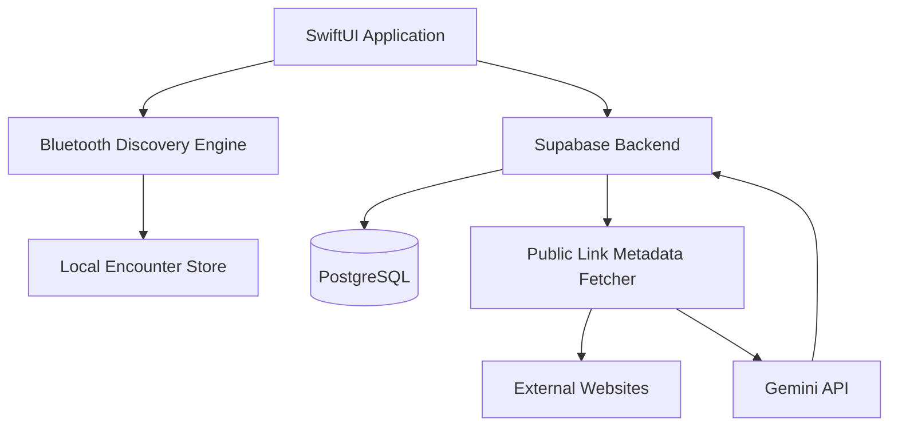
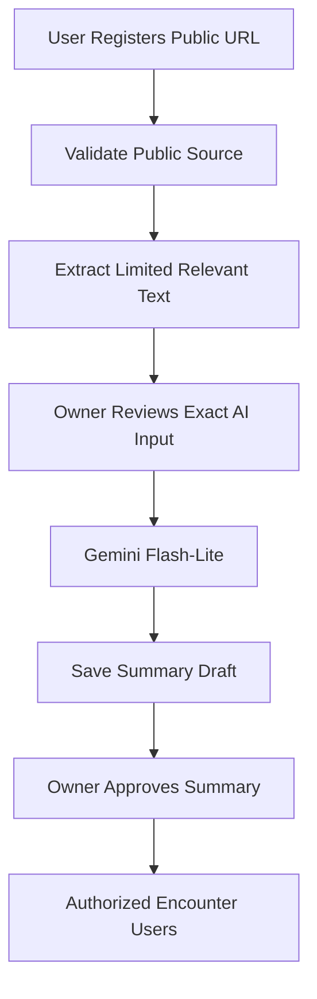

# Design — Engineer StreetPass

**Version:** 0.2  
**Status:** Draft architecture  
**Related:** `specification.md`

## 1. Architecture Decisions

- Native iOS development with SwiftUI
- Core Bluetooth for proximity detection
- Supabase for authentication and backend
- Link-based profiles without portfolio hosting
- Gemini 3.1 Flash-Lite for optional summaries
- Server-side matching and visibility enforcement
- Android postponed
- iPhone 15 and iPad 10th generation as initial test devices

## 2. Technology Stack

| Component | Technology |
|---|---|
| Interface | SwiftUI |
| Language | Swift |
| Bluetooth | Core Bluetooth |
| Local storage | SwiftData or SQLite |
| Authentication | Supabase Auth |
| Database | Supabase PostgreSQL |
| Backend functions | Supabase Edge Functions |
| AI | Gemini Developer API |
| Notifications | APNs |
| External works | HTTPS URLs |

Production deployment targets will be selected after validating the required APIs on modern supported devices.

No legacy iOS compatibility layer is planned.

## 3. System Architecture



The external website remains the authoritative source for the content.

The backend stores links and approved metadata, not a second copy of the entire portfolio.

## 4. iOS Project Structure

```text
EngineerStreetPass/
├── App/
├── Features/
│   ├── Onboarding/
│   ├── Home/
│   ├── Encounters/
│   ├── ExternalLinks/
│   ├── Connections/
│   └── Settings/
├── Domain/
│   ├── Models/
│   ├── UseCases/
│   └── Protocols/
├── Infrastructure/
│   ├── Bluetooth/
│   ├── LocalDatabase/
│   ├── Supabase/
│   ├── Notifications/
│   └── ExternalLinks/
└── Tests/
    ├── Unit/
    ├── Integration/
    └── Bluetooth/
```

The ExternalLinks feature replaces the former Portfolio feature.

## 5. Database Design

### Core Tables

```text
profiles
technical_interests
user_interests
connection_modes
user_connection_modes
matching_preferences
visibility_policies
external_links
link_summaries
encounter_candidates
encounters
connection_requests
blocks
reports
notification_preferences
```

### External Links

```sql
CREATE TABLE external_links (
    id UUID PRIMARY KEY,
    owner_id UUID NOT NULL,
    url TEXT NOT NULL,
    platform TEXT NOT NULL,
    title TEXT,
    description TEXT,
    visibility TEXT NOT NULL DEFAULT 'private',
    ai_processing_allowed BOOLEAN NOT NULL DEFAULT FALSE,
    ai_approved_content_hash TEXT,
    display_order INTEGER NOT NULL DEFAULT 0,
    created_at TIMESTAMPTZ NOT NULL DEFAULT NOW(),
    updated_at TIMESTAMPTZ NOT NULL DEFAULT NOW()
);
```

Foreign keys, URL constraints, access policies, and indexes must be added in the production migration.

The AI approval hash binds consent to a specific source-content snapshot.

### Link Summaries

```sql
CREATE TABLE link_summaries (
    id UUID PRIMARY KEY,
    link_id UUID NOT NULL,
    model_id TEXT NOT NULL,
    source_hash TEXT NOT NULL,
    summary TEXT NOT NULL,
    status TEXT NOT NULL DEFAULT 'draft',
    created_at TIMESTAMPTZ NOT NULL DEFAULT NOW(),
    approved_at TIMESTAMPTZ
);
```

Summary status transitions:

`draft → awaiting_approval → approved`

An approved summary may later become `hidden` or `invalidated`.

Only authorized approved summaries are returned to readers.

## 6. External Link Management

### 6.1 Registration Flow

1. User enters a URL.
2. Backend validates the URL.
3. The app identifies the platform when possible.
4. The user enters or confirms the title and description.
5. The user selects visibility.
6. The user optionally enables AI processing.
7. The link is saved.

### 6.2 Link Validation

Only supported HTTPS URLs are accepted.

Backend URL retrieval must prevent server-side request forgery.

Controls include:

- Hostname validation
- DNS and IP-address validation
- Blocking local and private-network destinations
- Redirect validation
- Download size limits
- Timeouts
- Unsupported content rejection

### 6.3 Display

Link cards may contain:

- Platform icon
- Title
- Short user-written description
- Technical tags
- Optional AI summary
- Open-original-link action

The app does not render full repository files or article contents internally.

### 6.4 Link Removal

Removing a link makes it unavailable through the application's authorized link API.

Cached summaries associated with the link must be hidden or invalidated.

Removing a link does not delete the original content from GitHub, Qiita, Zenn, or other external services.

## 7. AI Summary Processing

### 7.1 Trust Principle

Gemini receives only explicitly approved public information.

Its access must never exceed the scope available to an ordinary authorized application user.

For the free-tier implementation, AI input is restricted further to owner-approved public technical content.

### 7.2 Processing Flow



### 7.3 AI Authorization

An AI processing request is allowed only if:

```text
owner_authenticated
AND owner_controls_link
AND link_is_public
AND ai_processing_allowed
AND approved_source_hash == submitted_source_hash
AND content_passes_input_policy
```

The backend must not automatically expand the scope of the URL to include related repositories, profile pages, or private resources.

### 7.4 Data Sent to Gemini

Allowed, after approval:

- Relevant README excerpts
- Public article excerpts
- Public project descriptions
- Public technical metadata

Disallowed:

- Encounter records
- Physical location
- Bluetooth identifiers
- Contact information
- Private profile fields
- Private repositories
- OAuth tokens
- Connection requests
- Unapproved or confidential content

### 7.5 Data Storage

Store:

- Link metadata
- AI consent state
- Approved source hash
- Generated summary
- Summary approval state
- Model and prompt version

Do not retain complete downloaded repositories or article bodies merely to support summaries.

Temporary extraction data should be deleted after processing, subject to disclosed processing and operational requirements.

### 7.6 Caching

Use an approved source-content hash and model/prompt versions as cache keys.

Regenerate only after renewed approval when the submitted content changes.

Never regenerate automatically from an updated external page without consent.

### 7.7 AI Failure

If Gemini is unavailable:

- Preserve the original link.
- Show the user-written description.
- Avoid blocking encounters.
- Allow retry when permitted.

All Gemini requests are server-side. The API key must not be bundled in the iOS application.

## 8. Bluetooth Discovery

### 8.1 Core Technologies

- `CBCentralManager`
- `CBPeripheralManager`
- Documented background Bluetooth modes
- State preservation and restoration

### 8.2 Discovery Principle

Bluetooth exchanges only minimal encounter information.

Never advertise:

- Permanent account IDs
- GitHub usernames
- Email addresses
- Portfolio URLs
- Names
- Unnecessary personal details

The backend resolves eligible encounters according to authorization policies.

### 8.3 Privacy-Preserving Discovery

Investigate rotating temporary identifiers, encounter verification, replay protection, and limited server-side resolution.

Actual identifier exchange mechanisms must be validated under iOS background-advertising restrictions.

### 8.4 Encounter States

```text
Observed
  ↓
Candidate
  ↓
Verified
  ↓
Eligible
  ↓
Resolved
```

A detection callback is not automatically proof of a genuine physical encounter.

### 8.5 Background Limitations

Reliable detection between two locked devices is not guaranteed by Core Bluetooth.

The application must tolerate missed encounters and delayed discovery.

Do not rely on `BGTaskScheduler` for continuous scanning or deterministic wake-ups.

## 9. Test Plan

### Available Devices

- iPhone 15
- iPad 10th generation

Both will run custom development builds.

The iPad is used as a BLE peer for proof-of-concept testing, regardless of whether the eventual production app supports an iPad-specific interface.

### Test Cases

| Test | iPhone 15 | iPad 10 |
|---|---|---|
| A | Foreground | Foreground |
| B | Locked | Foreground |
| C | Foreground | Locked |
| D | Locked | Locked |
| E | Background for 10+ minutes | Background for 10+ minutes |
| F | Force-quit | Force-quit |

Test durations:

- 10 seconds
- 30 seconds
- 120 seconds

Repeat trials and collect:

- Detection success rate
- Detection latency
- Duplicate events
- False-positive events
- Battery usage
- Effect of device state

### Interpretation

iPhone-to-iPad success does not establish iPhone-to-iPhone reliability.

A separate test involving two modern iPhones will eventually be needed before advertising reliable iPhone StreetPass functionality.

No testing or compatibility work is planned for iPhone 6s or other unsupported legacy devices.

## 10. Matching and Visibility

Use rule-based matching for the MVP.

```text
verified_encounter
AND mutual_discovery_permission
AND no_block_relationship
AND compatible_connection_purposes
AND required_interest_conditions
```

After eligibility is established, evaluate permissions for each profile field and external link independently.

The backend must not return private fields and rely on SwiftUI to hide them.

Use PostgreSQL Row Level Security and restricted server APIs where appropriate.

## 11. Settings

### Connection Settings

- Enable or disable discovery
- Select connection modes
- Configure interest matching
- Set participant preferences

### Visibility Settings

- Profile field visibility
- Per-link visibility
- Contact detail visibility
- Connection permissions

### AI Settings

- Enable or disable AI processing
- Per-link AI consent
- Review generated summaries
- Hide or remove summaries

### Notification Settings

- Near-immediate
- Daily
- Weekly
- Off
- Quiet hours
- Event-specific conditions

## 12. Security Requirements

- Secure authentication
- Server-side authorization
- Minimal BLE payloads
- Protection against identifier correlation
- Replay resistance where feasible
- Rate limiting
- Blocking and reporting
- Secure URL handling
- Separate AI-processing consent
- No permanent movement-history exposure
- Data retention and deletion policies

External articles and README files are untrusted input. They must never be treated as operational instructions by the AI integration.

## 13. Implementation Milestones

### Milestone 1 — Bluetooth Proof of Concept

Implement and test foreground, background, and locked-device BLE discovery with iPhone 15 and iPad 10.

### Milestone 2 — Application Foundation

Build SwiftUI navigation, authentication, onboarding, interests, connection modes, and settings.

### Milestone 3 — External Link Discovery

Implement link registration, visibility, metadata previews, encounter history, and basic matching.

### Milestone 4 — Gemini Integration

Implement public-content extraction, owner approval, summarization, caching, and review.

### Milestone 5 — Beta and Safety

Add notification preferences, connection requests, blocking, reporting, privacy tests, and user evaluation.

### Future

Develop Android after the initial iOS implementation is validated.

## 14. Architecture Decision Records

**ADR-001 — Native iOS first:** SwiftUI and Core Bluetooth.

**ADR-002 — Link-only portfolios:** External services remain responsible for hosting content.

**ADR-003 — User-controlled visibility:** Every shared link has its own access policy.

**ADR-004 — Explicit AI consent:** Link visibility alone never authorizes AI processing.

**ADR-005 — Public-only Gemini processing:** The free-tier MVP uses approved public source content exclusively.

**ADR-006 — Modern-device testing:** Use iPhone 15 and iPad 10; no legacy iPhone support.

**ADR-007 — Experimental background discovery:** Do not promise reliable locked-device encounters without measured evidence.

**ADR-008 — Android later:** Reuse the backend and application protocol after the iOS MVP is validated.
